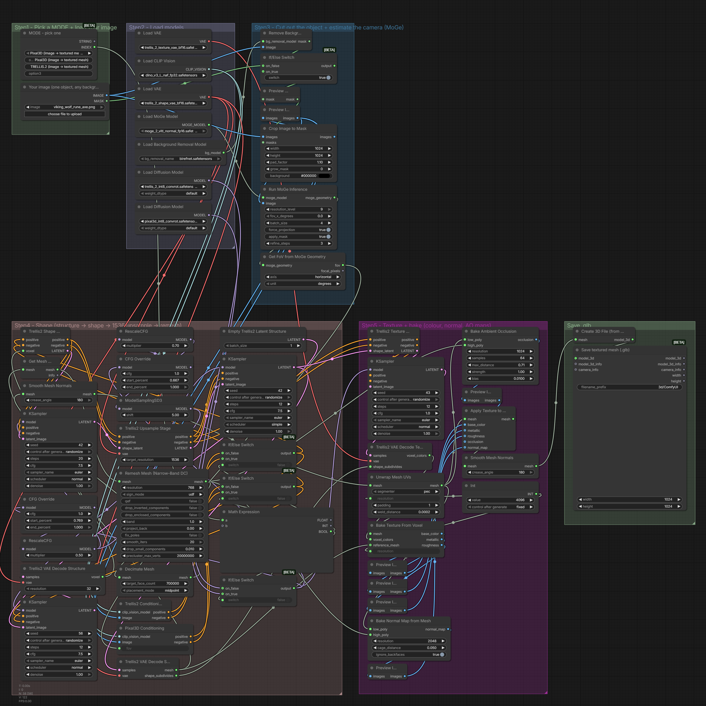

# The_frizzy1 - Image to 3D Ultimate · 12 GB v2.0.1
> One image in, textured .glb out - Pixal3D or TRELLIS.2 from a dropdown. Core ComfyUI nodes only.

| | |
|---|---|
| **Model family** | Pixal3D · TRELLIS.2 |
| **Tasks** | Image → textured 3D mesh |
| **Min VRAM** | 12 GB (tested) |
| **Tested on** | RTX 3060 12 GB · Ryzen 5 5600X · 32 GB DDR4 · ComfyUI 0.37.4 (Sage attention) |
| **YouTube explainer** | none yet |
| **License** | Workflow: MIT · Pixal3D / TRELLIS.2: MIT |

<p align="center"></p>

## Overview
The official Pixal3D + TRELLIS.2 template with a MODE dropdown: background removal, MoGe camera, shape, 1536 upsample, remesh, texture bake.

## Modes (one dropdown)

| Mode | Uses |
|---|---|
| Pixal3D | one image |
| TRELLIS.2 | one image |

## Measured on the RTX 3060

Each mode was run once on the RTX 3060 (ComfyUI 0.37.4). *Wall* = queue to finished, including model loading; *sampling* = time in the sampler nodes.

| Mode | Size | Wall | Sampling | Peak VRAM | Peak RAM |
|---|---|---|---|---|---|
| Pixal3D |  | 3 min 51 s | 1 min 10 s | 10.5 GB | 8.2 GB |
| TRELLIS.2 |  | 5 min 33 s | 2 min 23 s | 10.6 GB | 8.3 GB |

## Required models
See [downloads.md](downloads.md). Every file was read from the workflow `.json`.

## Required custom nodes
None - core ComfyUI **0.37.4+**.

Core nodes used: LoadImage, Save3DAdvanced, CustomCombo, PrimitiveInt, ComfySwitchNode, ComfyMathExpression, VAELoader, CLIPVisionLoader, UNETLoader, LoadMoGeModel, MoGeInference, MoGeGeometryToFOV, LoadBackgroundRemovalModel, RemoveBackground, MaskPreview, ImageCropToMask, PreviewImage, Trellis2Conditioning, Pixal3DConditioning, EmptyTrellis2LatentStructure, Trellis2ShapeStage, Trellis2UpsampleStage, Trellis2TextureStage, VaeDecodeStructureTrellis2, VaeDecodeShapeTrellis, VaeDecodeTextureTrellis, KSampler, CFGOverride, RescaleCFG, ModelSamplingSD3, RemeshMesh, DecimateMesh, UnwrapMesh, MeshSmoothNormals, BakeTextureFromVoxel, BakeNormalMapFromMesh, BakeAmbientOcclusion, ApplyTextureToMesh, GetMeshInfo, MeshToFile3D.

Checked on ComfyUI 0.45.3: every node above is core in 0.45.3 and the graph converts and validates on 0.45.3. Not run on 0.45.3 yet (the models are not on the 24 GB test server).

Attention: `--use-sage-attention` ran at the same speed with lower peak VRAM in image tests on the 24 GB server. `--use-ck-attention` gave a different image from the same seed in those tests; not checked for 3D.

## Get the models (one command)

```bash
python scripts/frizzy.py doctor 3d/image-to-3d-ultimate-12gb --comfy "C:/path/to/ComfyUI"
```

## Installation
1. Update ComfyUI to **0.37.4+**.
2. Download the files in [downloads.md](downloads.md).
3. Load `The_frizzy1_image-to-3d-ultimate-12gb_v2.0.1.json`, pick a **MODE**, add your inputs, **Run**.

If your models live in sub-folders (e.g. `diffusion_models/LTX-2.5/`), the loaders show red until you re-pick them once.
