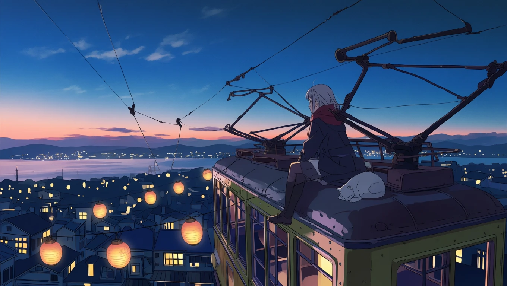
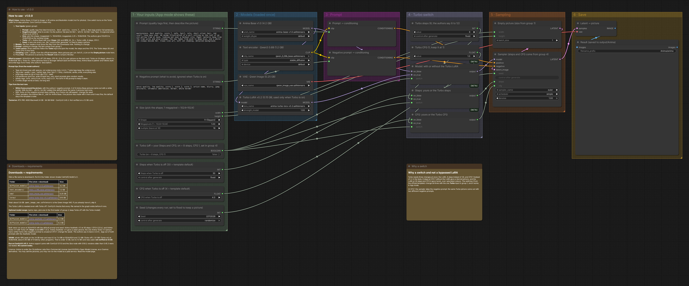

# The_frizzy1 — Anima v1.0.0

> Anima Base v1.0 text to image for anime and illustration, with a one-click Turbo switch (8 steps). Core ComfyUI nodes only.

| | |
|---|---|
| **Model family** | Anima (CircleStone Labs + Comfy Org, 2B, built on NVIDIA Cosmos-Predict2) |
| **Tasks** | Text → Image (anime / illustration, not photos) |
| **Min VRAM** | 12 GB is the target. **Not verified on 12 GB** (see Hardware & VRAM) |
| **Tested on** | RTX PRO 4000 Blackwell 24 GB · 64 GB RAM · ComfyUI 0.45.3 |
| **CivitAI** | Not published |
| **Hugging Face** | Not published |
| **YouTube explainer** | Not published |
| **License** | Workflow: MIT · Anima models and the Turbo LoRA: [CircleStone Labs Non-Commercial License](https://huggingface.co/circlestone-labs/Anima/blob/main/LICENSE.md), plus the NVIDIA Open Model License as a Cosmos derivative. The authors' summary: you may sell the pictures, you may not run the model as a paid service. |

## Preview

<p align="center">
  
  
</p>

<sub>Left: the default settings (Anima Base, 1024x1024, 30 steps, CFG 4, seed 22112026), 23 s. Right: same prompt and seed with Turbo on and Size set to 16:9 (1360x768, 8 steps, CFG 1), 4 s.</sub>

<p align="center"></p>

## Overview
Built from ComfyUI's built-in template `image_anima_base_v1` and restructured: the template's single subgraph node is laid out as six numbered groups, every input you change is in group 1, and there are three notes (How to use, Downloads + requirements, and a short why-note under the Turbo switch). Models and sampler settings are the template's. The negative prompt is the model page's recommended list, not the template's, with `border, white border` added, because 3 of 8 test pictures had a white frame without the two tags; the default prompt is new.

## Capabilities
- Text to image at 1024x1024 by default; the Size input picks the shape (1:1, 2:3, 3:2, 16:9, …) and the megapixels (megapixels 1 = 1024x1024, megapixels 2.25 = 1536x1536). 1360x768, 832x1248 and 1536x1536 were also run.
- **Turbo off** (default): Anima Base v1.0, 30 steps · CFG 4 · euler / simple.
- **Turbo on**: the same model with the Turbo LoRA v0.2, 8 steps · CFG 1. One input switches the model, the steps and the CFG together.
- Prompts can be Danbooru-style tags, full sentences, or both.
- Colour-coded groups: your inputs (green) · models (blue) · prompt (purple) · Turbo switch (grey-blue) · sampling (orange) · save (amber).

## Hardware & VRAM
All numbers are from one machine: RTX PRO 4000 Blackwell 24 GB, ComfyUI 0.45.3. It is not a 12 GB card. Whether the server was started with `--reserve-vram 12` for these runs could not be confirmed afterwards (its log does not record start flags). Peak VRAM is the whole-GPU peak from nvidia-smi, logged once per second, in GiB (MiB / 1024); about 0.45 GiB of it was held by other programs.

| Setting | Peak VRAM |
|---|---|
| 1024x1024 and other 1-megapixel shapes, Turbo off or on | 6.3 to 7.4 GiB |
| 1536x1536, Turbo off | 7.2 GiB |
| 1536x1536, Turbo on | 9.1 GiB |

- **Not verified on 12 GB.** Every peak is under 12 GiB, but the card had 24 GB and ComfyUI uses the room it finds, so this is not a 12 GB proof.
- The diffusion model file is 4.2 GB, the text encoder 1.2 GB, the VAE 0.25 GB, the Turbo LoRA 0.15 GB.
- No Comfy-Org repackaged, fp8 or int8 Anima Base files were found; the workflow loads the authors' files, as the template does.

## Required models
See the per-workflow [downloads.md](downloads.md) for the full table with verified links.
Every file below was read from the workflow `.json`.

```
ComfyUI/models/
├── diffusion_models/   ← anima-base-v1.0.safetensors
├── text_encoders/      ← qwen_3_06b_base.safetensors
├── vae/                ← qwen_image_vae.safetensors
└── loras/              ← anima-turbo-lora-v0.2.safetensors   (needed even with Turbo off)
```

## Required custom nodes
None. Run on ComfyUI **0.45.3** only. Anima support came with ComfyUI 0.11.0 ([PR #12012](https://github.com/comfyanonymous/ComfyUI/pull/12012)) and the ResolutionSelector node with 0.16.0; older versions were not tested.

Core nodes used: UNETLoader, CLIPLoader, VAELoader, LoraLoaderModelOnly, CLIPTextEncode, ResolutionSelector, EmptyLatentImage, ComfySwitchNode, KSampler, VAEDecode, SaveImage, PrimitiveInt, PrimitiveFloat, PrimitiveBoolean, PrimitiveStringMultiline, and MarkdownNote (the frontend's note node, not in `/object_info`). The module of each of the 15 backend nodes in `/object_info` of ComfyUI 0.45.3 is `nodes` or `comfy_extras`. The test install was not a clean one (it also has rgthree-comfy and ComfyUI-Manager); the workflow uses nothing from them.

## Optional custom nodes
None.

## Installation
1. Update ComfyUI (0.45.3 is the tested version).
2. Download the four files ([downloads.md](downloads.md), or the Downloads note inside the workflow).
3. Load `The_frizzy1_anima_v1.0.0.json`, write your prompt in group 1, press **Run**.

## Recommended settings
| Setting | Value | Notes |
|---|---|---|
| Size | 1:1, 1 megapixel (1024x1024) | the authors give 512x512 to 1536x1536 as the working range |
| Turbo | off | on = 8 steps, CFG 1, about 4 s instead of 23 s |
| Steps / CFG (Turbo off) | 30 / 4 | template defaults; the authors give 30 to 50 steps and CFG 4 to 5 |
| Turbo steps / CFG | 8 / 1 | in group 4 (not shown in App mode); the authors give 8 to 12 steps. 12 was run once (5 s) |
| Sampler | euler / simple | template default. `er_sde` (the authors' favourite for Base) was run once and was fine |
| Prompt prefix | `masterpiece, best quality, score_7, safe,` | the authors' recommendation |
| Negative prompt | the authors' list + `border, white border` | the two extra tags removed the white frame in 3 of 3 cases |

## Inputs / Outputs
- **Inputs:** a text prompt (and a negative prompt, used only with Turbo off).
- **Outputs:** a PNG in `output/Anima/`.

## Performance
On the machine above. Times are from sending the job to the finished file, measured to the second.

| Settings | Time | Peak VRAM | Runs |
|---|---|---|---|
| Turbo off, 1024x1024, 30 steps, CFG 4 | 21 to 23 s (the first run, with model load, also 23 s) | 6.4 to 7.4 GiB | 11 |
| Turbo off, 1360x768 and 832x1248 | 23 s | 6.6 to 6.7 GiB | 4 |
| Turbo on, 1024x1024 or 1360x768, 8 steps, CFG 1 | 4 s | 6.4 to 7.4 GiB | 6 |
| Turbo off, 1024x1024, batch_size 2 | 43 s for the two pictures | 7.1 GiB | 1 |
| Turbo on, 12 Turbo steps | 5 s | 6.3 GiB | 1 |
| Turbo off, 1536x1536 | 60 s | 7.2 GiB | 1 |
| Turbo on, 1536x1536 | 9 s | 9.1 GiB | 1 |
| Swap: `anima-aesthetic-v1.1`, 30 steps, CFG 4 | 23 s | 6.6 GiB | 1 |
| Swap: `anima-turbo-v1.1`, Turbo off, Steps 8, CFG 1 | 4 s | 6.3 GiB | 1 |

VRAM is read once per second, which can miss the short peak at decode: in one Turbo-off run (`bseed1`, seed 1) the ComfyUI process alone was caught at 7100 MiB (about 7.4 GiB for the whole GPU) while the whole-GPU reading for that run stopped at 6.6 GiB. The 7.4 GiB in the first row is that run.

RTX 3060 12 GB: Not verified.

## Known issues
- **White frame around the picture:** with the authors' negative prompt 3 of 8 Anima Base pictures had a white border (a full frame twice, white bars top and bottom once). The default negative prompt here adds `border, white border`; the same 3 pictures then had none. With Turbo on the negative prompt is not used (the same picture came out with two different negative prompts), so a frame can still appear → change the seed. The one `anima-turbo-v1.1` test picture had a frame.
- **Turbo changes the look:** thicker lines and a stronger default style in the test pictures. In one Turbo picture the scarf ends looked like hands.
- **Details drift from the prompt:** the "sleeping" cat sits awake in the default picture, and one portrait picture had two cats.
- **Do not mix the settings by hand:** 8 steps at CFG 1 without the LoRA gave a blurred picture, and the LoRA at 30 steps and CFG 4 gave harsh, over-saturated colours. Use the Turbo switch.
- **The Turbo LoRA must be downloaded even if you never use Turbo:** ComfyUI refused to run with a missing LoRA file while Turbo was off.
- **App mode was run once:** in a headless browser on ComfyUI 0.45.3 (frontend 1.57.6) App mode listed the eight inputs with their labels, and one click on Run there gave the default picture (the same pixels as the API run). Every other test run went through the API; Turbo was not switched on from App mode.
- **The seed changes every run:** the Seed input is on `randomize`, so the default picture (seed 22112026) comes out on the first run only. Set "control after generate" to `fixed` to keep a picture.
- The prompts are my own: the lab's standard `prompts.json` was not in the inputs folder. One prompt was used for every run.
- No Reddit reports were read (the search tool failed); the settings come from the model page and the template.

## Changelog
See [changelog.md](changelog.md).

## Related workflows
- [Qwen Image 2.1 · 12 GB](../../qwen/image-2.1-12gb) · [Z-Image Turbo](../../z-image/turbo) · [Kandinsky 5.0 Lite](../../kandinsky/kandinsky-5)
