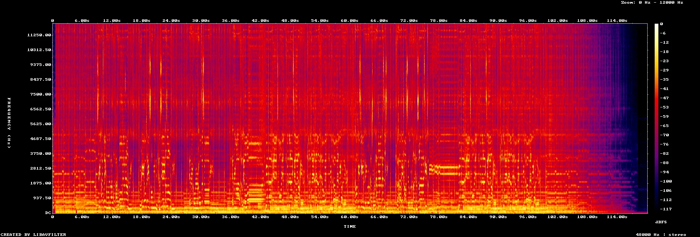
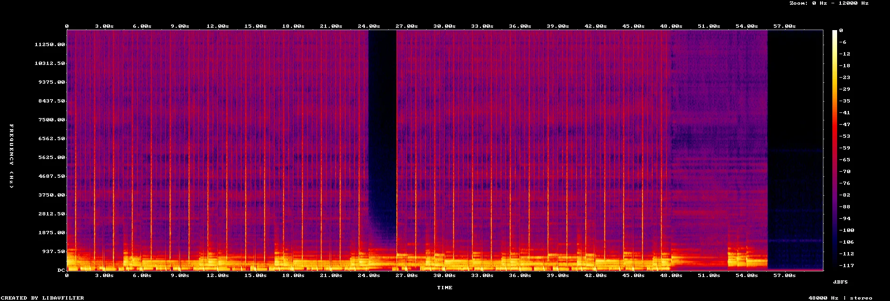
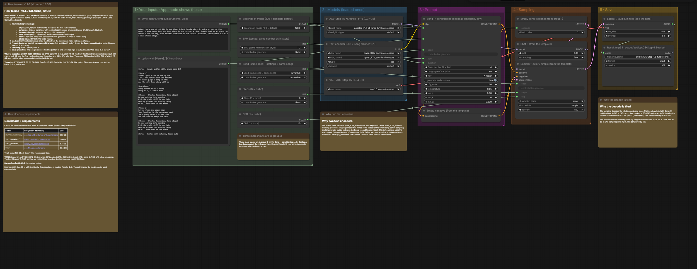
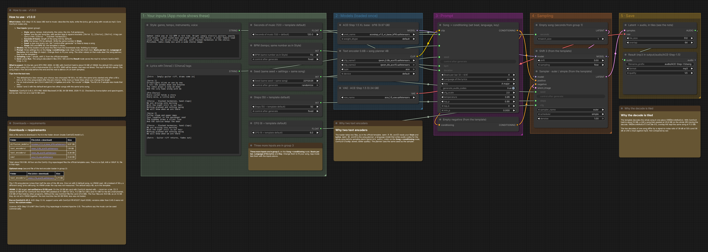

# The_frizzy1 — ACE-Step 1.5 XL Music v1.1.0

> Songs with vocals from a style description and your lyrics, with ACE-Step 1.5 XL. Two workflows: **XL turbo · 12 GB** (8 steps, tested on an RTX 3060) and **XL base** (50 steps). Core ComfyUI nodes only, MIT model.

| | |
|---|---|
| **Model family** | ACE-Step 1.5 XL (base, 4B) |
| **Tasks** | Text to music: style + lyrics → song · instrumental |
| **Min VRAM** | **12 GB, tested on an RTX 3060** with the XL turbo workflow. The XL base workflow is not verified on 12 GB (see Hardware & VRAM) |
| **Tested on** | XL turbo: RTX 3060 12 GB · 32 GB RAM · ComfyUI 0.45.3 · XL base: RTX PRO 4000 Blackwell 24 GB · 64 GB RAM · ComfyUI 0.45.3 (frontend 1.57.6) |
| **CivitAI** | Not published |
| **Hugging Face** | Not published |
| **YouTube explainer** | Not published |
| **License** | Workflow: MIT · ACE-Step 1.5 XL: MIT ([model page](https://huggingface.co/ACE-Step/acestep-v15-xl-base)) · the Comfy-Org repackage is tagged Apache-2.0 |

## Preview

- [turbo-song-1-indie-pop-120s.mp3](samples/turbo-song-1-indie-pop-120s.mp3): **XL turbo · 12 GB**, the default text, 120 s, seed 22112026, made on an RTX 3060 in 42 s. Spectrogram: [turbo-song-1-indie-pop-120s.webp](samples/turbo-song-1-indie-pop-120s.webp).

- [song-1-indie-pop-120s.mp3](samples/song-1-indie-pop-120s.mp3): the default run. Indie pop with a female vocal, 112 BPM, 120 s, seed 22112026.
- [song-2-lofi-instrumental-60s.mp3](samples/song-2-lofi-instrumental-60s.mp3): lo-fi hip hop, `[Instrumental]` as lyrics, 80 BPM, D minor, 60 s, same seed.

<p align="center">
  
  
</p>

<sub>The pictures are spectrograms of the two mp3 files (0 to 12 kHz), left song 1, right song 2. The Seed input changes after every run, so set it back to 22112026 to repeat these.</sub>

<p align="center"></p>

<p align="center"></p>

## Overview
Built from ComfyUI's built-in template `audio_ace_step1_5_xl_base` and restructured: numbered groups, the inputs you change in group 1, notes inside. Models and sampler settings are the template's. One thing differs: the song is decoded in tiles, because the template's one-piece decode took 20.8 GiB of VRAM for a 240 s song in a run where ComfyUI was held to about 10 GiB.

## Capabilities
- `The_frizzy1_ace-step-1.5-xl-turbo-12gb_v1.1.0.json`: **XL turbo, 12 GB.** Same groups and inputs, with `acestep_v1.5_xl_turbo_bf16`, the 1.7B song planner, 8 steps and CFG 1. Output in `output/audio/ACE-Step-1.5-turbo/`.
- `The_frizzy1_ace-step-1.5_v1.0.0.json`: a style description and lyrics with `[Verse]` / `[Chorus]` tags give a song as mp3 (48 kHz stereo).
- Instrumentals: `[Instrumental]` as lyrics and "No vocals" in the style.
- Length, BPM, beats per bar, language and key are inputs. 60 s, 120 s and 240 s were run (30 s too, with the template's decode).
- 50 steps, CFG 6, euler / simple, shift 3, as in the template.
- Colour-coded groups: your inputs (green) · models (blue) · prompt (purple) · sampling (orange) · save (amber).

## Hardware & VRAM

### XL turbo · 12 GB (v1.1.0): RTX 3060 12 GB, 32 GB RAM
Run from the saved `.json` in the browser (ComfyUI 0.45.3 portable, `--use-sage-attention`, no VRAM limit), 2026-11-24:

| Run | Time | Peak VRAM (whole GPU) |
|---|---|---|
| Song, 120 s (defaults), models read from disk | 42 s | 11.4 GiB |
| Song, 120 s, seed 22112027 | 37 s | 11.4 GiB |
| Song, 120 s, seed 22112028 | 34 s | 11.4 GiB |

- 2.7 GiB of each peak was held by other programs (desktop, editor) before ComfyUI started.
- Peak VRAM is the highest whole-GPU reading of `nvidia-smi`, sampled every 0.5 s, MiB / 1024. Times are from pressing Run to the finished mp3.
- The four files are 15.2 GB, so they are not in VRAM together on 12 GB. RAM use was not measured.

### XL base (v1.0.0)
All numbers are from one machine: RTX PRO 4000 Blackwell 24 GB, 64 GB RAM. It is not a 12 GB card.

| Run | ComfyUI start | Peak VRAM (whole GPU) |
|---|---|---|
| Song, 120 s (defaults) | `--reserve-vram 13.5` | 11.1 GiB |
| Song, 240 s | `--reserve-vram 13.5` | 11.3 GiB |
| Instrumental, 60 s | `--reserve-vram 13.5` | 11.1 GiB |
| Song, 120 s (defaults) | no limit | 21.6 GiB |

- **Not verified on a 12 GB card.** `--reserve-vram 13.5` on a 24 GB card leaves ComfyUI about 10 GiB. It is a limit ComfyUI sets itself, not a hard one, so these runs show that the graph can stay under 12 GiB, not that a 3060 runs it.
- 0.9 GiB of each capped figure was held by other programs on the card; the ComfyUI process itself peaked at 10.2 to 10.5 GiB. ComfyUI uses about as much as the limit allows: with `--reserve-vram 12.5` (one run, the template's decode) the 120 s song peaked at 12.2 GiB on the whole GPU and took 57 s, the same as the template's decode at `--reserve-vram 13.5`.
- Without a limit ComfyUI fills the card it finds (21.6 GiB), which says nothing about 12 GB.
- The four files are 19.9 GB, so on 12 GB they are not in VRAM together. The test machine has 64 GB RAM; less was not tested and RAM use was not measured.
- With the template's one-piece decode (`VAEDecodeAudio`) and the same limit: 11.1 GiB at 120 s, 20.8 GiB at 240 s.
- Peak VRAM is the highest whole-GPU reading of `nvidia-smi`, sampled about three times per second, MiB / 1024.

## Required models

**XL turbo · 12 GB (v1.1.0):**
```
ComfyUI/models/
├── diffusion_models/   ← acestep_v1.5_xl_turbo_bf16.safetensors  (9.97 GB)
├── text_encoders/      ← qwen_0.6b_ace15.safetensors             (1.19 GB)
│                       ← qwen_1.7b_ace15.safetensors             (3.71 GB)
└── vae/                ← ace_1.5_vae.safetensors                 (0.34 GB)
```
About 15.2 GB.

**XL base (v1.0.0):**
See the per-workflow [downloads.md](downloads.md) for the full table with verified links.
Every file below was read from the workflow `.json`.

```
ComfyUI/models/
├── diffusion_models/   ← acestep_v1.5_xl_base_bf16.safetensors   (9.97 GB)
├── text_encoders/      ← qwen_0.6b_ace15.safetensors             (1.19 GB)
│                       ← qwen_4b_ace15.safetensors               (8.38 GB)
└── vae/                ← ace_1.5_vae.safetensors                 (0.34 GB)
```

About 19.9 GB, all from [Comfy-Org/ACE-Step-1.5](https://huggingface.co/Comfy-Org/ACE-Step-1.5).

## Required custom nodes
None. Run on ComfyUI 0.45.3 only; older versions were not tested. ACE-Step 1.5 XL support came with [ComfyUI PR #13317](https://github.com/Comfy-Org/ComfyUI/pull/13317) (merged 2026-04-07).

Core nodes used (13, plus the frontend's MarkdownNote for the notes): ConditioningZeroOut, DualCLIPLoader, EmptyAceStep1.5LatentAudio, KSampler, ModelSamplingAuraFlow, PrimitiveFloat, PrimitiveInt, PrimitiveStringMultiline, SaveAudioAdvanced, TextEncodeAceStepAudio1.5, UNETLoader, VAEDecodeAudioTiled, VAELoader. Each one's module in `/object_info` of ComfyUI 0.45.3 is `nodes` or `comfy_extras.*`. The capped runs were made with `--disable-all-custom-nodes`.

## Optional custom nodes
None.

## Installation
1. Update ComfyUI (0.45.3 is the version this was run on).
2. Download the four files ([downloads.md](downloads.md), or the Downloads note inside the workflow).
3. Load `The_frizzy1_ace-step-1.5-xl-turbo-12gb_v1.1.0.json` (12 GB cards) or `The_frizzy1_ace-step-1.5_v1.0.0.json` (XL base), write your **Style** and **Lyrics**, press **Run**.

## Recommended settings
| Setting | Value | Notes |
|---|---|---|
| Seconds of music | 120 | template default. 60 and 240 were run too |
| BPM | 112 | write the same number in Style |
| Beats per bar / Language / Key | 4 / en / A major | on the **Song → conditioning** node; fit them to your song |
| Steps / CFG | turbo: 8 / 1 · base: 50 / 6 | others not tested |
| Sampler / scheduler / shift | euler / simple / 3 | from the template; others not tested |
| Decode tile size / overlap | 512 / 64 | the node's defaults; others not tested |
| Seed | changes every run | set "control after generate" to fixed to keep a song |

## Inputs / Outputs
- **Inputs:** text only. Style, lyrics, seconds, BPM, seed, steps and CFG in group 1; beats per bar, language and key on the conditioning node. No audio or picture input.
- **Outputs:** an mp3 (V0, 48 kHz stereo) in `output/audio/ACE-Step-1.5-turbo/` (turbo) or `output/audio/ACE-Step-1.5/` (base).

## Performance
One run each, on the machine above:

| Run | ComfyUI start | Time | Peak VRAM |
|---|---|---|---|
| Song, 120 s, models read from disk | no limit | 59 s | 21.6 GiB |
| Instrumental, 60 s, models loaded | no limit | 29 s | 21.6 GiB |
| Song, 120 s | `--reserve-vram 13.5` | 60 s | 11.1 GiB |
| Song, 240 s | `--reserve-vram 13.5` | 122 s | 11.3 GiB |
| Instrumental, 60 s | `--reserve-vram 13.5` | 32 s | 11.1 GiB |
| Song, 120 s, another seed | `--reserve-vram 13.5` | 61 s | 11.2 GiB |

The 120 s song from the capped run is the same audio as the one from the run without a limit.

RTX 3060 12 GB, XL turbo: 42 s for the default 120 s song with the models read from disk, 34 to 37 s after that (see Hardware & VRAM). The XL base workflow was not run on the 3060.

## Known issues
- **Nobody listened to the samples.** They were checked by machine: a speech-to-text model wrote the lyrics back from song 1 (both verses and both choruses, in order) and found no words in song 2; spectrograms and loudness per 10 s were looked at. Whether the songs sound good is not verified.
- **Silent tail:** both samples stop before the set length and end in about 4 s of silence.
- **Lyrics must fit the length:** the default lyrics fill 120 s. At 240 s the same lyrics gave a 90 s intro before the first sung line; at 30 s the song ended after the pre-chorus.
- **Song 2 has a short break** near 0:24 where everything but the low end drops out for about 2 s. One seed; not checked whether other seeds do it.
- **Tiled decode is not bit-identical** to the template's decode: the two versions of one song differ by a signal-to-noise ratio of 38 dB at 120 s and 36 dB at 240 s (mp3 against mp3). Not compared by ear.
- **XL turbo was checked on one prompt:** the default text, three seeds, 120 s only. Its sample's lyrics were checked by transcription (both verses and the choruses in order), not by ear. The XL sft file was not run.
- **Other languages than English** were not tested.
- **Seed:** the Seed input changes after every run. Set it to fixed to repeat a song.
- The style and lyrics are my own: the lab's standard `prompts.json` was not in the inputs folder. Reddit could not be read on the build night, so user reports were not checked.
- The browser checks (screenshot, App mode view) used frontend 1.57.6, older than the 1.58.5 that ComfyUI 0.45.3 asks for. No run was started from App mode.

## Changelog
See [changelog.md](changelog.md).

## Related workflows
- [MiniMax Music 3 · 12 GB](../minimax-music3-12gb) · [YuE2 Music · 12 GB](../yue2-music-12gb) · [AI Audio Maker](../ai-audio-maker)
