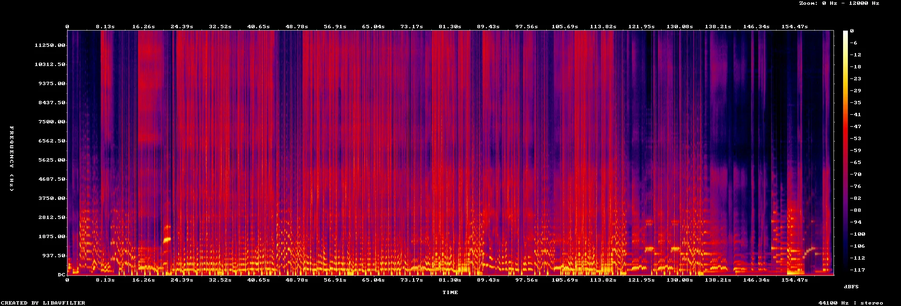
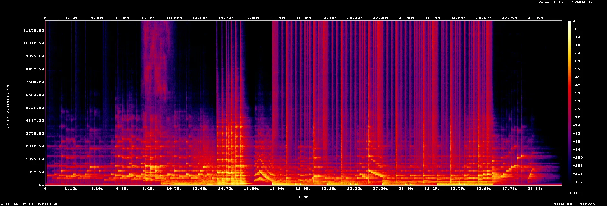
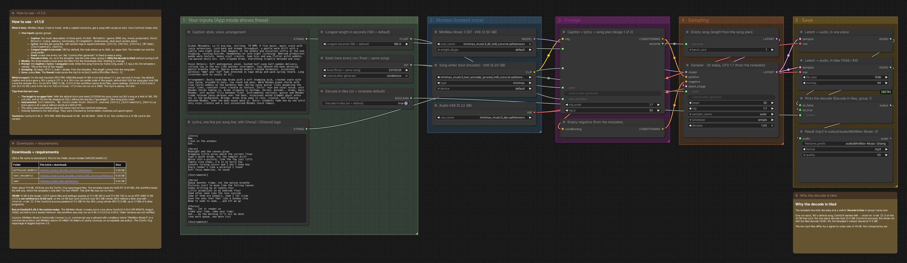

# The_frizzy1 — MiniMax Music 3 · 12 GB v1.1.0

☕ If this workflow saved you time: **[Buy me a coffee](https://buymeacoffee.com/the_frizzy1)**

> Songs with vocals from a caption and your lyrics, with MiniMax Music 3 and the int8 files. Core ComfyUI nodes only.

| | |
|---|---|
| **Model family** | MiniMax Music 3 (DiT int8, pruned int8 text encoder) |
| **Tasks** | Text to music: caption + lyrics → song · instrumental |
| **Min VRAM** | 12 GB is the target. v1.0.0 was measured on an RTX 3060 12 GB; **v1.1.0 is not verified on a 12 GB card** (see Hardware & VRAM) |
| **Tested on** | v1.1.0: RTX PRO 4000 Blackwell 24 GB · 64 GB RAM · ComfyUI 0.45.3 (frontend 1.57.6). v1.0.0: RTX 3060 12 GB · 32 GB RAM · ComfyUI 0.43.1 |
| **CivitAI** | Not published |
| **Hugging Face** | Not published |
| **YouTube explainer** | Not published |
| **License** | Workflow: MIT · MiniMax Music 3: MiniMax-Music3 Community License ([text](https://huggingface.co/MiniMaxAI/MiniMax-Music3/blob/main/LICENSE)) · the Comfy-Org repackage is tagged Apache-2.0 |

## Preview

- [song-1-lofi-vocals-163s.mp3](samples/song-1-lofi-vocals-163s.mp3): the default run. The template's lo-fi caption and lyrics, limit 180 s, seed 22112026. The song ended by itself at 163 s.
- [song-2-ambient-instrumental-42s.mp3](samples/song-2-ambient-instrumental-42s.mp3): ambient electronica, "Instrumental. No vocals" in the caption, only section tags as lyrics, limit 60 s, same seed. It ended at 42 s.

<p align="center">
  
  
</p>

<sub>The pictures are spectrograms of the two mp3 files (0 to 12 kHz), left song 1, right song 2. The Seed input changes after every run, so set it back to 22112026 to repeat these.</sub>

<p align="center"></p>

Older samples, made with v1.0.0 on the RTX 3060: [60 s](source/v1.0.0-rtx3060-60s.mp3) · [120 s](source/v1.0.0-rtx3060-120s.mp3).

## Overview
Built from ComfyUI's built-in template `audio_minimax_music_3` and restructured: numbered groups, the inputs you change in group 1, notes inside. Sampler settings are the template's. Two things differ from the template: the DiT is the int8 file (the template loads fp16 and lists int8 "for low VRAM"), and the length limit is 180 s instead of 60 s, because the template's own lyrics need about 150 to 165 s.

v1.0.x of this folder was the template's single subgraph node with the int8 file. v1.1.0 is the same graph laid out flat; models and settings did not change.

## Capabilities
- `The_frizzy1_minimax-music3-12gb_v1.1.0.json`: a caption and lyrics with `[Verse]` / `[Chorus]` tags give a song as mp3 (44.1 kHz stereo).
- Instrumentals: "Instrumental. No vocals" in the caption and only section tags as lyrics.
- The length is an upper limit (up to 360 s on the node); the model ends the song when the lyrics are done. Limits of 60, 120, 180 and 240 s were run.
- Five inputs in group 1, shown in App mode: caption, lyrics, longest length, seed, decode in tiles.
- Colour-coded groups: your inputs (green) · models (blue) · prompt (purple) · sampling (orange) · save (amber).

## Hardware & VRAM
**RTX 3060 12 GB, v1.0.0** (same three files and settings, ComfyUI 0.43.1, sage attention; numbers as published with v1.0.0, whole card as nvidia-smi reports it):

| Run | Wall | Peak VRAM | Peak RAM (ComfyUI) |
|---|---|---|---|
| 60 s of music, first run after starting ComfyUI | 2 min 20 s | 11.3 GB | 3.6 GB |
| 120 s of music | 4 min 28 s | 11.5 GB | 4.3 GB |

**v1.1.0** was run on one machine only: RTX PRO 4000 Blackwell 24 GB, 64 GB RAM, ComfyUI 0.45.3. It is not a 12 GB card.

| Run | ComfyUI start | Peak VRAM (whole GPU) | ComfyUI process |
|---|---|---|---|
| Default song (163 s) | `--reserve-vram 13.5` | 12.0 GiB | 11.2 GiB |
| Instrumental (42 s) | `--reserve-vram 13.5` | 11.3 GiB | 10.4 GiB |
| Default song (163 s) | no limit | 16.5 GiB | 16.1 GiB |
| One-piece decode of the default song (Decode in tiles off) | `--reserve-vram 13.5` | 23.4 GiB | 22.5 GiB |

- **v1.1.0 is not verified on a 12 GB card.** `--reserve-vram 13.5` on a 24 GB card leaves ComfyUI about 10 GiB. It is a limit ComfyUI sets itself, not a hard one. The whole-GPU figures of the limited runs include about 0.9 GiB (up to 1.1 GiB) held by other programs, one of them the idle first ComfyUI.
- Keep **Decode in tiles** on. With it off, the decode of the 163 s song took 22.5 GiB in spite of the limit.
- Without a limit ComfyUI uses more of the card it finds (16.5 GiB), which says nothing about 12 GB.
- The three files are 11.9 GB. RAM use was not measured for v1.1.0.
- Peak VRAM is the highest `nvidia-smi` reading, sampled about three times per second, MiB / 1024.

## Required models
See the per-workflow [downloads.md](downloads.md) for the full table with verified links.
Every file below was read from the workflow `.json`.

```
ComfyUI/models/
├── diffusion_models/   ← minimax_music3_dit_int8_convrot.safetensors                   (2.50 GB)
├── text_encoders/      ← minimax_music3_text_encoder_pruned_int8_convrot.safetensors   (9.20 GB)
└── vae/                ← minimax_music3_dav.safetensors                                (0.22 GB)
```

About 11.9 GB, all from [Comfy-Org/MiniMax-Music-3](https://huggingface.co/Comfy-Org/MiniMax-Music-3).

## Required custom nodes
None. The MiniMax Music 3 model nodes are in ComfyUI since the commit "Implement Minimax Music 3 + Core Support for Cuda Graphs (#15570)" of 2026-08-13, first tagged in v0.33.0 (read from the local ComfyUI git history). That is about the model nodes only and is not a tested minimum: the workflow itself was only run on 0.45.3 (v1.0.0 on 0.43.1, and its README asked for 0.42+). v1.1.0 also uses the PrimitiveBoolean, PrimitiveFloat and PrimitiveStringMultiline nodes. Older versions are not verified.

Core nodes used (15, plus the frontend's MarkdownNote for the notes): CLIPLoader, ComfySwitchNode, ConditioningZeroOut, EmptyMiniMaxMusic3LatentAudio, KSampler, MiniMaxMusic3TextEncode, PrimitiveBoolean, PrimitiveFloat, PrimitiveInt, PrimitiveStringMultiline, SaveAudioAdvanced, UNETLoader, VAEDecodeAudio, VAEDecodeAudioTiled, VAELoader. Each one's module in `/object_info` of ComfyUI 0.45.3 is `nodes` or `comfy_extras.*`. The VRAM-limited runs were made with `--disable-all-custom-nodes`.

## Optional custom nodes
None.

## Installation
1. Update ComfyUI (0.45.3 is the version v1.1.0 was run on).
2. Download the three files ([downloads.md](downloads.md), or the Downloads note inside the workflow).
3. Load `The_frizzy1_minimax-music3-12gb_v1.1.0.json`, write your **Caption** and **Lyrics**, press **Run**.

## Recommended settings
| Setting | Value | Notes |
|---|---|---|
| Longest length in seconds | 180 | an upper limit; the template sets 60. 60, 120 and 240 were run too |
| Seed | changes every run | set "control after generate" to fixed to keep a song |
| Decode in tiles | on | template default; tile 1536, overlap 64. Off took 22.5 GiB for 163 s |
| Song plan: cfg_scale / top_k | 1.7 / 50 | template values, on the node in group 3; others not tested |
| Steps / CFG | 30 / 1.7 | template values; others not tested |
| Sampler / scheduler | euler / simple | template values; others not tested |

## Inputs / Outputs
- **Inputs:** text only. Caption, lyrics, longest length, seed and decode in tiles in group 1. No audio or picture input.
- **Outputs:** an mp3 (V0, 44.1 kHz stereo) in `output/audio/MiniMax-Music-3/`.

## Performance
v1.1.0, one run each, on the 24 GB machine above. "Song" is the length of the mp3 that came out.

| Run | Limit | Song | ComfyUI start | Time |
|---|---|---|---|---|
| Default caption + lyrics (sample 1) | 180 s | 163 s | no limit | 277 s |
| Instrumental (sample 2) | 60 s | 42 s | no limit | 69 s |
| Default caption + lyrics | 240 s | 150 s | no limit | 253 s |
| Default caption + lyrics, first run after the download (earlier build of this graph, default limit 120) | 120 s | 120 s | no limit | 202 s |
| Default caption + lyrics | 180 s | 163 s | `--reserve-vram 13.5` | 279 s |
| Instrumental | 60 s | 42 s | `--reserve-vram 13.5` | 70 s |

That is about 1.7 s per second of music. In the 120 s run (the earlier build, default limit 120) the song plan (group 3) took 108 s and the sampler 83 s. The limited runs gave the same mp3 files, byte for byte, as the runs without a limit.

RTX 3060 12 GB: v1.0.0 took 2 min 20 s for 60 s and 4 min 28 s for 120 s (table above). v1.1.0: Not verified.

## Known issues
- **Nobody listened to the samples.** They were checked by machine: a speech-to-text model (Whisper small) transcribed song 1 in 30 s pieces and again in shifted windows, and returned only "Music" and "you" for song 2; spectrograms and loudness per 10 s were looked at. For song 1 the transcripts have both verses, both choruses, the bridge and "good night" (between 143 and 148 s). The first four lines of verse 2 were missing from the 30 s pieces, where they sit on the border at 60 s, and are in the window from 45 to 75 s. Two things do not match the lyrics: after "good night" the transcript has words that are not in the lyrics, and from about 150 s to the end it has "one more cue, one more try" again, a chorus line the lyrics do not repeat there. The model also looped ("oh, oh, oh", "mmm, mmm") on some windows, so it is a rough check. Whether the songs sound good is not verified.
- **The length limit changes the song.** With the same seed the default lyrics came out 163 s long at a limit of 180 and 150 s at 240; the two files are different takes.
- **A limit that is too short cuts the song off:** at 120 s the default lyrics stopped at exactly 120 s without the last line.
- **Decode in tiles is not bit-identical** to the one-piece decode: the two versions of song 1 differ by a signal-to-noise ratio of 44 dB (mp3 against mp3). Not compared by ear.
- **Slight clipping:** both sample mp3s reach 0.0 dB (ffmpeg volumedetect), and the mp3 of song 1, decoded to float, peaks at 1.01 with 0.0008 % of its samples at or above full scale (song 2 was not counted this way). Not judged by ear.
- **The fp16 DiT** that the template loads, and the bf16 text encoders in the same repo, were not run.
- **Slow on some installs:** one write-up measured this model about six times slower with a PyTorch cu128 build than with cu130 (their numbers, not checked here; this machine runs 2.14.1+cu130).
- **Languages other than English** were not tested.
- **Seed:** the Seed input changes after every run. Set it to fixed to repeat a song.
- The lab's standard `prompts.json` was not in the inputs folder: song 1 uses the template's caption and lyrics, the instrumental caption is my own.
- The browser checks (screenshot, App mode view) used frontend 1.57.6, older than the 1.58.5 that ComfyUI 0.45.3 asks for. No run was started from App mode.

## Changelog
See [changelog.md](changelog.md).

## Related workflows
- [YuE2 Music · 12 GB](../yue2-music-12gb) · [AI Audio Maker](../ai-audio-maker)
