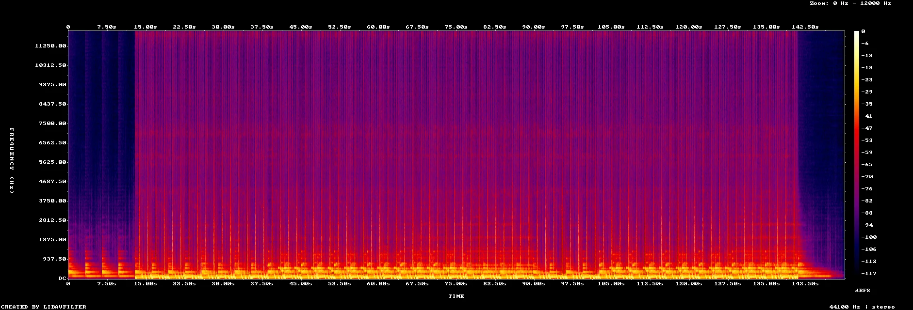
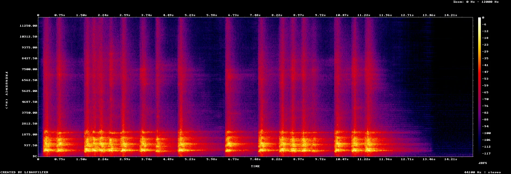
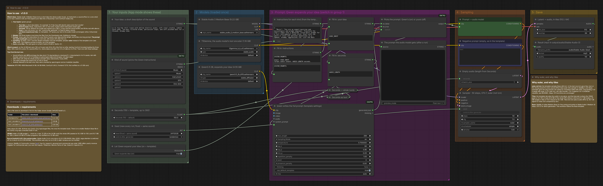

# The_frizzy1 — Stable Audio 3 Medium Base v1.0.0

☕ If this workflow saved you time: **[Buy me a coffee](https://buymeacoffee.com/the_frizzy1)**

> A short idea in, stereo music or a sound effect out (mp3), with Stable Audio 3 Medium Base. Qwen3.5 2B can expand the idea first. Core ComfyUI nodes only.

| | |
|---|---|
| **Model family** | Stable Audio 3 (Medium Base) + T5Gemma text encoder + Qwen3.5 2B prompt writer |
| **Tasks** | Text to audio: music · instrument · sound effect · one-shot, up to 380 s |
| **Min VRAM** | 12 GB is the target. **Not verified on a 12 GB card**; inside a 10 GiB budget on a 24 GB card the whole GPU peaked at 10.3 GiB (150 s) and 10.7 GiB (300 s) |
| **Tested on** | RTX PRO 4000 Blackwell 24 GB · 64 GB RAM · ComfyUI 0.45.3 (frontend 1.57.6) |
| **CivitAI** | Not published |
| **Hugging Face** | Not published |
| **YouTube explainer** | Not published |
| **License** | Workflow: MIT · Stable Audio 3: [Stability AI Community License](https://huggingface.co/stabilityai/stable-audio-3-medium-base/blob/main/LICENSE.md) (free below US$1 million yearly revenue) · T5Gemma: Gemma Terms of Use · Qwen3.5: Apache-2.0 |

## Preview

- [sample-1-lofi-150s.mp3](samples/sample-1-lofi-150s.mp3): the default run. The template's lo-fi idea, Kind of sound **Music**, 150 s, Qwen on, seed 24112026. Qwen's prompt: *"Lo-fi hip-hop chill track with mellow electric piano, soft vinyl crackle, subtle synth pads, low-pass filtered drums, percussion loops, and soft plucked bass creating relaxed, dreamy energy. BPM: 75. Length: 150 seconds"*.
- [sample-2-dog-sfx-15s.mp3](samples/sample-2-dog-sfx-15s.mp3): "A dog barking in a backyard", Kind of sound **SFX**, 15 s, Qwen on, same seed. Qwen's prompt: *"A dog barking with a high-pitched, piercing bark in a quiet backyard, featuring natural reverb and spatial ambience. Length: 15 seconds"*.

<p align="center">
  
  
</p>

<sub>The pictures are spectrograms of the two mp3 files (0 to 12 kHz), left sample 1, right sample 2. The Seed input changes after every run, so set it back to 24112026 to repeat these. Nobody listened to them: see Known issues.</sub>

<p align="center"></p>

## Overview
Built from ComfyUI's built-in template `audio_stable_audio_3_medium_base` (one subgraph node), unpacked and laid out in five numbered groups with the inputs in group 1 and three notes inside. Files, steps (50), CFG (7), scheduler, length and the Qwen prompt-writer settings are the template's.

Two settings differ from the template, both because of test results:
- **Sampler euler instead of lcm.** With lcm every sound effect tried came out as hiss, hum or the wrong sound (table under Performance). euler is the sampler in Stability AI's own Medium Base example.
- **Decode in tiles.** The template's one-piece decode peaked at 20.8 GiB for 150 s without a limit and 12.7 GiB inside a 10 GiB budget; the tiled decode stayed at 10.3 GiB.

Stability AI ships Medium Base "for fine-tuning" and points to Stable Audio 3 Medium (post-trained, 8 steps, CFG 1) for direct generation. This workflow is the Base model, as assigned; Medium was not run here.

## Capabilities
- `The_frizzy1_stable-audio-3_v1.0.0.json`: a short idea gives a stereo mp3 (44.1 kHz) of 1 to 380 s. 15, 30, 45, 60, 150 and 300 s were run.
- **Kind of sound** (Music, Instrument, SFX, One-shot) picks which instructions Qwen gets (the template's four instruction texts, unchanged). One-shot was not run.
- **Let Qwen expand your idea** off: your text goes to the audio model unchanged (run once, 60 s folk instrumental).
- **The prompt the audio model gets** (group 3) shows the prompt used, after the run.
- Five inputs in group 1, shown in App mode: idea, kind of sound, seconds, seed, Qwen on/off.
- Colour-coded groups: your inputs (green) · models (blue) · prompt (purple) · sampling (orange) · save (amber).

## Hardware & VRAM
One machine: RTX PRO 4000 Blackwell 24 GB, 64 GB RAM, ComfyUI 0.45.3. It is not a 12 GB card.

| Run | ComfyUI start | Peak VRAM (whole GPU) | ComfyUI process |
|---|---|---|---|
| 150 s, sample 1 (first run after start) | `--reserve-vram 13.89 --disable-all-custom-nodes` (10 GiB budget) | 10.27 GiB | 9.41 GiB |
| 15 s, sample 2 | 10 GiB budget | 10.11 GiB | 9.24 GiB |
| 300 s, default idea | 10 GiB budget | 10.75 GiB | 9.88 GiB |
| 60 s, Qwen off | 10 GiB budget | 7.41 GiB | 6.54 GiB |
| 150 s, one-piece decode (the template's) | 10 GiB budget | 12.72 GiB | 11.85 GiB |
| 150 s, sample 1 | no limit | 10.61 GiB | 10.16 GiB |
| 150 s, the template unchanged (lcm, one-piece decode) | no limit | 20.79 GiB | 20.34 GiB |

- **Not verified on a 12 GB card.** `--reserve-vram 13.89` on the 24 GB card leaves ComfyUI about 10 GiB. It is a limit ComfyUI sets itself, not a hard one. The whole-GPU figures include 0.87 GiB held by other programs in the limited runs (0.45 GiB in the runs without a limit).
- Keep the tiled decode: the one-piece decode went over 12 GiB in the 10 GiB budget.
- The limited runs gave the same mp3 files, byte for byte, as the runs without a limit (samples 1 and 2 and the Qwen-off run).
- The three files are 15.0 GB on disk. RAM use was not measured.
- Peak VRAM is the highest `nvidia-smi` reading, sampled about three times per second, MiB / 1024.

## Required models
See the per-workflow [downloads.md](downloads.md) for the full table with verified links.
Every file below was read from the workflow `.json`.

```
ComfyUI/models/
├── checkpoints/     ← stable_audio_3_medium_base.safetensors   (9.22 GB)
└── text_encoders/   ← t5gemma_b_b_ul2.safetensors              (1.19 GB)
                     ← qwen3.5_2b_bf16.safetensors              (4.55 GB)
```

About 15.0 GB, from [Comfy-Org/stable-audio-3](https://huggingface.co/Comfy-Org/stable-audio-3) and [Comfy-Org/Qwen3.5](https://huggingface.co/Comfy-Org/Qwen3.5). Size and SHA-256 of all three matched Hugging Face.

## Required custom nodes
None. Stable Audio 3 is in ComfyUI since the commit "Support Stable Audio 3 model. (#14010)" of 2026-05-20, first tagged in v0.22.0; "Disable sage attention in stable audio dit and VAE. (#14148)" followed in v0.23.0 (both read from the local ComfyUI git history). That is not a tested minimum: the workflow was only run on 0.45.3. Older versions are not verified.

Core nodes used (18, plus the frontend's MarkdownNote for the notes): CheckpointLoaderSimple, CLIPLoader, CLIPTextEncode, ComfyMathExpression, ComfySwitchNode, CustomCombo, EmptyLatentAudio, JsonExtractString, KSampler, PreviewAny, PrimitiveBoolean, PrimitiveFloat, PrimitiveInt, PrimitiveStringMultiline, SaveAudioAdvanced, StringReplace, TextGenerate, VAEDecodeAudioTiled; and VAEDecodeAudio only in the one-piece comparison run, not in the workflow. Each one's module in `/object_info` of ComfyUI 0.45.3 is `nodes` or `comfy_extras.*`. The VRAM-limited runs were made with `--disable-all-custom-nodes`.

## Optional custom nodes
None.

## Installation
1. Update ComfyUI (0.45.3 is the version this was run on).
2. Download the three files ([downloads.md](downloads.md), or the Downloads note inside the workflow).
3. Load `The_frizzy1_stable-audio-3_v1.0.0.json`, write **Your idea**, pick the **Kind of sound**, press **Run**.

## Recommended settings
| Setting | Value | Notes |
|---|---|---|
| Seconds | 150 | template value; the model card allows up to 380 s (16,777,216 samples at 44.1 kHz). 15 to 300 s were run |
| Kind of sound | match your idea | SFX for sound effects; Music gives a full track |
| Let Qwen expand your idea | on | template value. Off for a prompt you wrote in full |
| Sampler | euler | **changed** from the template's lcm, see Performance |
| Steps / CFG / scheduler | 50 / 7 / simple | template values; others not tested |
| Decode tile / overlap | 512 / 64 | node defaults; the template decodes in one piece |
| Qwen (TextGenerate) | 256 tokens, temperature 0.7, seed 0 | template values. Its seed is fixed, so the same idea gives the same Qwen prompt; the main Seed changes only the audio |

## Inputs / Outputs
- **Inputs:** text only. Idea, kind of sound, seconds, seed and Qwen on/off in group 1. No audio input (Stable Audio 3 can continue or inpaint audio, this workflow does not).
- **Outputs:** an mp3 (V0, 44.1 kHz stereo) in `output/audio/Stable-Audio-3/`.

## Performance
Times on the 24 GB machine above, one run each, wall time from queueing the prompt to the saved file.

| Run | Length | ComfyUI start | Time |
|---|---|---|---|
| Sample 1, first run after starting ComfyUI | 150 s | 10 GiB budget | 29.1 s |
| Sample 1 | 150 s | no limit | 26.1 s |
| Sample 2 (dog) | 15 s | either | 4.0 s |
| Default idea | 300 s | 10 GiB budget | 54.1 s |
| Qwen off, folk instrumental | 60 s | 10 GiB budget | 12.0 s |
| The template unchanged, first run after the download | 150 s | no limit | 27.1 s |

In the template run the sampler did about 3.2 steps per second for 150 s of audio (ComfyUI log). The model files were in the disk cache in all runs; a load from a cold disk was not timed.

**lcm against euler** (all other settings the same). An AudioSet classifier (MIT AST, CPU) labelled every 10 s of each mp3; a run counts when the asked-for label scored 0.5 or more (dog) or 0.15 or more (rain or thunder):

| Idea (Kind of sound SFX) | lcm (template) | euler (this workflow) |
|---|---|---|
| "A dog barking in a backyard", 4 seeds | 0 of 4 (best 0.28; top labels Music, Train, Vehicle horn) | 4 of 4 (Dog 0.65 to 0.80) |
| "Heavy rain on a tin roof with distant rolling thunder", 4 seeds | 0 of 4 (Hiss, White noise, Hum, Silence) | 3 of 4 (Thunderstorm up to 0.82) |
| "Footsteps walking on gravel", 3 seeds | 0 of 3 | 0 of 3 (Tap, Scrape, Crushing) |

dpmpp_2m gave about the same as euler on the dog and the rain (one seed each). For music both samplers gave "Music" at 0.7 to 0.9 in most windows. The lo-fi idea, 3 seeds each: with lcm the next labels were Electronic music and Dubstep, Drum machine and Sampler, or Electronic music and Techno; with euler two seeds opened with Piano / Electric piano and then read as Rhythm and blues / Soul, the third as Sampler / Drum machine. "Hip hop music" stayed at 0.07 or lower in all six. A classifier is a rough check of what a sound is, not of quality.

RTX 3060 12 GB: Not verified.

## Known issues
- **Nobody listened to the samples.** They were checked by machine: spectrograms, loudness per 10 s, and the AudioSet classifier above. For sample 1 the classifier gave Music 0.75 to 0.93 in every 10 s window, Piano 0.48 in the first; for sample 2 Dog 0.71 and Bark 0.47 in the first 10 s, Dog 0.39 in the last 5 s. Whether they sound good, and whether sample 1 sounds like lo-fi hip-hop, is not verified.
- **Medium Base is the fine-tuning model.** Stability AI recommends Stable Audio 3 Medium for generating. A Civitai write-up (MisterMR, August 2026) found Base underwhelming with the template, and a Reddit post (r/comfyui, June 2026) reported output that "sounds nothing like lo-fi hip hop" with the template. Both used the template's lcm sampler; whether euler fixes what they heard is not verified.
- **Footsteps** came out as taps and scrapes, not clear steps, with either sampler (3 seeds). Other sound effects than dog, rain and footsteps were not tried.
- **Solo piano** (Kind of sound Instrument, "Solo grand piano, slow and gentle", one seed) was labelled Music with Gong, Electric piano and Glockenspiel; Piano scored 0.09 or less with euler and 0.16 or less with dpmpp_2m.
- **Silence at the end:** 3 of the 7 runs with these settings ended with 2.0 to 2.5 s of silence (below −50 dB); the model sometimes ends a piece before the Seconds you set.
- **Tiled decode is not bit-identical** to the one-piece decode: the two versions of sample 1 differ by 36.7 dB signal-to-noise (mp3 against mp3). Not compared by ear.
- **Slight clipping:** both samples reach 0.0 dB (ffmpeg volumedetect); sample 1 decoded to float peaks at 1.003 with 0.00004 % of its samples at or above full scale.
- **Sage attention:** a Reddit post blamed bad Stable Audio output on sage attention; ComfyUI switches it off for this model since v0.23.0. This machine ran without it; not tested with `--use-sage-attention`.
- **Not run:** One-shot; Instrument other than the piano idea above; 380 s; Stable Audio 3 Medium and the Small models; languages other than English.
- **Seed:** the Seed input changes after every run. Set it to fixed to repeat a sound.
- The lab's standard `prompts.json` was not in the inputs folder: sample 1 uses the template's idea, the other ideas are my own.
- The browser checks (screenshot, App mode view) used frontend 1.57.6, older than the 1.58.5 that ComfyUI 0.45.3 asks for. No run was started from App mode.

## Changelog
See [changelog.md](changelog.md).

## Related workflows
- [ACE-Step 1.5 XL Music](../ace-step-1.5) · [MiniMax Music 3 · 12 GB](../minimax-music3-12gb) · [YuE2 Music · 12 GB](../yue2-music-12gb) · [AI Audio Maker](../ai-audio-maker)
