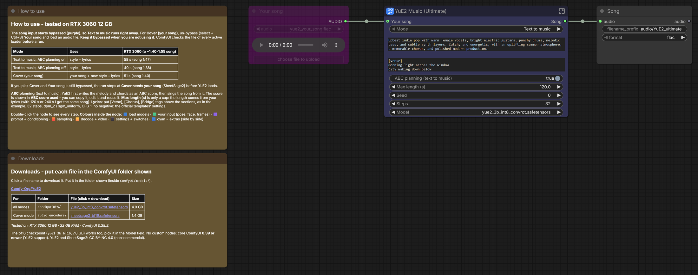

# The_frizzy1 — YuE2 Music · 12 GB v1.0.0

☕ If this workflow saved you time: **[Buy me a coffee](https://buymeacoffee.com/the_frizzy1)**

> YuE2 (a 3B open music model from the Multimodal Art Projection team) makes complete songs with vocals from a music
> style and your lyrics. Text to music and cover (new style + lyrics on your song's melody) in one node. Core ComfyUI
> nodes only, tested on an RTX 3060.

| | |
|---|---|
| **Model family** | YuE2 3B (int8) + SheetSage2 (cover mode) |
| **Tasks** | Text → song (vocals + instruments) · Cover (your song's melody, new style + lyrics) |
| **Needs** | VRAM peaked at 7.5 GB · system RAM peaked at 4.0 GB · ComfyUI **0.39+** |
| **Tested on** | RTX 3060 12 GB · Ryzen 5 5600X · 32 GB DDR4 · ComfyUI 0.39.2 (Comfy Desktop) |
| **YouTube explainer** | — (no video yet) |
| **License** | Workflow: MIT · YuE2 + SheetSage2: CC BY-NC 4.0 (**non-commercial**) |

## Quick start
1. Update ComfyUI to **0.39 or newer** (YuE2 support; no custom nodes).
2. Download the files in [downloads.md](downloads.md) (SheetSage2 only for cover mode).
3. Load `The_frizzy1_yue2-music-12gb_v1.0.0.json`. It opens on **Text to music**: write the music style and your lyrics, **Run**.
4. Cover: pick **Cover (your song)**, un-bypass (select + **Ctrl+B**) **Your song** and load an audio file.

## Listen

Made by this workflow on the RTX 3060, the official templates' style, lyrics and seed:

| | Song | Length | RTX 3060 |
|---|---|---|---|
| Text to music, ABC planning on | [song-1-text-to-music.mp3](samples/song-1-text-to-music.mp3) | 1:47 | 58 s |
| Text to music, ABC planning off | [song-2-no-abc-planning.mp3](samples/song-2-no-abc-planning.mp3) | 1:38 | 40 s |
| Cover (the template's reference song) | [song-3-cover.mp3](samples/song-3-cover.mp3) | 1:40 | 51 s |

Times = queue to finished. The first run includes loading the model.

## Modes

| Mode | Uses | What happens |
|---|---|---|
| Text to music | music style + lyrics | **ABC planning** on: YuE2 first writes the melody + chords as an ABC score (median 13 s), then makes the song from it. Off: straight to the song. |
| Cover (your song) | your song + new style + lyrics | SheetSage2 transcribes your song's melody to ABC (8 s), YuE2 sings the new lyrics on it. |

The score that was used is shown in **ABC score used**: copy it, edit it, reuse it. **Max length (s)** is only a cap: the
length comes from your lyrics (with 120 s and 240 s I got the same song). Put [Verse], [Chorus], [Bridge] above the
sections, as in the example.

## Overview
Built from the two official templates (YuE2: Text to Music, YuE2: Music Cover) in ComfyUI 0.39, same settings:
int8 ConvRot checkpoint, 32 steps, dpm_2 / sgm_uniform, CFG 1, no negative. Lazy switches pick the path, so SheetSage2
and the ABC planner only load when the mode uses them. Medians on the RTX 3060: writing the music 24 s,
sampling 17 s.

## Required models
See [downloads.md](downloads.md) — every file was read from the workflow `.json`.

## Required custom nodes
None - core ComfyUI **0.39+**.

## Troubleshooting
- **"Invalid audio file" before it starts:** Your song is un-bypassed but its file is not on your PC. Load your song, or bypass it (Ctrl+B) for text to music.
- **Run stops at "Cover needs your song":** you picked Cover and Your song is still bypassed.
- **Song shorter than Max length:** normal, the length follows the lyrics. Add sections for a longer song.
