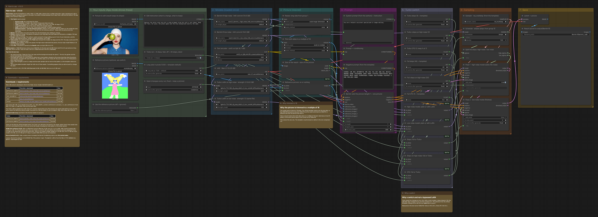

# The_frizzy1 — Bernini-R Image Edit v1.0.0

> Edit a picture with a written instruction using ByteDance's Bernini-R (built on Wan 2.2 14B). Core ComfyUI nodes only, Apache-2.0 model.

| | |
|---|---|
| **Model family** | Bernini-R 14B (loads as a Wan 2.2 high noise + low noise pair in ComfyUI) |
| **Tasks** | Image edit · optional reference picture |
| **Min VRAM** | 12 GB is the target. **Not verified on 12 GB** (see Hardware & VRAM) |
| **Tested on** | RTX PRO 4000 Blackwell 24 GB · 64 GB RAM · ComfyUI 0.45.3 (frontend 1.57.6) |
| **CivitAI** | Not published |
| **Hugging Face** | Not published |
| **YouTube explainer** | Not published |
| **License** | Workflow: MIT · Bernini-R: Apache-2.0 (LICENSE file of [ByteDance/Bernini-R](https://huggingface.co/ByteDance/Bernini-R)) · text encoder and VAE: see [Comfy-Org/Wan_2.1_ComfyUI_repackaged](https://huggingface.co/Comfy-Org/Wan_2.1_ComfyUI_repackaged) · lightx2v LoRA: see [Kijai/WanVideo_comfy](https://huggingface.co/Kijai/WanVideo_comfy) (no licence tag on that page) |

## Preview

<p align="center">
  
  
</p>

<sub>Left: the default run, "replace the white swim cap with a wide-brimmed straw hat with a red ribbon", seed 22112026, Turbo on, 20 s. Right: "put the bottle on a wooden table in a sunny garden", same seed, Turbo on, 20 s. The seed input changes after every run, so set it back to 22112026 to repeat these. The source pictures, from the lab's standard inputs:</sub>

<p align="center"></p>

<p align="center"></p>

## Overview
Built from ComfyUI's built-in template `video_bernini_r_image_editing` and restructured: the template's subgraph is laid out flat in numbered groups, every input you change is in group 1, notes are inside. Four things differ from the template. It loads the two 14.5 GB int8 convrot files instead of the 15.6 GB fp8 files, and the Comfy-Org Wan 2.1 VAE instead of Kijai's copy. The picture is trimmed to sides that are a multiple of 16, so the result has the size of the picture that went in. The task menu is gone: the system prompt is fixed to the authors' image editing line. And a reference picture can be switched on with one input.

## Capabilities
- `The_frizzy1_bernini-r_v1.0.0.json`: one picture plus an instruction gives an edited picture of the same shape, long side 1280 by default.
- Turbo on (default): lightx2v LoRA on both models (strength 3 and 1.5), 6 steps (3 + 3), CFG 1. Turbo off: no LoRA, 40 steps (20 + 20), CFG 5. All values are the template's. One input switches models, steps, split and CFG together.
- Optional reference picture with its own on/off input ("the hat from the reference picture").
- res_multistep / simple, two passes (high noise, then low noise), as in the template.
- Colour-coded groups: your inputs (green) · models (blue) · picture (teal) · prompt (purple) · Turbo switch (grey-blue) · sampling (orange) · save (amber).

## Hardware & VRAM
All numbers are from one machine: RTX PRO 4000 Blackwell 24 GB. It is not a 12 GB card.

| Run | Peak VRAM (whole GPU) |
|---|---|
| ComfyUI with no VRAM limit, all runs with the shipped model files | 22.7 to 23.4 GiB |
| ComfyUI started with `--reserve-vram 13.5`, custom nodes off: Turbo on, 1280x704 (two seeds) and 720x1280 | 11.3 GiB |
| Same, with the reference picture | 11.5 GiB |
| Same, Turbo off (40 steps) | 11.5 GiB |

- **Not verified on 12 GB.** With no limit ComfyUI fills the memory it finds, so the first row shows what a 24 GB card uses, not what the workflow needs. The other rows are five runs inside a smaller budget on the same 24 GB card: they finished, gave the same pictures (identical files for the two that were compared) and took about the same time. That is not a test on a 12 GB card.
- About 0.9 GiB of each capped figure was held by other programs, among them the idle first ComfyUI.
- Each of the two models is 14.5 GB, more than 12 GB, so ComfyUI keeps part of it in system RAM. RAM use was not measured.
- Peak VRAM is the highest whole-GPU reading of `nvidia-smi`, sampled once per second, MiB / 1024.

## Required models
See the per-workflow [downloads.md](downloads.md) for the full table with verified links.
Every file below was read from the workflow `.json`.

```
ComfyUI/models/
├── diffusion_models/   ← wan2.2_bernini_r_high_noise_int8_convrot.safetensors                 (14.5 GB)
│                       ← wan2.2_bernini_r_low_noise_int8_convrot.safetensors                  (14.5 GB)
├── text_encoders/      ← umt5_xxl_fp8_e4m3fn_scaled.safetensors                               (6.7 GB)
├── vae/                ← wan_2.1_vae.safetensors                                              (0.25 GB)
└── loras/              ← lightx2v_T2V_14B_cfg_step_distill_v2_lora_rank64_bf16.safetensors    (0.63 GB)
```

About 36.7 GB. The text encoder and VAE are the Wan 2.1 / Wan 2.2 files.

## Required custom nodes
None. Run on ComfyUI 0.45.3 only; older versions were not tested. The Bernini Conditioning node came with ComfyUI PR #14216 (first tagged in v0.25.0).

Core nodes used (21, plus the frontend's MarkdownNote for the notes): BasicScheduler, BerniniConditioning, CLIPLoader, CLIPTextEncode, ComfySwitchNode, GetImageSize, KSamplerSelect, LoadImage, LoraLoaderModelOnly, PrimitiveBoolean, PrimitiveFloat, PrimitiveInt, PrimitiveStringMultiline, ResizeImageMaskNode, SamplerCustom, SaveImage, SplitSigmas, StringConcatenate, UNETLoader, VAEDecode, VAELoader. Each one's module in `/object_info` of ComfyUI 0.45.3 is `nodes` or `comfy_extras.*`, and five runs were done with `--disable-all-custom-nodes`.

## Optional custom nodes
None.

## Installation
1. Update ComfyUI (0.45.3 is the version this was run on).
2. Download the five files ([downloads.md](downloads.md), or the Downloads note inside the workflow).
3. Load `The_frizzy1_bernini-r_v1.0.0.json`, load your picture in **Picture to edit**, write the instruction, press **Run**.

## Recommended settings
| Setting | Value | Notes |
|---|---|---|
| Turbo | on | 6 steps, CFG 1. 16 to 24 s per picture on the test card |
| Turbo off | 40 steps, CFG 5 | template values, set in group 5. 3 min 23 s to 4 min 19 s per picture |
| Long side in pixels | 1280 | template default. 1024 and 832 were run once each (13 s and 8 s) |
| Sampler / scheduler | res_multistep / simple | from the template. euler was tried once and did not remove the mesh pattern (Known issues) |
| Turbo LoRA strength | 3 (high noise) and 1.5 (low noise) | from the template; 2 and 1 were tried, see Known issues |
| Reference picture | off | turn on only with a picture loaded |
| Seed | changes every run | set "control after generate" to fixed to keep a picture |

## Inputs / Outputs
- **Inputs:** one picture and an instruction in English; optionally a reference picture. Turbo, long side and seed are in group 1 too.
- **Outputs:** a PNG in `output/Bernini-R/`, the shape of the picture with sides trimmed to a multiple of 16 (1368x768 gave 1280x704, 1776x1184 gave 1280x848, 1088x1920 gave 720x1280).

## Performance
One run each unless noted, on the machine above, ComfyUI with no VRAM limit, model files already in the disk cache:

| Run | Settings | Time |
|---|---|---|
| Hat picture, with model load | 1280x704, Turbo on | 20 s (two runs) |
| Hat picture, models loaded | 1280x704, Turbo on, three other seeds | 16 to 19 s |
| Forest picture | 1280x848, Turbo on (eight runs: winter with seven seeds, sunset) | 21 to 24 s |
| Bottle picture | 720x1280, Turbo on | 20 s (two runs) |
| Hat picture + reference picture | 1280x704, Turbo on | 24 s (two runs) |
| Forest picture, smaller | 1024x672 / 832x544, Turbo on | 13 s / 8 s |
| Hat picture, Turbo off | 1280x704, 40 steps, CFG 5 | 3 min 23 s |
| Forest picture, Turbo off | 1280x848, 40 steps, CFG 5 | 4 min 19 s |

With `--reserve-vram 13.5` (see Hardware & VRAM) the same runs took 19 to 22 s (hat, bottle), 26 s (reference) and 3 min 26 s (Turbo off).

One more run was started from App mode with the Run button (defaults): 16 s from the click to the saved picture.

RTX 3060 12 GB: Not verified.

## Known issues
- **Mesh pattern on fine detail with Turbo on:** in the forest-to-winter test the snowy branches show a mesh or fish-scale pattern when the picture is enlarged 2x. It is strong with the default seed 22112026, clearly there with seeds 4 and 5. Seeds 1, 2, 3 and 7 looked clean at 2x; at 3x some of them show a faint hatch. It did not go away with LoRA strengths 2 and 1, with 8 steps, with the euler sampler, with the fp8 model files (three seeds) or with the Comfy-Org Wan 2.2 lightx2v LoRA pair (three seeds). The one Turbo-off run of that picture drew clean branches. The hat, bottle and sunset results did not show it. For pictures full of foliage, try other seeds or turn Turbo off.
- **Things you did not ask for:** in the hat test one of three Turbo seeds added shoulder-length hair. The Turbo-off run did not.
- **The size note:** the template resizes only the long side; the 1368x768 test picture went in as 1280x719 and came back as 1280x712. This workflow trims to a multiple of 16 first. It changes the size only: the template's result showed no defect in the one comparison run.
- **Reference picture:** tested with one picture and one instruction (the white hat with the blue bow was put on the woman). Several references, or a reference without a picture to edit, are not wired here.
- **Reference picture loader must point at an existing file** even when switched off. It is set to `example.png`, which ships with ComfyUI.
- **The system prompt is glued to the instruction without a space**, as in the template ("...image editing.Replace the..."). Not compared with a space.
- **Text-to-image, video editing and the 1.3B model** are not part of this workflow. The built-in templates cover them.
- **Seed:** the Seed input changes after every run and can become negative; a negative seed was run once and worked.
- The instructions are my own: the lab's standard `prompts.json` was not in the inputs folder. The authors recommend a prompt enhancer (an LLM that rewrites the instruction); it is not used here.
- The browser checks (screenshot, one App mode run) used frontend 1.57.6, older than the 1.58.5 that ComfyUI 0.45.3 asks for.

## Changelog
See [changelog.md](changelog.md).

## Related workflows
- [FireRed Image Edit 1.1](../../firered/image-edit-1.1) · [Qwen Image 2.1 Ultimate · 12 GB](../../qwen/image-2.1-ultimate-12gb) · [Flux Kontext GGUF](../../flux/kontext)
