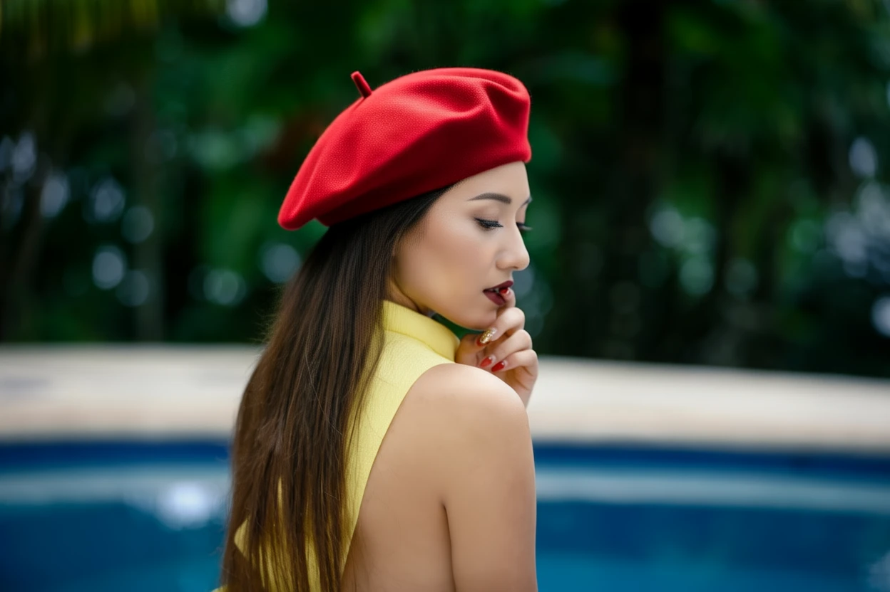
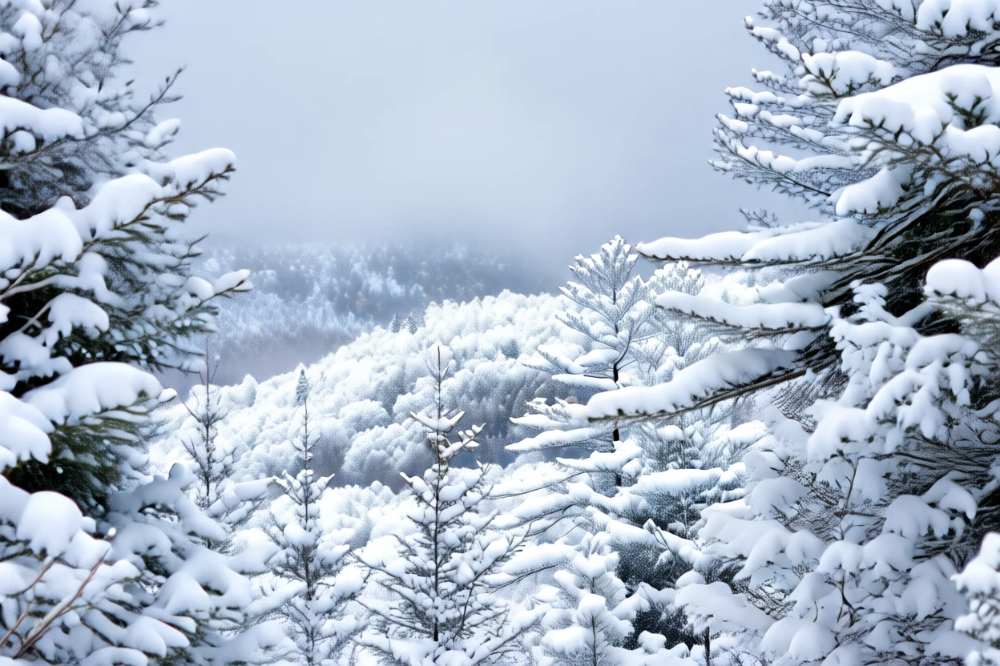
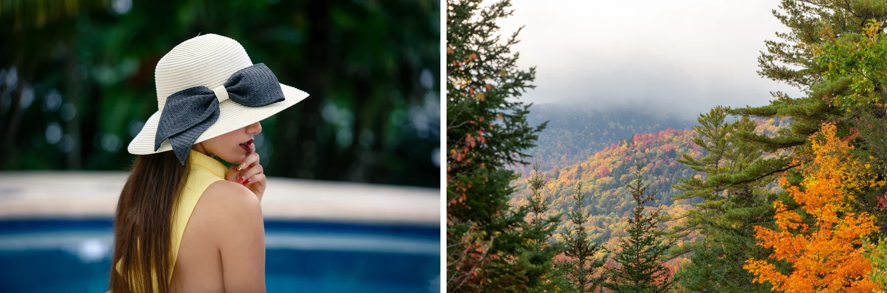
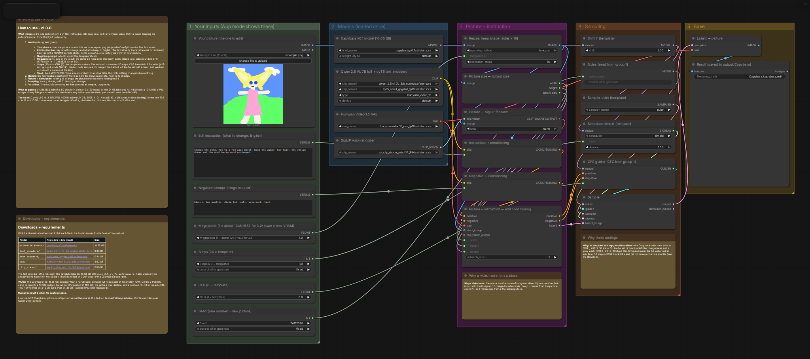

# The_frizzy1 — Capybara Image Edit v1.0.0

> Edit a picture with a written instruction, using Capybara v0.1 (a Hunyuan Video 1.5 fine-tune). The picture keeps its shape. Core ComfyUI nodes only.

| | |
|---|---|
| **Model family** | Capybara v0.1 (loads as a Hunyuan Video 1.5 model in ComfyUI) |
| **Tasks** | Image edit (one picture + instruction) |
| **Min VRAM** | 12 GB is the target. **Not verified on 12 GB** (ran inside a 10 GiB budget on a 24 GB card, see Hardware & VRAM) |
| **Tested on** | RTX PRO 4000 Blackwell 24 GB · 64 GB RAM · ComfyUI 0.45.3 (frontend 1.57.6) |
| **CivitAI** | Not published |
| **Hugging Face** | Not published |
| **YouTube explainer** | Not published |
| **License** | Workflow: MIT · Capybara: MIT ([xgen-universe/Capybara](https://github.com/xgen-universe/Capybara)) · it is built on Tencent HunyuanVideo 1.5; the Comfy-Org repackage is tagged with the [Tencent Hunyuan Community licence](https://github.com/Tencent-Hunyuan/HunyuanVideo-1.5/blob/master/LICENSE) |

## Preview

<p align="center">
  
  
</p>

<sub>Left: the default settings, with the sample photo loaded, "Change the straw hat to a red wool beret. Keep the woman, her hair, the yellow dress and the pool background unchanged.", seed 24112026, 41 s. Right: same settings, "Turn the scene into a snowy winter day. Snow covers the trees and the hills, keep the trees and the mist where they are.", 39 s. Enlarged, the snow shows a fine speckle (see Known issues). The source pictures, from the lab's standard inputs:</sub>

<p align="center"></p>

<p align="center"></p>

## Overview
Built from ComfyUI's built-in template `Image_capybara_v0_1_image_edit` and restructured: taken out of its subgraph, numbered groups, every input you change in group 1, notes inside. Two things differ from the template. The picture keeps its shape (the template centre-crops every picture to 1024x1024). And it loads the 9.38 GB fp8 text encoder instead of the 16.58 GB bf16 one. Steps, CFG, shift, sampler and scheduler are the template's.

Capybara is one model for text to image, image edit, text to video and video edit. This file does only the image edit.

## Capabilities
- `The_frizzy1_capybara-image-edit_v1.0.0.json`: one picture plus an instruction gives an edited picture of the same shape, 1 megapixel by default, sides a multiple of 16.
- 20 steps, CFG 6, shift 7, euler / simple, as in the template.
- App mode shows only the group 1 inputs: picture, instruction, negative prompt, megapixels, steps, CFG, seed.
- Colour-coded groups: your inputs (green) · models (blue) · picture + instruction (purple) · sampling (orange) · save (amber).

## Hardware & VRAM
All numbers are from one machine: RTX PRO 4000 Blackwell 24 GB. It is not a 12 GB card. Peak VRAM is the highest whole-GPU reading of `nvidia-smi`, sampled once per second, MiB / 1024.

| ComfyUI started with | Peak VRAM (whole GPU) | Time (two samples) |
|---|---|---|
| no limit | 23.2 to 23.4 GiB | 39 to 41 s |
| a 12 GiB budget (`--reserve-vram 11.89`) | 12.9 GiB | 43 to 45 s |
| a 10 GiB budget (`--reserve-vram 13.89`) | 10.9 to 11.0 GiB | 45 to 48 s |

- **Not verified on 12 GB.** The budget runs used a second ComfyUI with `--disable-all-custom-nodes` on the same 24 GB card. The pictures were pixel-identical in all three runs. About 0.86 GiB of the whole-GPU figure was held by other programs.
- The Capybara file is 16.65 GB, bigger than a 12 GB card, so ComfyUI keeps part of it in system RAM. RAM use was not measured; plan on 32 GB or more.
- ComfyUI fills the memory it finds, so the "no limit" row shows what a 24 GB card uses, not what the workflow needs.

## Required models
See the per-workflow [downloads.md](downloads.md) for the full table with verified links.
Every file below was read from the workflow `.json`.

```
ComfyUI/models/
├── diffusion_models/   ← capybara_v0.1.safetensors                 (16.65 GB)
├── text_encoders/      ← qwen_2.5_vl_7b_fp8_scaled.safetensors     (9.38 GB)
│                       ← byt5_small_glyphxl_fp16.safetensors       (0.44 GB)
├── vae/                ← hunyuanvideo15_vae_fp16.safetensors       (2.52 GB)
└── clip_vision/        ← sigclip_vision_patch14_384.safetensors    (0.86 GB)
```

About 29.9 GB. Everything except the Capybara file is shared with Hunyuan Video 1.5.

## Required custom nodes
None. Run on ComfyUI 0.45.3 only; older versions were not tested.

Core nodes used (21, plus the frontend's MarkdownNote for the notes): BasicScheduler, CFGGuider, CLIPTextEncode, CLIPVisionEncode, CLIPVisionLoader, DualCLIPLoader, GetImageSize, HunyuanVideo15ImageToVideo, ImageScaleToTotalPixels, KSamplerSelect, LoadImage, ModelSamplingSD3, PrimitiveFloat, PrimitiveInt, PrimitiveStringMultiline, RandomNoise, SamplerCustomAdvanced, SaveImage, UNETLoader, VAEDecode, VAELoader. Each one's module in `/object_info` of ComfyUI 0.45.3 is `nodes` or `comfy_extras.*`, none is marked deprecated, and the budget runs were done with `--disable-all-custom-nodes`.

## Optional custom nodes
None.

## Installation
1. Update ComfyUI (0.45.3 is the version this was run on).
2. Download the five files ([downloads.md](downloads.md), or the Downloads note inside the workflow).
3. Load `The_frizzy1_capybara-image-edit_v1.0.0.json`, load your picture in **Your picture**, write the instruction, press **Run**.

## Recommended settings
| Setting | Value | Notes |
|---|---|---|
| Steps / CFG / shift | 20 / 6 / 7 | template values. 39 to 41 s per picture on the test card |
| Authors' edit settings | 50 steps, CFG 1, shift 5 | from the Capybara code. 44 to 45 s; kept the hat edit, but the forest stayed half autumn and washed out. Steps and CFG are in group 1, shift is in group 4 |
| 50 steps at CFG 6 | | the template note's tip. 89 s, one forest run; nearly the same picture, the speckle stayed |
| Megapixels | 1 | 0.88 (the authors' 720p) was run once: 1184x784, 37 s, same speckle |
| Sampler / scheduler | euler / simple | from the template; others not tested |
| Seed | 24112026, fixed | type a new number for another take |

## Inputs / Outputs
- **Inputs:** one picture and an instruction. The negative prompt, megapixels, steps, CFG and seed are in group 1 too.
- **Outputs:** a PNG in `output/Capybara/`, the shape of the picture with sides rounded to a multiple of 16 (1776x1184 gave 1248x832). Small pictures are enlarged: the 768x768 `example.png` gave 1024x1024.

## Performance
One run each, on the machine above, model files already in the disk cache:

| Run | Settings | Time | Peak VRAM |
|---|---|---|---|
| Hat, first run of the night (models loading) | 1248x832, 20 steps, CFG 6 | 40 s | 23.2 GiB |
| Hat, sample 1 (after unloading the models) | 1248x832, 20 steps, CFG 6 | 41 s | 23.4 GiB |
| Forest, sample 2, models loaded | 1248x832, 20 steps, CFG 6 | 39 s | 23.4 GiB |
| Forest, other seed / short instruction / CFG 4 / CFG 4 + shift 5 | 1248x832, 20 steps | 37 to 39 s | 22.5 to 23.4 GiB |
| Forest, 0.88 megapixels | 1184x784, 20 steps | 37 s | 23.0 GiB |
| Forest, 50 steps | 1248x832, CFG 6 | 89 s | 22.5 GiB |
| Hat / forest, authors' settings | 50 steps, CFG 1, shift 5 | 44 / 45 s | 20.0 / 19.8 GiB |
| Shipped defaults (`example.png`) | 1024x1024, 20 steps | 39 s | 23.2 GiB |
| Samples in a 12 GiB budget | as samples 1 and 2 | 45 / 43 s | 12.9 GiB |
| Samples in a 10 GiB budget | as samples 1 and 2 | 48 / 45 s | 11.0 / 10.9 GiB |

RTX 3060 12 GB: Not verified.

## Known issues
- **Fine speckle on snow and foliage:** the forest-to-winter edit shows a fine dotted texture on the snow, plain at 1:1 on the far hills. It was there in every run of that picture: 20 and 50 steps, CFG 1, 4 and 6, shift 5 and 7, 1 and 0.88 megapixels, two seeds and a short instruction. The VAE is not the cause (encoding and decoding the source photo without sampling came out clean). The hat edit, with a smooth blurred background, shows no such texture. Other users also report noise in Capybara edits ([review video](https://www.youtube.com/watch?v=SU2wQDCx4a0), [r/comfyui](https://www.reddit.com/r/comfyui/comments/1rnrspv/did_anyone_try_capybara_v2v_and_i2v/)).
- **Core ComfyUI skips three Capybara weights:** the log says `unet unexpected: ['cond_special_token_embedding.weight', 'siglip_type_embedding.weight', 'task_bias.weight']`. ComfyUI 0.45.3 loads Capybara as a plain Hunyuan Video 1.5 model and has no Capybara-specific code, so these weights (a task bias and picture-embedding markers in the authors' code) are not used. Whether that causes the speckle was not tested: the authors' own pipeline was not run.
- **The face can change:** in the hat sample the hat covered her eyes, and the result shows her whole face, which the model had to invent. Only two pictures were tested.
- **CFG 1 is weak here:** the authors' code runs edits at CFG 1, but in this graph that left the forest edit half done (orange trees, grey wash). The template's CFG 6 is the default.
- **Picture loader must point at an existing file.** It is set to `example.png`, which ships with ComfyUI, so the first Run works before you load your own.
- The instructions are my own: the lab's standard `prompts.json` was not in the inputs folder.
- The browser checks (screenshot, App mode view) used frontend 1.57.6, older than the 1.58.5 that ComfyUI 0.45.3 asks for.

## Changelog
See [changelog.md](changelog.md).

## Related workflows
- [FireRed Image Edit 1.1](../../firered/image-edit-1.1) · [Bernini-R Image Edit](../../bernini/bernini-r) · [Qwen Image 2.1 Ultimate · 12 GB](../../qwen/image-2.1-ultimate-12gb)
