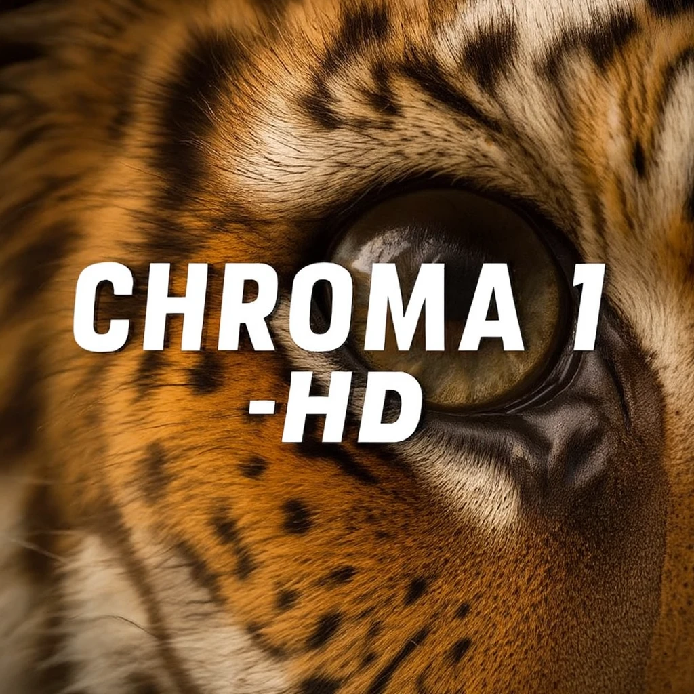
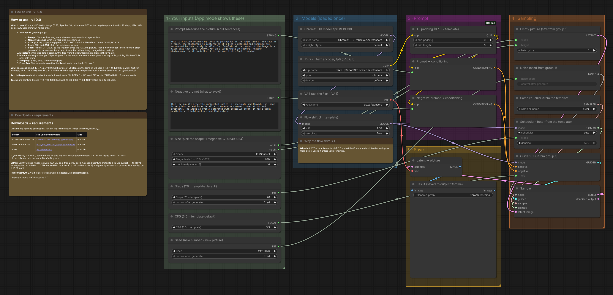

# The_frizzy1 — Chroma1-HD v1.0.0

> Chroma1-HD text to image with a real CFG and a working negative prompt: three files, 26 steps, 1024x1024. Core ComfyUI nodes only.

| | |
|---|---|
| **Model family** | Chroma (Chroma1-HD by lodestones, 8.9B, built from FLUX.1-schnell) |
| **Tasks** | Text → Image |
| **Min VRAM** | 12 GB is the target. **Not verified on 12 GB** (see Hardware & VRAM) |
| **Tested on** | RTX PRO 4000 Blackwell 24 GB · 64 GB RAM · ComfyUI 0.45.3 |
| **CivitAI** | Not published |
| **Hugging Face** | Not published |
| **YouTube explainer** | Not published |
| **License** | Workflow: MIT · Chroma1-HD: [Apache-2.0](https://huggingface.co/lodestones/Chroma1-HD) |

## Preview

<p align="center">
  
  
</p>

<sub>Left: the default settings and the template's prompt (1024x1024, 26 steps, CFG 3.5, seed 24112026), 47 s including the model load. Right: a fishing-boat prompt with Shape set to 16:9 (1360x768), seed 31415, 47 s.</sub>

<p align="center"></p>

## Overview
Built from ComfyUI's built-in template `image_chroma_text_to_image` and restructured: five numbered groups, every input you change in group 1, and two notes (How to use, Downloads + requirements). The model files and the sampling settings are the template's: Chroma1-HD fp8mixed, T5-XXL fp8, the Flux.1 VAE, euler / beta, 26 steps, CFG 3.5, flow shift 1, T5 padding 0 / 0. What differs from the template: the fixed 1024x1024 size is now a Size input (shape + megapixels), the seed is a group 1 input with a new default (24112026, on `fixed`), pictures are saved to `output/Chroma/`, and the template's notes were replaced by the two house notes (the flow shift note is kept as "Why the flow shift is 1").

## Capabilities
- Text to image at 1024x1024 by default; the Size input picks the shape. 1:1 (1024x1024) and 16:9 (1360x768) were run.
- Real CFG (3.5), so the negative prompt works; Chroma reads long, natural sentences in both prompts.
- Text in the picture works sometimes (see Known issues).
- Colour-coded groups: your inputs (green) · models (blue) · prompt (purple) · sampling (orange) · save (amber).

## Hardware & VRAM
All numbers are from one machine: RTX PRO 4000 Blackwell 24 GB, ComfyUI 0.45.3. It is not a 12 GB card. Peak VRAM is read from nvidia-smi once per second, in GiB (MiB / 1024).

| Run | ComfyUI process peak | Whole-GPU peak |
|---|---|---|
| Lab ComfyUI, no VRAM limit, first run | 14.0 GiB | 14.5 GiB |
| Lab ComfyUI, no VRAM limit, model loaded | 16.4 GiB | 16.9 GiB |
| Second ComfyUI, 12 GiB budget (`--reserve-vram 11.89`) | 12.0 to 12.1 GiB | 12.8 to 13.0 GiB |
| Second ComfyUI, 10 GiB budget (`--reserve-vram 13.89`) | 10.0 to 10.1 GiB | 10.8 to 11.0 GiB |

- ComfyUI fills the room it is given, so the unlimited numbers say nothing about what a 12 GB card needs.
- In the 10 GiB budget both sample prompts took 49 to 50 s (47 s without a limit) and gave byte-identical pictures (same SHA-256) to the unlimited runs.
- **Not verified on 12 GB.** A budget on a 24 GB card is not a 12 GB card: the rest of the system, the driver and other programs differ.
- The model file is the Comfy-Org fp8mixed file (9.19 GB). Comfy-Org has no int8 or GGUF Chroma file; GGUF needs a custom node pack, so it is not used.

## Required models
See the per-workflow [downloads.md](downloads.md) for the full table with verified links.
Every file below was read from the workflow `.json`.

```
ComfyUI/models/
├── diffusion_models/  ← Chroma1-HD-fp8mixed.safetensors
├── text_encoders/     ← t5xxl_fp8_e4m3fn_scaled.safetensors
└── vae/               ← ae.safetensors
```

## Required custom nodes
None. Run on ComfyUI **0.45.3** only; older versions were not tested (Chroma support came in with ComfyUI PR #7355).

Core nodes used: UNETLoader, CLIPLoader (type `chroma`), VAELoader, ModelSamplingAuraFlow, T5TokenizerOptions, CLIPTextEncode, ResolutionSelector, EmptySD3LatentImage, RandomNoise, KSamplerSelect, BasicScheduler, CFGGuider, SamplerCustomAdvanced, VAEDecode, SaveImage, PrimitiveInt, PrimitiveFloat, PrimitiveStringMultiline, and MarkdownNote (the frontend's note node, not in `/object_info`). The module of each of the 18 backend nodes in `/object_info` of ComfyUI 0.45.3 is `nodes` or `comfy_extras`.

## Optional custom nodes
None.

## Installation
1. Update ComfyUI (0.45.3 is the tested version).
2. Download the three files ([downloads.md](downloads.md), or the Downloads note inside the workflow). If you run Flux.1 you already have the T5 and the VAE.
3. Load `The_frizzy1_chroma_v1.0.0.json`, write your prompt in group 1, press **Run**.

## Recommended settings
| Setting | Value | Notes |
|---|---|---|
| Size | 1:1, megapixels 1 (1024x1024) | 16:9 at megapixels 1 gives 1360x768; other sizes were not tested |
| Steps / CFG | 26 / 3.5 | template defaults; other values were not tested |
| Sampler | euler / beta | template default; other samplers were not tested |
| Flow shift | 1 | template value; its note says 1.0 is the Chroma author's intended shift |
| T5 padding (min_padding / min_length) | 0 / 0 | template value; the template note says min_padding 1 is the official setting and 0 also works. 1 was not tested |
| multiple (on the Size node) | 16 | the model works on 16 px blocks |

## Inputs / Outputs
- **Inputs:** a text prompt and a negative prompt. No picture, video or audio input.
- **Outputs:** a PNG in `output/Chroma/`.

## Performance
On the machine above. Times are from sending the job to the finished file. 7 runs, all through the API.

| Settings | Time | Runs |
|---|---|---|
| 1024x1024, first run with the model load | 47 s | 1 |
| 1024x1024, model already loaded (seed 777) | 46 s | 1 |
| 1360x768 (16:9) | 47 s | 1 |
| Both samples in a 12 GiB budget (fresh second ComfyUI) | 48 to 49 s | 2 |
| Both samples in a 10 GiB budget (fresh second ComfyUI) | 49 to 50 s | 2 |

The model load adds little: the first run and the warm run differ by 1 s. Sampling 26 steps with CFG (two model passes per step) is most of the time.

RTX 3060 12 GB: Not verified.

## Known issues
- **Text in the picture is hit or miss:** the default seed wrote "CHROMA 1 -HD" over two lines (the prompt asks for "CHROMA1-HD"), seed 777 wrote "CHROMA-HI" → try a few seeds, keep titles short.
- **The seed is fixed:** the Seed input is on `fixed` (24112026), so the first Run gives the default picture above. Pressing Run again with nothing changed does nothing (ComfyUI reuses the result): type a new seed, or set "control after generate" to `randomize`, for a new picture.
- **Only three pictures were looked at** (two tiger seeds, one boat), the boat also at 2x zoom on the lighthouse: no grid or texture faults were seen. That is too few to say how often Chroma gets anatomy or hands wrong.
- **App mode was opened, not run:** in a headless browser on ComfyUI 0.45.3 (frontend 1.57.6) App mode listed the seven inputs with their labels, and the prompt the browser builds from the file is the same as the one sent through the API. Run was not clicked there.
- Not tested: the full-precision model, the fp16 T5, LoRAs (Reddit users report the "flash-heun" LoRAs at CFG 1 for faster runs), Chroma1-Flash, and any other steps / CFG / sampler.
- The prompts: the default is the template's tiger prompt, the boat prompt is my own; the lab's standard `prompts.json` was not in the inputs folder.

## Changelog
See [changelog.md](changelog.md).

## Related workflows
- [SDXL](../../sdxl/sdxl) · [Anima](../../anima/anima) · [Flux.2 Dev GGUF](../../flux/flux2-dev)
