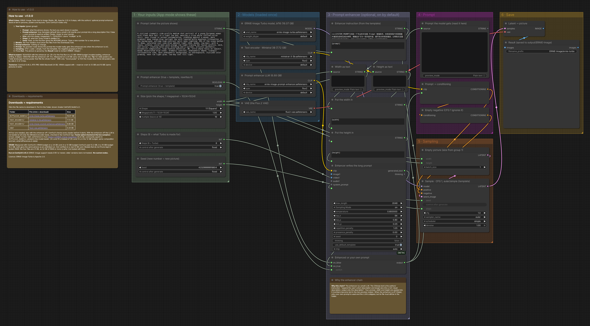

# The_frizzy1 — ERNIE-Image Turbo v1.0.0

> ERNIE-Image Turbo text to image in 8 steps, with the authors' optional prompt enhancer. Good at text in pictures. Core ComfyUI nodes only.

| | |
|---|---|
| **Model family** | ERNIE-Image (Baidu, 8B single-stream DiT), Turbo = the 8-step distilled release |
| **Tasks** | Text → Image |
| **Min VRAM** | 12 GB is the target. **Not verified on 12 GB** (ran inside 12 GiB and 10 GiB VRAM budgets on a 24 GB card, see Hardware & VRAM) |
| **Tested on** | RTX PRO 4000 Blackwell 24 GB · 62 GB RAM · ComfyUI 0.45.3 |
| **CivitAI** | Not published |
| **Hugging Face** | Not published |
| **YouTube explainer** | Not published |
| **License** | Workflow: MIT · ERNIE-Image-Turbo: [Apache 2.0](https://huggingface.co/baidu/ERNIE-Image-Turbo/blob/main/LICENSE) |

## Preview

<p align="center">
  
  
</p>

<sub>Left: the default settings (the template's prompt, enhancer on, 1024x1024, seed 423299999918804), 29 s for the first run in a 12 GiB budget. Right: a poster prompt with two lines of text, enhancer off, Shape 16:9 (1360x768), seed 24112026, 14 s. Both lines of text came out letter-perfect.</sub>

<p align="center"></p>

## Overview
Built from ComfyUI's built-in template `image_ernie_image_turbo` (a single subgraph node) and laid out flat: six numbered groups, every input you change in group 1, and two notes (How to use, Downloads + requirements). The model files, the sampler settings and the prompt-enhancer chain are the template's. Three things differ: the width and height became a Size input (shape + megapixels), the seed is `fixed` instead of `randomize`, and the deprecated `TextGenerate` node is replaced by `TextGenerateV2` ("Generate Text"), which runs the same code in ComfyUI 0.45.3 (same pictures, checked pixel by pixel).

## Capabilities
- Text to image, 1024x1024 by default; the Size input picks the shape. 1024x1024 and 1360x768 (16:9) were run.
- 8 steps · CFG 1 · euler / simple (template). No negative prompt: at CFG 1 it has no effect, so the template feeds an empty one.
- **Prompt enhancer** (on by default, as in the template): a 3B LLM from the authors rewrites your prompt into a long description, using the target width and height. Off = your prompt as written. The prompt the model really got is shown in group 4.
- Text in pictures: the poster sample has a title and a time line, both spelled right.
- Colour-coded groups: your inputs (green) · models (blue) · prompt enhancer (grey-blue) · prompt (purple) · sampling (orange) · save (amber).

## Hardware & VRAM
All numbers are from one machine: RTX PRO 4000 Blackwell 24 GB, ComfyUI 0.45.3. It is not a 12 GB card. For the budget rows a second ComfyUI was started with `--reserve-vram` (card total minus the budget) and `--disable-all-custom-nodes`. VRAM is the peak of the ComfyUI process from nvidia-smi, read once per second, in GiB (MiB / 1024); the whole GPU was 0.5 to 0.9 GiB higher (other programs).

| Setting | Sample 1 (1024x1024, enhancer on) | Sample 2 (1360x768, enhancer off) |
|---|---|---|
| No budget (lab instance) | 22.6 GiB | 22.6 GiB |
| 12 GiB budget | 12.2 GiB | 12.1 GiB |
| 10 GiB budget | 10.2 GiB | 10.1 GiB |

- The pictures from the 12 GiB and 10 GiB budgets are pixel-identical to the unlimited ones. ComfyUI keeps the part of the models that does not fit in system RAM.
- **Not verified on 12 GB.** A budget on a 24 GB card is not a 12 GB card; the RTX 3060 run is still to come.
- System RAM: the four files are 31 GB together. The machine has 62 GB; less RAM was not tested.
- Comfy-Org ships only the bf16 model (16.07 GB). A community fp8 file (8.22 GB) was faster here, see Recommended settings.

## Required models
See the per-workflow [downloads.md](downloads.md) for the full table with verified links.
Every file below was read from the workflow `.json`.

```
ComfyUI/models/
├── diffusion_models/  ← ernie-image-turbo.safetensors
├── text_encoders/     ← ministral-3-3b.safetensors
│                      ← ernie-image-prompt-enhancer.safetensors
└── vae/               ← flux2-vae.safetensors
```

All four are needed even with the enhancer off: ComfyUI checks every loader before a run.

## Required custom nodes
None. Run on ComfyUI **0.45.3** only; older versions were not tested (ERNIE-Image support arrived in ComfyUI 0.19.1, [PR #13369](https://github.com/Comfy-Org/ComfyUI/pull/13369)).

Core nodes used: UNETLoader, CLIPLoader, VAELoader, StringReplace, PreviewAny, TextGenerateV2, ComfySwitchNode, CLIPTextEncode, ConditioningZeroOut, ResolutionSelector, EmptyFlux2LatentImage, KSampler, VAEDecode, SaveImage, PrimitiveStringMultiline, PrimitiveBoolean, PrimitiveInt, and MarkdownNote (the frontend's note node, not in `/object_info`). The module of each of the 17 backend nodes in `/object_info` of ComfyUI 0.45.3 is `nodes` or `comfy_extras`. ComfySwitchNode is marked experimental (BETA badge) in this version.

## Optional custom nodes
None.

## Installation
1. Update ComfyUI (0.45.3 is the tested version).
2. Download the four files ([downloads.md](downloads.md), or the Downloads note inside the workflow).
3. Load `The_frizzy1_ernie-image_v1.0.0.json`, write your prompt in group 1, press **Run**.

## Recommended settings
| Setting | Value | Notes |
|---|---|---|
| Steps / CFG | 8 / 1 | template and model card values; others were not tested |
| Sampler | euler / simple | template; others were not tested |
| Size | 1:1, megapixels 1 (1024x1024) | 16:9 gives 1360x768. The model card lists 1376x768 and 1264x848 among its sizes; those were not run |
| Prompt enhancer | on (template) | turn it off when the exact wording matters; the poster sample was made with it off |
| Wide posters | say "wide landscape-format poster that fills the whole frame" | see Known issues |
| Faster model file | `ernie-image-turbo-fp8.safetensors` (community, 8.22 GB) | 24 s and 10 s instead of 29 s and 14 s in the 12 GiB budget; same composition and text, small differences in detail. Pick it in the model loader |

## Inputs / Outputs
- **Inputs:** a text prompt. No picture, video or audio input.
- **Outputs:** a PNG in `output/ERNIE-Image/`.

## Performance
On the machine above. Times are from sending the job to the finished file. All runs went through the API with the prompts converted from the shipped file.

| Settings | Time | Runs |
|---|---|---|
| Sample 1, 12 GiB budget, first run on a fresh ComfyUI (models load, enhancer writes, 8 steps) | 29 s | 1 |
| Sample 1, 10 GiB budget, first run on a fresh ComfyUI | 29 s | 1 |
| Sample 2 (enhancer off), 12 / 10 GiB budget, after sample 1 | 14 / 15 s | 2 |
| Sample 1 / 2, no budget, models already in memory from earlier runs | 28 / 13 s | 2 |
| Sample 1 / 2 with the fp8 model file, 12 GiB budget | 24 / 10 s | 2 |

RTX 3060 12 GB: Not verified.

## Known issues
- **Three posters instead of one:** with the prompt "A vintage travel poster…" at 16:9, the model drew three tall posters side by side in 4 of 4 tries (seeds 24112026, 1, 2, 3), and one of them misspelled the title. "A wide landscape-format vintage travel poster that fills the whole frame…" gave one full-frame poster with both text lines right in 4 of 4 tries (seeds 24112026, 1, 2, 777).
- **The enhancer changes the person:** the template prompt asks for "a young European woman"; with the enhancer on, the picture shows an East Asian woman. Reddit users report the same lean for this model. Turn the enhancer off or describe the person more exactly. Only this one prompt was checked.
- **Memory:** ComfyUI fills whatever VRAM it is given (22.6 GiB with no limit). A Reddit user saw a 3090 nearly full and blamed the enhancer; here both samples used the same amount, so the budget, not the enhancer, sets the number.
- **App mode was opened, not run:** in a headless browser on ComfyUI 0.45.3 App mode listed the six inputs with their labels, and the prompt the browser builds from the file is the same as the one sent through the API. Run was not clicked there.
- The prompts are the template's (sample 1) and my own (sample 2): the lab's standard `prompts.json` was not in the inputs folder.
- Reddit was read as search excerpts only (r/StableDiffusion and r/comfyui, April 2026): clean pictures with good text and hands, prompt following mixed, saturated look, realism with people weaker than Z-Image Turbo. None of that was checked here beyond the pictures above.

## Changelog
See [changelog.md](changelog.md).

## Related workflows
- [Z-Image Turbo](../../z-image/turbo) · [SDXL](../../sdxl/sdxl) · [Qwen Image 2.1 · 12 GB](../../qwen/image-2.1-12gb)
