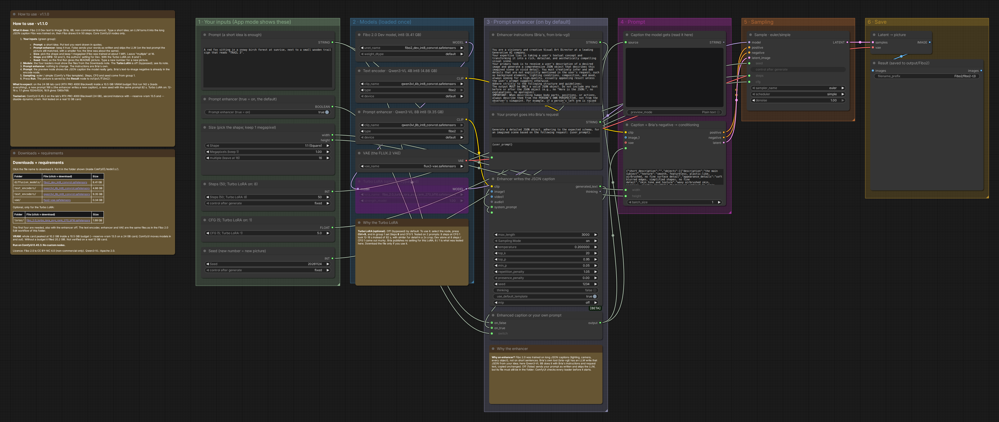

# The_frizzy1 · Fibo 2.0 Edit + Text to Image · 12 GB v1.1.0

☕ If this workflow saved you time: **[Buy me a coffee](https://buymeacoffee.com/the_frizzy1)**

> Two workflows for Bria's Fibo 2.0, core ComfyUI nodes only. **Edit** (Edit Turbo, 4 steps): say what the picture
> should look like. **Text to image** (new in v1.1.0, Dev, 50 steps): type a short idea, an LLM writes Fibo's JSON caption,
> Fibo draws it. The optional Turbo LoRA brings text to image down to 8 steps.

| | |
|---|---|
| **Model family** | Fibo 2.0 Edit Turbo + Fibo 2.0 Dev (int8) |
| **Tasks** | Edit one image · Text to image |
| **Needs** | Edit: 12 GB VRAM, measured on an RTX 3060 · Text to image: ran inside a 10.5 GiB VRAM budget, **not verified on a 12 GB card** |
| **Tested on** | Edit: RTX 3060 12 GB, ComfyUI 0.43.1 (v1.0.0) · Text to image: RTX PRO 4000 Blackwell 24 GB, ComfyUI 0.45.3 |
| **YouTube explainer** | (no video yet) |
| **License** | Workflow: MIT · Fibo 2.0: **CC BY-NC 4.0, non-commercial only** · Qwen3-VL: Apache-2.0 |

## Quick start
1. Update ComfyUI (edit: **0.43 or newer**; text to image was run on **0.45.3** only). No custom nodes.
2. Download the files in [downloads.md](downloads.md). Both workflows share the text encoder, the enhancer and the VAE.
3. Load a workflow, write your prompt, **Run**:
   - `The_frizzy1_fibo2-edit-turbo-12gb_v1.0.1.json`: edit a picture (unchanged since v1.0.1).
   - `The_frizzy1_fibo2-t2i-dev-12gb_v1.1.0.json`: text to image (new).

## Preview

**Text to image** (Fibo 2.0 Dev, enhancer on):

1: the workflow's defaults (first Run), 1024x1024, 50 steps, 142 s. 2: bakery prompt, 16:9 (1360x768), 50 steps, 166 s.
3: the same bakery prompt with the Turbo LoRA, 8 steps, CFG 1, 12 s. Times are from the 10.5 GiB budget run.
Bakery prompt: *A small corner bakery on a rainy evening, warm light in the big window, a hand-painted sign above the door
that reads "FIBO BAKERY", a cyclist with a red umbrella riding past on the wet street.*

**Edit** (Fibo 2.0 Edit Turbo, from v1.0.0):

Input (my own FLUX 3 Klein picture), "His sweater is a bright yellow raincoat.", "The net is bright blue."
Made on the RTX 3060 with the enhancer on.

The text-to-image workflow in ComfyUI.

## Text to image: how it works

Fibo 2.0 was trained on long JSON captions (lighting, camera, every object), not short sentences. Bria's own tool,
`bria-vgl`, has an LLM write that JSON from your idea. The workflow does the same with Qwen3-VL 8B (the edit workflow's
enhancer file) and Bria's "generate" instructions, copied unchanged from `bria-vgl` 0.10.2. Bria's text-to-image negative
caption is in the encode node; CFG 5 and 50 steps are the Fibo 2.0 Dev model card settings, euler / simple is from Comfy's
Fibo template.

- **Inputs (group 1, App mode shows them):** prompt, enhancer on/off, shape (keep 1 megapixel), steps, CFG, seed.
- **Turbo LoRA (optional, bypassed):** Comfy-Org ships `fibo_2.0_turbo_lora_avg_rank_270_bf16` without settings.
  Select the node, Ctrl+B, then Steps 8 and CFG 1 in group 1. On the two test prompts it gave similar detail in 12-16 s
  instead of 82 s. As a control, Dev alone at 8 steps / CFG 1 came out murky, so the LoRA is doing the work.
- **Enhancer off:** your words go to Fibo as written. On the fox prompt the picture still matched (smaller fox, sign
  on a post); the time was the same (85 s vs 82 s, since the enhancer result is cached for a repeated prompt anyway).
- **Sizes:** 1:1 gives 1024x1024, 16:9 gives 1360x768 (ResolutionSelector, 1 MP, multiple of 16). Bria's own 16:9
  size is 1424x800; that was not tried.

## Edit: keep the prompt enhancer on

Fibo reads a structured JSON caption, not a sentence. The enhancer (Qwen3-VL 8B) looks at your picture and writes it.
I switched it off once and gave Fibo the plain sentence "The net is bright blue.": the fisherman got a white blazer, red curly
hair and sunglasses, and the net stayed red. Off only makes sense if you write the JSON yourself.

Write what the result looks like, not what stays the same.

## Measured

**Text to image, v1.1.0** · RTX PRO 4000 Blackwell 24 GB · ComfyUI 0.45.3 · second instance with `--reserve-vram 13.5`
(about a 10.5 GiB budget) and `--disable-dynamic-vram` (see Known issues). VRAM = whole card from nvidia-smi, MiB / 1024.

| Run | Size | Wall | Peak VRAM (whole card) |
|---|---|---|---|
| Defaults, first run (loads all models, enhancer writes the caption) | 1024x1024 | 142 s | 10.2 GiB |
| New seed, same prompt (caption cached) | 1024x1024 | 82 s | 9.3 GiB |
| Enhancer off | 1024x1024 | 85 s | 9.4 GiB |
| New prompt, enhancer on | 1360x768 | 166 s | 10.1 GiB |
| Turbo LoRA on, 8 steps, CFG 1 (first LoRA run / next one) | 1024x1024 / 1360x768 | 16 s / 12 s | 9.3 / 9.4 GiB |

Without a budget the same instance filled 20.2 GiB (124 s first run, 80 s new seed). A budget on a 24 GB card is not a 12 GB
card: **not verified on 12 GB**.

**Edit, v1.0.0** · RTX 3060 12 GB · ComfyUI 0.43.1 · sage attention. *Wall* = queue to finished. VRAM is the whole card as
nvidia-smi reports it (about 0.7 GB is Windows).

| Run | Size | Wall | Peak VRAM | Peak RAM (ComfyUI) |
|---|---|---|---|---|
| Edit, first run after starting ComfyUI (loads Fibo + enhancer) | about 1 MP | 1 min 9 s | 11.3 GB | 3.2 GB |
| Edit, new prompt, enhancer on | about 1 MP | 1 min 6 s | 11.4 GB | 3.4 GB |
| Edit, enhancer off (wrong result, see above) | about 1 MP | 15 s | 11.6 GB | 3.2 GB |

Lighter than the official template: Qwen3-VL-4B int8 (the same file as FLUX 3 Klein's) instead of bf16.

## Required models
See [downloads.md](downloads.md): every file name read from the two workflow `.json` files.

## Required custom nodes
None. Core nodes used:
- Edit: UNETLoader, CLIPLoader, VAELoader, LoadImage, BatchImagesNode, PrimitiveStringMultiline, TextGenerate,
  ComfySwitchNode, PreviewAny, TextEncodeFibo2, KSampler, VAEDecode, SaveImage, ImageCompare, MarkdownNote.
- Text to image: UNETLoader, CLIPLoader, VAELoader, LoraLoaderModelOnly (bypassed), PrimitiveStringMultiline,
  PrimitiveBoolean, PrimitiveInt, PrimitiveFloat, ResolutionSelector, StringReplace, TextGenerateV2, ComfySwitchNode,
  PreviewAny, TextEncodeFibo2, KSampler, VAEDecode, SaveImage, MarkdownNote.

## Known issues
- **Lab only, not a workflow bug:** on the lab ComfyUI 0.45.3 the enhancer stopped with `module 'comfy_kitchen' has no
  attribute 'memmove'`. The lab's Python has comfy-kitchen 0.2.40, and ComfyUI 0.45.3's requirements ask for 0.2.41. The
  text-to-image runs above were made with `--disable-dynamic-vram`, which avoids that code path. If you see this error,
  run `pip install -r requirements.txt` in your ComfyUI folder.
- The edit workflow (v1.0.1, unchanged) uses `TextGenerate`, which ComfyUI 0.45.3 marks deprecated (it still exists and
  validates); the text-to-image workflow uses `TextGenerateV2`. The edit workflow's Load Image default is my own picture,
  so load yours before the first Run.
- The Turbo LoRA settings (8 steps, CFG 1) are what was tested on two prompts here, not a published setting.

## Attention
Faster attention: start ComfyUI with `--use-sage-attention` (less VRAM). `--use-ck-attention` changes the image for the same seed.
Measured for the edit workflow on the RTX 3060; the text-to-image runs used the default attention.

## License

Workflow: MIT. Fibo 2.0: CC BY-NC 4.0, so no commercial use of the model (Dev, Edit Turbo and the Turbo LoRA). Qwen3-VL: Apache-2.0.
