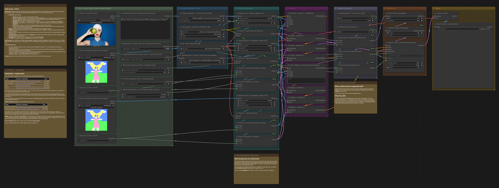

# The_frizzy1 — FireRed Image Edit 1.1 v1.0.0

> Edit a picture with a written instruction, or combine up to three pictures, with FireRed Image Edit 1.1. Core ComfyUI nodes only, Apache-2.0 model.

| | |
|---|---|
| **Model family** | FireRed Image Edit 1.1 (loads as a Qwen Image Edit model in ComfyUI) |
| **Tasks** | Image edit · multi-image edit (up to 3 pictures) |
| **Min VRAM** | 12 GB is the target. **Not verified on 12 GB** (see Hardware & VRAM) |
| **Tested on** | RTX PRO 4000 Blackwell 24 GB · 64 GB RAM · ComfyUI 0.45.3 (frontend 1.57.6) |
| **CivitAI** | Not published |
| **Hugging Face** | Not published |
| **YouTube explainer** | Not published |
| **License** | Workflow: MIT · FireRed Image Edit 1.1 and its Lightning LoRA: Apache-2.0 · the community conversions are tagged Apache-2.0 on their pages · text encoder and VAE: see [Comfy-Org/Qwen-Image_ComfyUI](https://huggingface.co/Comfy-Org/Qwen-Image_ComfyUI) |

## Preview

<p align="center">
  
  
</p>

<sub>Left: the default run, "replace the white swim cap with a wide-brimmed straw hat with a red ribbon", seed 22112026, Lightning on, 23 s. Right: three pictures combined (the man, the bottle, the forest), same seed, Lightning on, 55 s. The seed input changes after every run, so set it back to 22112026 to repeat these. The source pictures, from the lab's standard inputs:</sub>

<p align="center"></p>

<p align="center"></p>

## Overview
Built from ComfyUI's built-in template `image_firered_image_edit1_1` and restructured: numbered groups, every input you change in group 1, notes inside. Three things differ from the template. It loads a 20.6 GB int8 convrot file instead of the 40.9 GB one. Lightning (8 steps, the template's own LoRA) is on by default. And the pictures are resized and encoded in the graph instead of inside the text encoder node, which removed a strip the template's wiring left on the right edge of every 16:9 test result.

## Capabilities
- `The_frizzy1_firered-image-edit-1.1_v1.0.0.json`: one picture plus an instruction gives an edited picture of the same shape, about 1 megapixel by default.
- Picture 2 and Picture 3 are optional, each with its own on/off input in group 1.
- Lightning on: 8 steps, CFG 1, with the Lightning LoRA the template loads (`FireRed-Image-Edit-1.0-Lightning-8steps-v1.0`). Lightning off: 40 steps, CFG 4, no LoRA (the template's settings). One input switches model, steps and CFG together.
- euler / simple, shift 3.1, CFGNorm 1, as in the template.
- Colour-coded groups: your inputs (green) · models (blue) · pictures (teal) · prompt (purple) · Lightning switch (grey-blue) · sampling (orange) · save (amber).

## Hardware & VRAM
All numbers are from one machine: RTX PRO 4000 Blackwell 24 GB, ComfyUI 0.45.3 started without any VRAM limit. It is not a 12 GB card.

| Run | Peak VRAM (whole GPU) |
|---|---|
| One picture, 1 megapixel, Lightning on or off | 21.8 to 23.2 GiB |
| Two or three pictures, Lightning on | 21.9 to 23.3 GiB |
| One picture, 2 megapixels, Lightning on | 22.9 GiB |

- **Not verified on 12 GB.** ComfyUI fills the memory it finds, so these figures show what a 24 GB card uses, not what the workflow needs. About 0.45 GiB of each figure was held by other programs.
- The 20.6 GB model does not fit in 12 GB, so on a 12 GB card ComfyUI keeps part of it in system RAM and runs slower than the times below. RAM use was not measured.
- Earlier the same day the same graph (with a different Lightning LoRA) peaked at 12.6 to 13.0 GiB in a session where ComfyUI held its models to about 12 GB. That session's start flags were not saved, so this is a pointer, not a result.
- Peak VRAM is the highest whole-GPU reading of `nvidia-smi`, sampled once per second, MiB / 1024.

## Required models
See the per-workflow [downloads.md](downloads.md) for the full table with verified links.
Every file below was read from the workflow `.json`.

```
ComfyUI/models/
├── diffusion_models/   ← FireRed-ImageEdit-1.1_int8_convrot_WT.safetensors            (20.6 GB)
├── text_encoders/      ← qwen_2.5_vl_7b_fp8_scaled.safetensors                        (9.4 GB)
├── vae/                ← qwen_image_vae.safetensors                                   (0.25 GB)
└── loras/              ← FireRed-Image-Edit-1.0-Lightning-8steps-v1.0.safetensors     (0.85 GB)
```

About 31.0 GB. The text encoder and VAE are the Qwen Image files.

## Required custom nodes
None. Run on ComfyUI 0.45.3 only; older versions were not tested.

Core nodes used (19, plus the frontend's MarkdownNote for the notes): CFGNorm, CLIPLoader, ComfySwitchNode, ImageScaleToTotalPixels, KSampler, LoadImage, LoraLoaderModelOnly, ModelSamplingAuraFlow, PrimitiveBoolean, PrimitiveFloat, PrimitiveInt, PrimitiveStringMultiline, ReferenceLatent, SaveImage, TextEncodeQwenImageEditPlus, UNETLoader, VAEDecode, VAEEncode, VAELoader. Each one's module in `/object_info` of ComfyUI 0.45.3 is `nodes` or `comfy_extras.*`.

## Optional custom nodes
None.

## Installation
1. Update ComfyUI (0.45.3 is the version this was run on).
2. Download the four files ([downloads.md](downloads.md), or the Downloads note inside the workflow).
3. Load `The_frizzy1_firered-image-edit-1.1_v1.0.0.json`, load your picture in **Picture 1**, write the instruction, press **Run**.

## Recommended settings
| Setting | Value | Notes |
|---|---|---|
| Lightning | on | 8 steps, CFG 1. 19 to 22 s per picture on the test card |
| Lightning off | Steps 40, CFG 4 | template defaults. 3 min 10 s per picture |
| Megapixels | 1 | sets picture 1 and the result; pictures 2 and 3 are always 1 megapixel. 2 was run once (1936x1088, 52 s) |
| Sampler / scheduler / shift | euler / simple / 3.1 | from the template; others not tested |
| Picture 2, Picture 3 | off | turn on only with a picture loaded |
| Seed | changes every run | set "control after generate" to fixed to keep a picture |

## Inputs / Outputs
- **Inputs:** one picture and an instruction; optionally a second and third picture. Lightning, megapixels, steps, CFG and seed are in group 1 too.
- **Outputs:** a PNG in `output/FireRed/`, the shape of Picture 1 with sides rounded to a multiple of 16 (a 1368x768 picture gave 1360x768).

## Performance
One run each unless noted, on the machine above (24 GB, no VRAM limit), model files already in the disk cache:

| Run | Settings | Time | Peak VRAM |
|---|---|---|---|
| One picture, with model load | 1360x768, Lightning on | 23 s | 22.8 GiB |
| One picture, models loaded | 1360x768, Lightning on | 19 s | 21.8 GiB |
| One picture, other pictures | 1248x832 (two runs) and 768x1360 (two runs), Lightning on | 21 to 22 s | 22.8 to 23.2 GiB |
| Two pictures | 768x1360, Lightning on | 36 s | 23.1 GiB |
| Three pictures | 768x1360, Lightning on | 51 to 55 s (three runs) | 21.9 to 23.3 GiB |
| One picture, 2 megapixels | 1936x1088, Lightning on | 52 s | 22.9 GiB |
| One picture, Lightning off | 1360x768, 40 steps, CFG 4 | 3 min 10 s | 22.9 GiB |

One more run was started from App mode with the Run button (defaults): 20.5 s from the click to the saved picture.

RTX 3060 12 GB: Not verified. Expect longer times than these: the model will not fit in VRAM there.

## Known issues
- **Fine dotted texture on snow:** in the forest-to-winter test the snow on the distant trees shows a fine dotted texture when the picture is enlarged. It was there with all three model files, both Lightning LoRAs, four samplers, three schedulers and four shift values; with Lightning off it was weaker, not gone. A sunset edit of the same picture and the three-picture forest results did not show it. Qwen Image users report the same kind of pattern ([discussion](https://huggingface.co/Qwen/Qwen-Image/discussions/52)); FireRed loads as a Qwen Image Edit model.
- **The newer Lightning LoRA is not used:** `FireRed-Image-Edit-1.1-Lightning-8steps-v1.2.safetensors` put a woven pattern over the foliage of the three-picture test in 8 of 8 settings tried (8, 12 and 16 steps, strength 0.8, shift 2, er_sde, the authors' 40.9 GB model). The template's LoRA, which this file loads, was clean with 3 of 3 seeds. On the flat-background hat picture both LoRAs looked fine.
- **The template's edge strip:** with the built-in template's wiring, the 16:9 test picture came out with a skin-coloured strip, 8 px wide, on the lower right edge in 8 of 8 runs earlier the same day (three model files, two LoRAs, Lightning on and off). The left edge of the picture wraps around when a picture side divided by 8 is odd. This workflow resizes to multiples of 16 and sets the reference latents itself: none of the runs of that picture had the strip (numeric check), and the edges of the other final pictures were checked enlarged, by eye.
- **Text is not reliable:** asked earlier the same day to add the word FIRERED to a bottle, it wrote FIRSERED and replaced a line of small print. One try, with the newer LoRA; not repeated.
- **Left and right:** in the three-picture and two-picture tests the man held the bottle in his left hand; the instruction said right (4 of 4 runs).
- **Picture 3 without Picture 2** was not tested. Use Picture 2 first.
- **Picture 2 and 3 loaders must point at an existing file** even when switched off. They are set to `example.png`, which ships with ComfyUI.
- **Community model file:** the default int8 file comes from a single uploader, not from the model authors or Comfy-Org. If it disappears, the fp8 file or the authors' file work in the same loader (see downloads.md). Those two were run only earlier the same day, with the newer LoRA.
- **Seed:** the Seed input changes after every run. Set it to fixed to repeat a picture.
- The instructions are my own: the lab's standard `prompts.json` was not in the inputs folder.
- The browser checks (screenshot, one App mode run) used frontend 1.57.6, older than the 1.58.5 that ComfyUI 0.45.3 asks for.

## Changelog
See [changelog.md](changelog.md).

## Related workflows
- [Qwen Image 2.1 Ultimate · 12 GB](../../qwen/image-2.1-ultimate-12gb) · [Flux Kontext GGUF](../../flux/kontext) · [Fibo 2.0 Edit Turbo · 12 GB](../../fibo/fibo2-edit-12gb)
