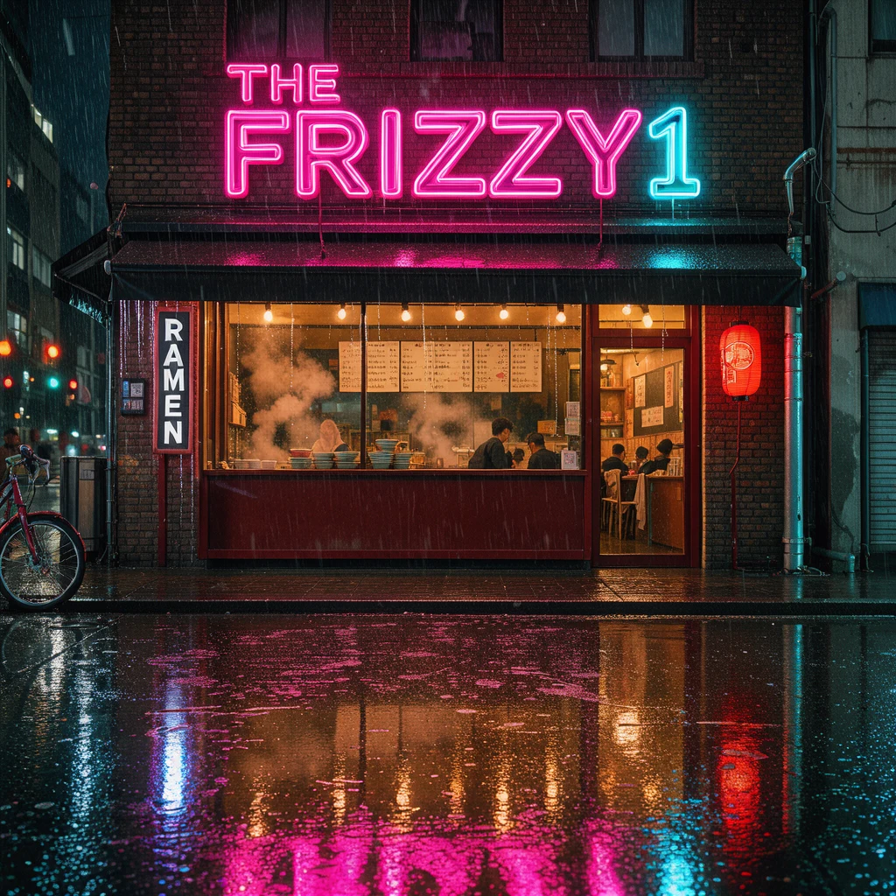

# The_frizzy1 — FLUX 3 Klein · 12 GB v1.0.0

☕ If this workflow saved you time: **[Buy me a coffee](https://buymeacoffee.com/the_frizzy1)**

> FLUX 3 Image Klein (Black Forest Labs, 5.6B) on a 12 GB card: text to image, and editing with 1 to 4 reference
> images, with BFL's own prompt upsampler. Two workflow files, core ComfyUI nodes only.

| | |
|---|---|
| **Model family** | FLUX 3 Image Klein (distilled, int8) |
| **Tasks** | Text → Image · Edit · Multi-reference (up to 4 here) · Bounding boxes |
| **Needs** | 12 GB VRAM · 32 GB system RAM (ComfyUI peaked at 4.1 GB) · ComfyUI **0.41+** |
| **Tested on** | RTX 3060 12 GB · Ryzen 5 5600X · 32 GB RAM · ComfyUI 0.43.1 · sage attention |
| **YouTube explainer** | (no video yet) |
| **License** | Workflow: MIT · FLUX 3 Image Klein: FLUX Kommunity License |

## Quick start
1. Update ComfyUI to **0.41 or newer** (FLUX 3 Image support; no custom nodes).
2. Accept BFL's terms on Hugging Face, then download the 4 files in [downloads.md](downloads.md).
3. Text to image: load `The_frizzy1_flux3-klein-t2i-12gb_v1.0.0.json`, write your prompt, **Run**.
4. Editing: load `The_frizzy1_flux3-klein-edit-12gb_v1.0.0.json`, load your photo as image 1 (and a reference as image 2), say what to change, **Run**.

## Preview

Made by these workflows on the RTX 3060: text to image, a neon sign with text, and two images combined.

## The two files

| File | What it does |
|---|---|
| `The_frizzy1_flux3-klein-t2i-12gb_v1.0.0.json` | Text to image, optional bounding boxes |
| `The_frizzy1_flux3-klein-edit-12gb_v1.0.0.json` | Edit image 1, add images 2 to 4 as references (3 and 4 are muted, Ctrl+M to use them) |

Both are BFL's official int8 graphs with my notes, a 1 MP default for 12 GB, and the model names left bare so they
load from any folder layout.

## Why the prompt upsampler is on

BFL's model card says to always run one: Klein was trained on long scene captions, and a short prompt typed as is
gives generic pictures. The upsampler (Qwen3.5 9B, w4a8) writes that caption for you and, in edit mode, looks at your
images first. You see what it wrote in **Upsampled prompt**. Turn it off with *enable upsampler* if you write the
long caption yourself.

## Measured on the RTX 3060

*Wall* = queue to finished image. VRAM is the whole card as nvidia-smi reports it (about 0.7 GB is Windows).

| Run | Size | Wall | Peak VRAM | Peak RAM (ComfyUI) |
|---|---|---|---|---|
| Text to image, first run after starting ComfyUI (loads the files) | 1 MP | 50 s | 11.0 GB | not measured |
| Text to image, new prompt (upsampler + image) | 1 MP | 25 s | 11.2 GB | 3.8 GB |
| Text to image, same prompt, new seed (upsampled prompt reused) | 1 MP | 14 s | 11.1 GB | 3.8 GB |
| Text to image, same prompt | 4 MP | 1 min 16 s | 11.2 GB | 4.0 GB |
| Edit, one image, new prompt | 1 MP | 41 s | 11.3 GB | 4.0 GB |
| Edit, two images, new prompt | 1 MP | 1 min 5 s | 11.4 GB | 4.1 GB |

4 MP works on 12 GB, the sky in my test image showed some banding. My 1 MP results looked clean.

## Required models
See [downloads.md](downloads.md): 4 files, 17.8 GB, every file name read from the workflow `.json`.

## Required custom nodes
None - core ComfyUI **0.41+**.

## Troubleshooting
- **Images 3 and 4 do nothing:** they are muted. Select them and press **Ctrl+M** to use them.
- **Generic looking pictures:** check that *enable upsampler* is on, or write a long scene caption yourself.

## License

Workflow: MIT. The model is under the FLUX Kommunity License: non-commercial use, and commercial use of outputs if
your revenue is under US$5M (read the license on the model page). Qwen3-VL-4B and the prompt upsampler: Apache-2.0.
