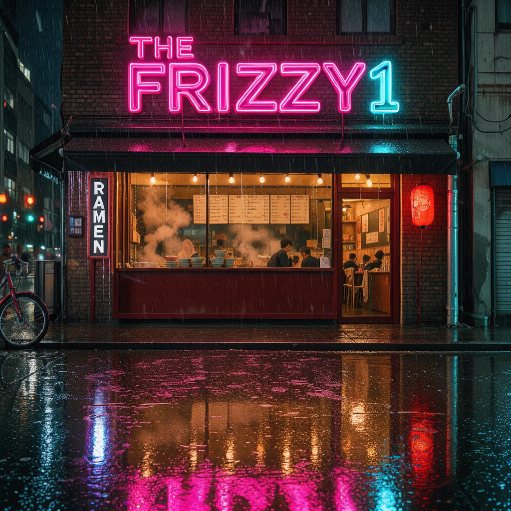
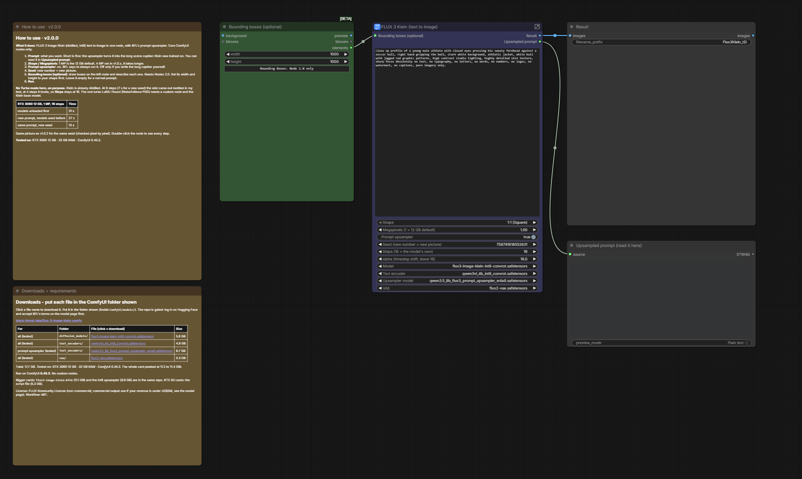

# The_frizzy1 - FLUX 3 Klein · 12 GB v2.0.0

☕ If this workflow saved you time: **[Buy me a coffee](https://buymeacoffee.com/the_frizzy1)**

> FLUX 3 Image Klein (Black Forest Labs, 5.6B) on a 12 GB card: text to image, and editing with 1 to 4 reference
> images, with BFL's own prompt upsampler. New in v2.0.0: text to image is one node. There is also a lighter one-photo edit file without the upsampler, for 6 to 8 GB
> cards (ran inside a 6 GiB budget, not yet on a real 6 or 8 GB card). Three workflow files, core ComfyUI nodes only.

| | |
|---|---|
| **Model family** | FLUX 3 Image Klein (distilled, int8) |
| **Tasks** | Text → Image · Edit · Multi-reference (up to 4 here) · Bounding boxes · Low-VRAM edit (one photo) |
| **Needs** | 12 GB VRAM · 32 GB system RAM (ComfyUI peaked at 4.1 GB) · ComfyUI **0.41+** |
| **Tested on** | Text to image v2.0.0: RTX 3060 12 GB · 32 GB RAM · ComfyUI 0.45.3. v1.0.x files: RTX 3060 12 GB · Ryzen 5 5600X · 32 GB RAM · ComfyUI 0.43.1 · sage attention. Low-VRAM edit file (v1.1.0): RTX PRO 4000 Blackwell 24 GB capped to 6, 8 and 12 GiB budgets · 64 GB RAM · ComfyUI 0.45.3 |
| **ComfyUI 0.45.3** | The text to image file (v2.0.0) and the low-VRAM edit file ran on 0.45.3. The edit file (v1.0.2: notes changed only since v1.0.1) was not run on 0.45.3. All nodes are core in 0.45.3. |
| **YouTube explainer** | (no video yet) |
| **License** | Workflow: MIT · FLUX 3 Image Klein: FLUX Kommunity License |

## Quick start
1. Update ComfyUI to **0.41 or newer** (FLUX 3 Image support; no custom nodes).
2. Accept BFL's terms on Hugging Face, then download the 4 files in [downloads.md](downloads.md).
3. Text to image: load `The_frizzy1_flux3-klein-t2i-12gb_v2.0.0.json`, write your prompt, **Run**.
4. Editing: load `The_frizzy1_flux3-klein-edit-12gb_v1.0.2.json`, load your photo as image 1 (and a reference as image 2), say what to change, **Run**.
5. 6 or 8 GB card, or no room for the upsampler: download flux3-image-klein-int8-convrot, qwen3vl_4b_int8_convrot and flux2-vae (skip the upsampler), load `The_frizzy1_flux3-klein-edit-lowvram_v1.1.0.json`, load your photo, write the whole instruction, **Run**.

## Preview

Made by the v1.0.x workflows on the RTX 3060: text to image, a neon sign with text, and two images combined.

Made by the low-VRAM edit file inside a 6 GiB budget: new light on a portrait and on a product shot, 1 MP, 16 steps. The same seed gave the same picture at 6, 8 and 12 GiB.

## The three files

| File | What it does |
|---|---|
| `The_frizzy1_flux3-klein-t2i-12gb_v2.0.0.json` | Text to image, optional bounding boxes |
| `The_frizzy1_flux3-klein-edit-12gb_v1.0.2.json` | Edit image 1, add images 2 to 4 as references (3 and 4 are muted, Ctrl+M to use them) |
| `The_frizzy1_flux3-klein-edit-lowvram_v1.1.0.json` | Edit one photo, no prompt upsampler, 3 files (11.0 GB). For 6 to 8 GB cards. Flat graph, App mode inputs set (not run from App mode) |

The text to image file (v2.0.0) is BFL's official int8 graph in one node: prompt, shape, megapixels, upsampler on/off, seed and steps on
the outside (and in App mode), the optional box editor beside it. The edit file is BFL's graph with my notes. Both have a 1 MP default
and bare model names, so pick the files in the node if yours are in a subfolder. The low-VRAM file is BFL's `flux3_klein_int8_i2i` template rebuilt flat without the upsampler:
same model, 16 steps, CFG 1, euler / simple, shift 2.77 (alpha 16).

## Why the prompt upsampler is on

BFL's model card says to always run one: Klein was trained on long scene captions, and a short prompt typed as is
gives generic pictures. The upsampler (Qwen3.5 9B, w4a8) writes that caption for you and, in edit mode, looks at your
images first. You see what it wrote in **Upsampled prompt**. Turn it off with *Prompt upsampler* (edit file: *enable upsampler*) if you write the
long caption yourself.

## Text to image v2.0.0 on the RTX 3060, and why there is no Turbo mode

RTX 3060 12 GB, 32 GB RAM, ComfyUI 0.45.3, default attention, 1 MP, upsampler on. Time = sending the job to the saved picture, one run
each. "Models unloaded" = ComfyUI kept running, models and cache freed first (not a fresh start).

| Run | 16 steps (the file) | 8 steps (test) | 4 steps (test) |
|---|---|---|---|
| Models unloaded, upsampler + picture | 31 s | 25 s | not run |
| New prompt, models used before | 27 s | not run | not run |
| Same prompt, new seed | 13 s | 7 s | 6 s |
| Peak VRAM, whole card | 11.3 to 11.4 GiB | 11.2 to 11.4 GiB | 11.3 GiB |

ComfyUI's RAM (working set) peaked at 2.0 GiB. The saved file gives the same pixels as v1.0.2 (checked once, seed 758781618552631).

Bounding boxes: one test with one box (a balloon) gave the same caption and pixels as v1.0.2, but the upsampler left the balloon out in both,
so check the upsampled prompt when you use boxes. Boxes drawn by hand in Nodes 2.0 were not tested in v2.0.0.

Klein is already distilled. At 8 steps the skin came out mottled in the close-up test (the second test prompt looked fine), at 4 steps it
broke. A mode that costs that much picture for 6 seconds is not worth a switch, so there is none; **Steps** is on the node if you want to
try. One turbo LoRA exists ([NoiseToNova PDD](https://huggingface.co/NoiseToNova/Flux-3-Klein-turbo-pdd-4_8-steps), 4 and 8 steps): it is
for the Klein **base** model and needs a custom node, so it was not used or tested here.

## Low-VRAM edit file: measured inside 6, 8 and 12 GiB budgets

There is no 6 or 8 GB card in the lab. The 24 GB lab card ran a second ComfyUI 0.45.3 with `--reserve-vram` set so that
ComfyUI could use only 6, 8 or 12 GiB, and `--disable-all-custom-nodes`. Peak = the ComfyUI process as nvidia-smi
reports it, once per second; other programs held 0.86 GiB on top. *Wall* = queue to finished picture. 64 GB system RAM.

| Run (1 MP, 16 steps) | Output | 6 GiB budget | 8 GiB budget | 12 GiB budget |
|---|---|---|---|---|
| Portrait, first run after starting ComfyUI (loads the files, which were in the OS file cache) | 1360x768 | 17 s · 5.93 GiB | 17 s · 7.93 GiB | 17 s · 10.71 GiB |
| Same portrait, new seed | 1360x768 | 15 s · 5.93 GiB | 15 s · 7.90 GiB | 15 s · 10.75 GiB |
| Product shot, new photo + new text | 768x1360 | 16 s · 5.93 GiB | 16 s · 7.93 GiB | 16 s · 10.80 GiB |

ComfyUI stays inside the budget it gets by keeping part of the model in system RAM, so the peak follows the budget;
it is not the smallest card the file needs. The time did not change with the budget on this card. A real 6 or 8 GB card is a slower GPU
and may lose more time moving the model from RAM: not measured. RAM use was not measured. Same seed,
same picture at every budget (checked by hash).

## Measured on the RTX 3060 (v1.0.x files)

*Wall* = queue to finished image. VRAM is the whole card as nvidia-smi reports it (about 0.7 GB is Windows).

| Run | Size | Wall | Peak VRAM | Peak RAM (ComfyUI) |
|---|---|---|---|---|
| Text to image, first run after starting ComfyUI (loads the files) | 1 MP | 50 s | 11.0 GB | not measured |
| Text to image, new prompt (upsampler + image) | 1 MP | 25 s | 11.2 GB | 3.8 GB |
| Text to image, same prompt, new seed (upsampled prompt reused) | 1 MP | 14 s | 11.1 GB | 3.8 GB |
| Text to image, same prompt | 4 MP | 1 min 16 s | 11.2 GB | 4.0 GB |
| Edit, one image, new prompt | 1 MP | 41 s | 11.3 GB | 4.0 GB |
| Edit, two images, new prompt | 1 MP | 1 min 5 s | 11.4 GB | 4.1 GB |

4 MP works on 12 GB, the sky in my test image showed some banding. My 1 MP results looked clean.

## Required models
See [downloads.md](downloads.md): 4 files, 17.7 GB, every file name read from the workflow `.json`. The low-VRAM edit file needs only
flux3-image-klein-int8-convrot, qwen3vl_4b_int8_convrot and flux2-vae (11.0 GB), not the upsampler.

## Required custom nodes
None - core ComfyUI **0.41+**.

Core nodes used: UNETLoader, CLIPLoader, VAELoader, CLIPTextEncode, TextGenerateV2 (edit file: TextGenerate), Flux3LayoutPrompt, CreateBoundingBoxes,
EmptyFlux2LatentImage, ModelSamplingFlux, KSampler, VAEDecode, SaveImage, PreviewAny, ResolutionSelector, ComfySwitchNode,
ComfyMathExpression, PrimitiveFloat, PrimitiveInt, PrimitiveBoolean, PrimitiveStringMultiline, StringConcatenate, StringContains, StringTrim. The edit file
also uses LoadImage, BatchImagesNode, ReferenceMultiLatent, RepeatLatentBatch, ImageScaleToTotalPixels, GetImageSize, StringFormat.
The low-VRAM edit file: LoadImage, UNETLoader, CLIPLoader, VAELoader, CLIPTextEncode, ImageScaleToTotalPixels, GetImageSize,
ReferenceMultiLatent, EmptyFlux2LatentImage, ModelSamplingFlux, KSampler, VAEDecode, SaveImage, PrimitiveStringMultiline,
PrimitiveFloat, PrimitiveInt.

## Faster attention
Start ComfyUI with `--use-sage-attention` (less VRAM). `--use-ck-attention` changes the image for the same seed.

## Troubleshooting
- **Images 3 and 4 do nothing:** they are muted. Select them and press **Ctrl+M** to use them.
- **Generic looking pictures:** check that *enable upsampler* is on, or write a long scene caption yourself. In the low-VRAM file
  there is no upsampler: write the change and what must stay, as in the default text.
- **GGUF files of Klein (unsloth and others):** they need the ComfyUI-GGUF custom node; core ComfyUI 0.45.3 has no GGUF loader.
  The low-VRAM file uses BFL's int8 file (5.8 GB), which core ComfyUI loads and streams from RAM when VRAM is short.
- **TrueRelight LoRA (pandacooming) does nothing:** on ComfyUI 0.45.3 the log shows `lora key not loaded` for all 516 of its
  keys. It is saved with diffusers key names, which core ComfyUI does not map for FLUX 3 yet (current ComfyUI master is the
  same). That is why this folder has no relight LoRA. The low-VRAM file can still change the lighting from the text alone
  (the samples above); it was not compared with the LoRA.

## License

Workflow: MIT. The model is under the FLUX Kommunity License: non-commercial use, and commercial use of outputs if
your revenue is under US$5M (read the license on the model page). Qwen3-VL-4B and the prompt upsampler: Apache-2.0.
