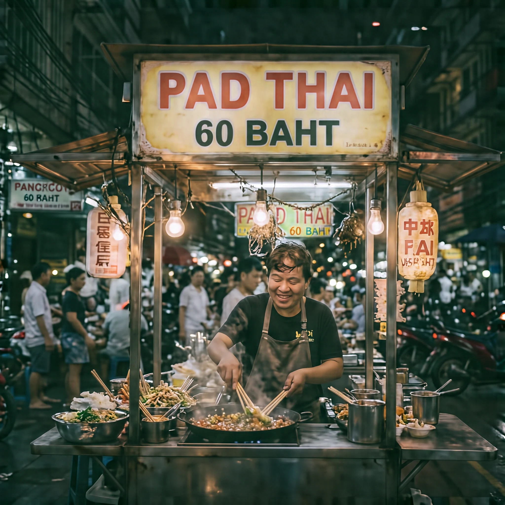
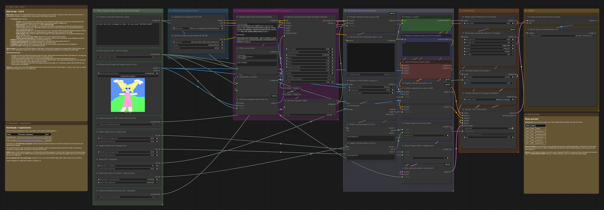

# The_frizzy1 — HiDream-O1-Image · 12 GB v1.0.0

> HiDream-O1-Image (8B, MIT): text to image at 2048x2048, or edit your picture with a short instruction. Gemma 4 can rewrite the prompt first. Core ComfyUI nodes only.

| | |
|---|---|
| **Model family** | HiDream-O1-Image (HiDream.ai), full (undistilled) model, Comfy-Org fp8 file |
| **Tasks** | Text → Image · Image edit (one picture + instruction) · optional prompt rewrite (Gemma 4 E4B) |
| **Min VRAM** | 12 GB is the target. **Not verified on 12 GB** (ran inside a 10 GiB ComfyUI budget on a 24 GB card, see Hardware & VRAM) |
| **Tested on** | RTX PRO 4000 Blackwell 24 GB · 64 GB RAM · ComfyUI 0.45.3 |
| **CivitAI** | Not published |
| **Hugging Face** | Not published |
| **YouTube explainer** | Not published |
| **License** | Workflow: MIT · HiDream-O1-Image: [MIT](https://huggingface.co/HiDream-ai/HiDream-O1-Image) · Gemma 4 (Comfy-Org repackage): Apache-2.0 |

## Preview

<p align="center">
  
  
</p>

<sub>Left: the default settings (text to image, 2048x2048, 40 steps, CFG 5, seed 24112026, prompt "A street food stall in Bangkok at night, the sign reads 'PAD THAI 60 BAHT'"), 140 s. Right: edit mode on `klein_ref_autumn_forest.jpg` (1776x1184) with "Make it winter: cover the trees and the hills with snow.", seed 1, result 1760x1184, 171 s. Both inside a 10 GiB ComfyUI budget.</sub>

<p align="center"></p>

## Overview
Built from ComfyUI's built-in template `image_hidream_o1` and restructured: the prompt-rewrite subgraph unpacked, six numbered groups, every input in group 1 (App mode shows them), and three notes (How to use, Downloads + requirements, Sizes and why). The sampler settings are the template's: 40 steps, CFG 5, dpmpp_2m_sde_gpu, normal scheduler, noise scale 8, patch seam smoothing. Differences from the template: the fp8 checkpoint instead of bf16; Width, Height, Steps and Seed are inputs in group 1; a new default prompt; Gemma only gets the picture in edit mode (the template also passes it in text to image mode); the template's `TextGenerate` (marked deprecated in ComfyUI 0.45.3) is replaced by `TextGenerateV2` with the same settings; the picture loader starts with `example.png`; and a **Resize picture to 4 MP?** switch in group 1.

HiDream-O1 works directly on pixels: no VAE file and no separate text encoder. The Gemma file is only for the optional prompt rewrite.

## Capabilities
- Text to image, 2048x2048 by default. Readable sign text came out with the plain prompt (one seed, with both the fp8 and the bf16 file).
- Edit: switch **Edit a picture** on, load a picture and write a short instruction. The result has the picture's size rounded down to 32 px.
- The **Picture to edit** loader must always hold a picture, also in text-to-image mode: ComfyUI checks the file before every run. It starts with `example.png`, which comes with ComfyUI.
- Optional prompt rewrite with Gemma 4 E4B (template instructions), switch in group 1, off by default.
- **Resize picture to 4 MP?** switch in group 1 (off by default): for big phone photos in edit mode. It always resizes to 4 MP, so a smaller picture gets bigger.
- Colour-coded groups: your inputs (green) · models (blue) · Gemma rewrite (purple) · prompt, picture and size (grey-blue) · sampling (orange) · save (amber).

## Hardware & VRAM
All numbers are from one machine: RTX PRO 4000 Blackwell 24 GB, ComfyUI 0.45.3. Peak VRAM is the whole-GPU peak from nvidia-smi (read about 3 times a second), in GiB (MiB / 1024). About 0.9 GiB of it was held by other programs.

| Run | No limit (lab ComfyUI) | 10 GiB ComfyUI budget (second ComfyUI, `--reserve-vram 13.89`, no custom nodes) |
|---|---|---|
| Template unchanged (fp8 file swapped in), 2048x2048, cold | 134 s · 12.2 GiB | not run |
| Text to image, defaults (sample 1) | 135 s · 19.9 GiB | 140 s · 11.3 GiB |
| Edit 1776x1184 picture (sample 2 settings) | 169 to 170 s · 11.2 to 23.4 GiB | 171 s · 11.3 GiB |
| Text to image with Gemma rewrite on (run with the template's `TextGenerate`, before the swap to `TextGenerateV2`) | 152 s · 20.0 GiB | 334 s · 11.3 GiB |
| Edit with **Resize picture to 4 MP?** on (result 2496x1664) | 384 s · 20.9 GiB (earlier graph, node un-bypassed by hand) | 384 s · 11.6 GiB |
| Edit with Gemma rewrite on (sample 2 settings) | not run | 326 s · 11.5 GiB |

- In the 10 GiB budget the pictures were pixel-identical to the runs without a limit (text to image and edit compared).
- The text-to-image default was also run on a ComfyUI whose `input/` folder held only `example.png` (as on a fresh install): it ran, 135 s · 11.3 GiB, the same pixels as sample 1. With the earlier default picture (`klein_ref_autumn_forest.jpg`) that ComfyUI refused the run: "Invalid image file".
- Without a limit ComfyUI fills whatever room the card has, so those peaks say nothing about the need.
- **Not verified on 12 GB.** The budget is ComfyUI's own limit on a 24 GB card, not a hard one.
- With Gemma on, the budget doubled the time (152 s → 334 s): Gemma and HiDream are loaded in turn.

## Required models
See the per-workflow [downloads.md](downloads.md) for the full table with verified links.
Every file below was read from the workflow `.json`.

```
ComfyUI/models/
├── checkpoints/     ← hidream_o1_image_fp8_scaled.safetensors   (8.07 GB)
└── text_encoders/   ← gemma4_e4b_it_fp8_scaled.safetensors      (9.06 GB)
```

Both files are required. ComfyUI checks the Gemma loader even when the rewrite is off and refuses the prompt without the file (tested: "Value not in list" on the Gemma loader).

## Required custom nodes
None. Run on ComfyUI **0.45.3** only; older versions were not tested. HiDream-O1 support came with [PR #13817](https://github.com/Comfy-Org/ComfyUI/pull/13817) (May 2026).

Core nodes used: BasicScheduler, CLIPLoader, CLIPTextEncode, CheckpointLoaderSimple, ComfyMathExpression, ComfySwitchNode, EmptyHiDreamO1LatentImage, GetImageSize, HiDreamO1PatchSeamSmoothing, HiDreamO1ReferenceImages, ImageScaleToTotalPixels, JsonExtractString, KSamplerSelect, LoadImage, ModelNoiseScale, PreviewAny, PrimitiveBoolean, PrimitiveInt, PrimitiveStringMultiline, RegexReplace, SamplerCustom, SaveImage, StringConcatenate, StringReplace, TextGenerateV2, VAEDecode, and MarkdownNote (the frontend's note node). The module of each of the 26 backend nodes in `/object_info` of ComfyUI 0.45.3 is `nodes` or `comfy_extras`.

## Optional custom nodes
None.

## Installation
1. Update ComfyUI (0.45.3 is the tested version).
2. Download the two files ([downloads.md](downloads.md), or the Downloads note inside the workflow).
3. Load `The_frizzy1_hidream-o1-12gb_v1.0.0.json`, write your prompt in group 1, press **Run**. Keep a picture in the **Picture to edit** loader, also for text to image (`example.png` from ComfyUI is preset; ComfyUI refuses the run if the loader's file is missing).

## Recommended settings
| Setting | Value | Notes |
|---|---|---|
| Width x Height | 2048x2048 or another trained size (Sizes note) | the core node says lower sizes lose quality; lower sizes were not tested |
| Steps / CFG | 40 / 5 | template; HiDream's own script uses 50 steps. Other values not tested |
| Sampler | dpmpp_2m_sde_gpu, normal | template. euler was run once on an edit: softer, fewer top-edge squares |
| Gemma rewrite | off | on, the sign text was misspelt in 2 of 2 seeds; in edit mode it replaced the picture (1 run) |
| Edit instruction | short ("Make it winter: …") | a long scene description ignored the source picture (1 run) |

## Inputs / Outputs
- **Inputs:** a prompt; for edit mode one picture (any size; 1776x1184 was tested).
- **Outputs:** one png in `output/HiDream-O1/`.

## Performance
See Hardware & VRAM. On the lab card: 135 to 140 s for 2048x2048 text to image, 170 s for an edit of a 2.1 MP picture. Not timed on an RTX 3060.

## Known issues
- **Faint 32 px squares in flat areas.** The model works on 32 px patches. In edits of a cloudy sky the top strip (first 32 to 64 px) showed visible squares in 3 of 3 fp8 seeds, in one of them a bright block. The bf16 file (16.4 GB) and the euler sampler showed weaker squares in one run each; stronger seam smoothing (ramp 2-4-8 from 60 %, 271 s) and the 4 MP resize did not remove them. In the three text-to-image pictures no squares were visible at half size, but a measured 32 px grid score says a weak grid is there too.
- **Long instructions in edit mode** make a new picture instead of an edit: keep it short.
- **Gemma rewrite** makes richer scenes but misspelt the sign text in both runs. In edit mode (one run) it turned "Make it winter" into a long scene description and the result was a new snowy landscape, not an edit of the source picture: leave Gemma off for edits.
- Reddit users report a plastic look and weak anatomy compared with newer models; that was not judged here.

## Changelog
See [changelog.md](changelog.md).

## Related workflows
- [FLUX 3 Klein · 12 GB](../../flux/flux3-klein-12gb): text to image and edit with a prompt upsampler.
- [Bernini-R Image Edit](../../bernini/bernini-r): instruction edit.
- [Qwen Image 2.1 Ultimate · 12 GB](../../qwen/image-2.1-ultimate-12gb)
