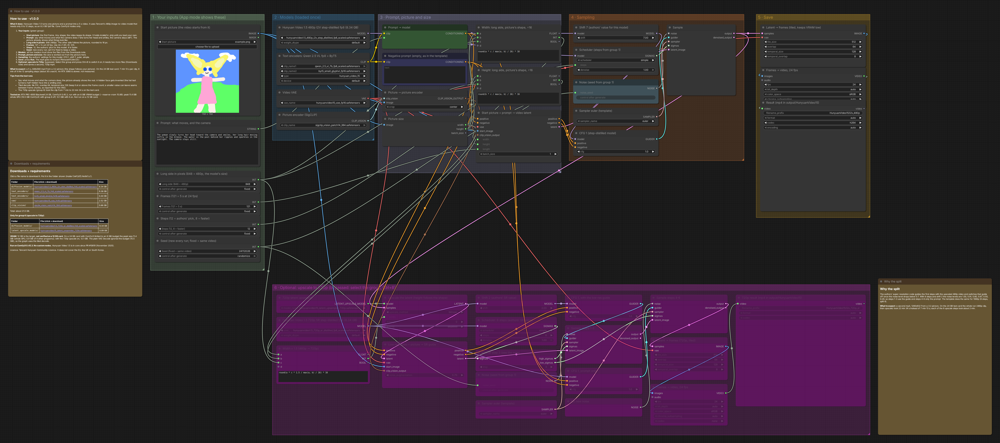

# The_frizzy1 — Hunyuan Video 1.5 I2V · 12 GB v1.0.0

> Turn one picture and a prompt into a 5 s video with Tencent's Hunyuan Video 1.5 (8.3B), using the 480p step-distilled model (12 steps) and an optional 720p upscale. Core ComfyUI nodes only.

| | |
|---|---|
| **Model family** | Hunyuan Video 1.5 |
| **Tasks** | I2V · optional 480p → 720p upscale (super-resolution) |
| **Min VRAM** | 12 GB is the target. **Not verified on 12 GB** (see Hardware & VRAM) |
| **Tested on** | RTX PRO 4000 Blackwell 24 GB · 64 GB RAM · ComfyUI 0.45.3 (frontend 1.57.6) |
| **CivitAI** | Not published |
| **Hugging Face** | Not published |
| **YouTube explainer** | Not published |
| **License** | Workflow: MIT · Hunyuan Video 1.5: [Tencent Hunyuan Community Licence](https://github.com/Tencent-Hunyuan/HunyuanVideo-1.5/blob/main/LICENSE), which **does not apply in the EU, the UK or South Korea** and needs a separate licence above 100 million monthly users · SigCLIP vision file: Apache-2.0 ([Comfy-Org/sigclip_vision_384](https://huggingface.co/Comfy-Org/sigclip_vision_384)) |

## Preview

<p align="center">
  
  
</p>

<sub>Left: the default settings with the woman-with-hat picture, 848x560, 121 frames, 12 steps, seed 24112026, 7 min 13 s. Right: the autumn-forest picture with group 6 (upscale to 720p) switched on, 1280x832, same seed, 22 min 34 s. The animated previews are 12 fps, 576 px wide; the clips are `samples/preview-1.mp4` (as saved) and `samples/preview-2.mp4` (re-encoded to 3 MB, CRF 26). The seed input changes after every run, so set it back to 24112026 to repeat these. The source pictures, from the lab's standard inputs:</sub>

<p align="center"></p>

<p align="center"></p>

## Overview
Built from ComfyUI's built-in template `video_hunyuan_video_1.5_720p_i2v` and restructured into numbered groups with every input in group 1 and the notes inside. The big change is the model: the template loads the 720p I2V model (16.7 GB fp16, 20 steps, CFG 6). This workflow loads the authors' 480p I2V **step-distilled** model as an 8.34 GB fp8 file, with their settings for it (12 steps, CFG 1, shift 7), which makes a 5 s clip in about 7 minutes on the test card. The template's optional 1080p upscale is replaced by the 480p → 720p pair the authors list for this model, bypassed by default.

## Capabilities
- `The_frizzy1_hunyuan-video-1.5-i2v-12gb_v1.0.0.json`: one picture plus a prompt gives a 121-frame, 24 fps mp4 (5 s).
- The video takes the picture's shape: the long side is 848 px by default, the other side follows the picture, rounded to 16 px (a 3:2 picture gives 848x560). The template used a fixed 1280x720 and cropped other shapes.
- 480p step-distilled model, 12 steps, CFG 1, shift 7, euler / simple (the authors' table; sampler and scheduler from the template).
- Group 6, bypassed: 720p latent upsampler + 720p super-resolution model, 6 steps, saves a second, 1.5x larger mp4.
- Tiled VAE decode in both paths (tile 512, overlap 64, 128 frames at a time).
- Colour-coded groups: your inputs (green) · models (blue) · prompt, picture and size (purple-grey) · sampling (orange) · save (amber) · optional upscale (magenta).

## Hardware & VRAM
All numbers are from one machine: RTX PRO 4000 Blackwell 24 GB. It is not a 12 GB card.

| Run | Peak VRAM (whole GPU) |
|---|---|
| ComfyUI with no VRAM limit, defaults, plain VAE Decode (first build) | 23.4 GiB |
| ComfyUI with a 10 GiB budget (`--reserve-vram 13.89`), plain VAE Decode | 12.4 GiB while sampling, **15.5 GiB in the decode** |
| Same budget, tiled decode only (sampling result cached) | 9.7 GiB |
| ComfyUI with an 8 GiB budget (`--reserve-vram 15.89`), shipped graph, defaults | 10.3 GiB while sampling, **11.4 GiB** in the decode |
| Same budget, group 6 (720p upscale) on | **12.1 GiB** |

- **Not verified on 12 GB.** With no limit ComfyUI fills the card, so the first row shows what a 24 GB card uses, not what the workflow needs. The budget rows are runs on the same 24 GB card with ComfyUI told to keep the rest free and custom nodes off; that is ComfyUI's own soft limit, not a 12 GB card.
- The plain VAE Decode ignored the budget (15.5 GiB). That is why both decodes in the graph are the tiled one. The tiled and plain decodes of the same latent differ by 41 to 43 dB PSNR (no visible difference).
- About 0.9 GiB of each capped figure was held by other programs, among them the idle lab ComfyUI.
- With group 6 on, the peak (12.1 GiB whole GPU, 11.2 GiB for ComfyUI) is at the edge of a 12 GB card even in the smaller budget.
- The 8 GiB budget did not slow sampling down (29.9 s per step, against 29.4 s with no limit) and gave the same frames as the 10 GiB run (PSNR 138 dB, i.e. identical).
- Peak VRAM is the highest whole-GPU reading of `nvidia-smi`, sampled about three times a second (1,294 readings in the 433 s run), MiB / 1024.

## Required models
See the per-workflow [downloads.md](downloads.md) for the full table with verified links.
Every file below was read from the workflow `.json`.

```
ComfyUI/models/
├── diffusion_models/        ← hunyuanvideo1.5_480p_i2v_step_distilled_fp8_scaled.safetensors   (8.34 GB)
│                            ← hunyuanvideo1.5_720p_sr_distilled_fp8_scaled.safetensors          (8.34 GB, group 6 only)
├── text_encoders/           ← qwen_2.5_vl_7b_fp8_scaled.safetensors                             (9.38 GB)
│                            ← byt5_small_glyphxl_fp16.safetensors                               (0.44 GB)
├── vae/                     ← hunyuanvideo15_vae_fp16.safetensors                               (2.52 GB)
├── clip_vision/             ← sigclip_vision_patch14_384.safetensors                            (0.86 GB)
└── latent_upscale_models/   ← hunyuanvideo15_latent_upsampler_720p.safetensors                  (0.09 GB, group 6 only)
```

About 21.5 GB without group 6, 30.0 GB with it.

## Required custom nodes
None. Run on ComfyUI 0.45.3 only; older versions were not tested. Hunyuan Video 1.5 came to core with ComfyUI PR #10819 (November 2025).

Core nodes used (26, plus the frontend's MarkdownNote for the notes): BasicScheduler, CFGGuider, CLIPTextEncode, CLIPVisionEncode, CLIPVisionLoader, ComfyMathExpression, CreateVideo, DisableNoise, DualCLIPLoader, GetImageSize, HunyuanVideo15ImageToVideo, HunyuanVideo15LatentUpscaleWithModel, HunyuanVideo15SuperResolution, KSamplerSelect, LatentUpscaleModelLoader, LoadImage, ModelSamplingSD3, PrimitiveInt, PrimitiveStringMultiline, RandomNoise, SamplerCustomAdvanced, SaveVideo, SplitSigmas, UNETLoader, VAEDecodeTiled, VAELoader. Each one's module in `/object_info` of ComfyUI 0.45.3 is `nodes` or `comfy_extras.*`, and both sample runs were done with `--disable-all-custom-nodes`.

## Optional custom nodes
None.

## Installation
1. Update ComfyUI (0.45.3 is the version this was run on).
2. Download the five files ([downloads.md](downloads.md), or the Downloads note inside the workflow). Add the two group 6 files if you want the 720p upscale.
3. Load `The_frizzy1_hunyuan-video-1.5-i2v-12gb_v1.0.0.json`, load your picture in **Start picture**, write what should move, press **Run**.

## Recommended settings
| Setting | Value | Notes |
|---|---|---|
| Long side in pixels | 848 | 480p, the size this model is made for. Other values were not run |
| Frames | 121 | 5 s at 24 fps, the template's length. Use 4n+1. Other lengths were not run |
| Steps | 12 | the authors recommend 8 or 12 for this model; 8 was not run |
| CFG / shift | 1 / 7 | the authors' values for the 480p I2V step-distilled model |
| Sampler / scheduler | euler / simple | from the template |
| Group 6 (720p upscale) | off | 6 steps, shift 2, split at step 3: the authors' values for 480p → 720p SR (see the "Why the split" note) |
| Seed | changes every run | set "control after generate" to fixed to keep a video |

## Inputs / Outputs
- **Inputs:** one picture (any shape) and a prompt in English. Long side, frames, steps and seed are in group 1 too, and App mode shows these six.
- **Outputs:** an H.264 mp4 (24 fps, no audio) in `output/HunyuanVideo15/`; with group 6 on, a second mp4 1.5x larger (1280x832 from a 3:2 picture).

## Performance
On the machine above, one run each, model files already in the disk cache:

| Run | Settings | Time |
|---|---|---|
| Hat picture, no VRAM limit, plain decode | 848x560, 121 frames, 12 steps | 6 min 57 s (sampling 5 min 53 s) |
| Hat picture, 10 GiB budget, plain decode | same | 7 min 4 s |
| Hat picture, 8 GiB budget, shipped graph | same | 7 min 13 s (sampling 5 min 59 s) |
| Forest picture, 8 GiB budget, group 6 on | 848x560, then 1280x832 | 22 min 34 s (480p sampling 6 min 1 s, 6 upscale steps 12 min 53 s) |

The authors report about 75 s for this model on an RTX 4090 with their own code; the lab ComfyUI runs without sage attention. RTX 3060 12 GB: Not verified.

## Known issues
- **Hidden faces get invented:** in the hat picture the face is mostly hidden under the brim. With the prompt "turns her head toward the camera and smiles" the model drew a full face that is not in the picture. That is what the prompt asked for, but it is not "the same person".
- **Fine grain after the 720p upscale:** at 2x zoom the pine needles in the forest clip show a fine hatched grain that the 480p clip does not have. At normal size it reads as extra sharpness. One clip, one seed.
- **The second half of the upscale drops the start picture:** as in the template, steps 4-6 of group 6 get the prompt only. The authors' code keeps the picture and drops only the low-resolution guide. Not compared.
- **Motion slows at the end:** in the hat clip the frame-to-frame change falls from about 8.7 to 1.2 (mean pixel difference, 8 frames apart) over the last second. Normal for a 5 s clip, but it looks like the clip settles.
- **Start picture loader must point at an existing file**: it holds `example.png`, which ships with ComfyUI. Load your own picture there.
- The 720p I2V models (the template's fp16 file and the 50-step cfg-distilled fp8 file), 8 steps, other lengths, other sizes and text to video were not run.
- The prompts are my own: the lab's standard `prompts.json` was not in the inputs folder. The authors recommend letting an LLM rewrite the prompt first; this workflow does not.
- The browser checks (screenshot, App mode view) used frontend 1.57.6, older than the 1.58.5 that ComfyUI 0.45.3 asks for. No run was started from App mode.

## Changelog
See [changelog.md](changelog.md).

## Related workflows
- [Hunyuan Video Low-VRAM](../video) (Hunyuan Video 1.0, GGUF, 4 GB) · [LTX 2.5 Ultimate · 12 GB](../../ltx/ltx-2.5-ultimate-12gb) · [Kandinsky 5](../../kandinsky/kandinsky-5) · [Wan 2.2 GGUF Low-VRAM](../../wan2.2/gguf-lowvram)
