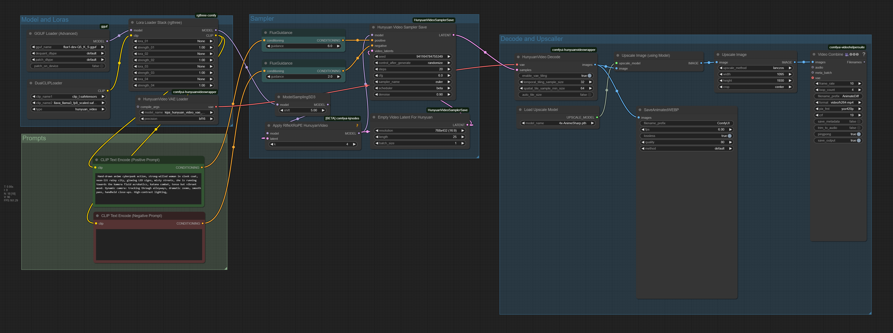

# The_frizzy1: Hunyuan Video Low-VRAM v1.1.2

> Semi-native Hunyuan Video (text to video) on **4 GB VRAM**. GGUF + upscaler + RifleX. Works, but slow. Wan 2.1 is often better on tiny GPUs.

| | |
|---|---|
| **Model family** | Hunyuan Video |
| **Tasks** | Text → Video (the shipped graph has no image input; v1.0.0 was I2V) |
| **Min VRAM** | 4 GB |
| **Tested on** | RTX 3050 Laptop 4 GB (slow) |
| **ComfyUI** | Built on core 0.3.15. Checked on ComfyUI 0.45.3: every core node it uses exists in 0.45.3. It could not be validated on the test server because the ComfyUI-HunyuanVideoWrapper and ComfyUI-HunyuanVideoSamplerSave packs and three of its model files are not installed there. Not run on 0.45.3. |
| **CivitAI** | https://civitai.com/models/1312419 |
| **Hugging Face** | https://huggingface.co/The-frizzy1/Hunyuan-Video-Low-VRAM-4GB |
| **License** | Tencent Hunyuan Community |
| **Newer** | [MiniMax H3 Ultimate](../../minimax/h3-ultimate-12gb) · [LTX 2.5 Ultimate](../../ltx/ltx-2.5-ultimate-12gb) (12 GB). On 4 GB: Wan 2.2 GGUF. |


## Preview

<details><summary>Workflow graph</summary>

<p align="center"></p>
</details>

## Nodes
- Core: DualCLIPLoader, CLIPTextEncode, FluxGuidance, ModelSamplingSD3, UpscaleModelLoader, ImageUpscaleWithModel, ImageScale, SaveAnimatedWEBP.
- gguf (calcuis): LoaderGGUFAdvanced.
- rgthree-comfy: Lora Loader Stack (rgthree).
- ComfyUI-KJNodes: ApplyRifleXRoPE_HunuyanVideo.
- ComfyUI-HunyuanVideoWrapper: HyVideoVAELoader, HyVideoDecode.
- ComfyUI-HunyuanVideoSamplerSave: HunyuanVideoSamplerSave, EmptyVideoLatentForHunyuan.
- ComfyUI-VideoHelperSuite: VHS_VideoCombine.

The graph has "How to use" and "Downloads" notes on the left. Faster attention: start ComfyUI with --use-sage-attention (less VRAM). --use-ck-attention changes the image for the same seed.

## v1.1.1 fix
The originally shipped workflow had its diffusion loader pointing at `flux1-dev-Q5_K_S.gguf` (a leftover from
another graph). **v1.1.1 corrects it** to `fast-hunyuan-video-t2v-720p-Q5_K_M.gguf`. The untouched original is
kept in [`source/hunyuan.json`](source/). See [docs/AUDIT.md](../../../docs/AUDIT.md).

## Notes
- The shipped graph is text to video only (no image input). In the I2V setup the image is encoded into latent space for *style*; it does not animate the image directly.
- T2V works well on low VRAM. Check quantisation versions.
- Low on VRAM? Replace the sampler with **Tiled KSampler**.
- GGUF errors are usually fixed by updating nodes.
- **Tip from the creator:** Wan 2.1 performs better on low VRAM → [wan2.1/gguf-lowvram](../../wan2.1/gguf-lowvram).

## Get the models (one command)

From the repo root, this finds ComfyUI, downloads the missing models into the right folders, and installs the custom nodes:

```bash
python scripts/frizzy.py doctor hunyuan/video --comfy "C:/path/to/ComfyUI"
```

No pip installs. Details: [scripts/README.md](../../../scripts/README.md).

## Required models
Full verified table + links: **[downloads.md](downloads.md)**.

## Files
- `The_frizzy1_hunyuan-video-lowvram_v1.1.2.json`: current workflow (v1.1.1 graph plus in-graph notes).
- `source/The_frizzy1_hunyuan-video-lowvram_v1.1.1.json`: previous version.
- `source/hunyuan.json`: original (unfixed) as shipped.
- `samples/workflow.png`: workflow graph screenshot.

## Changelog
See [changelog.md](changelog.md).

## Related workflows
- [Wan 2.1 GGUF Low-VRAM](../../wan2.1/gguf-lowvram) · [LTX-2 GGUF](../../ltx/ltx2)
