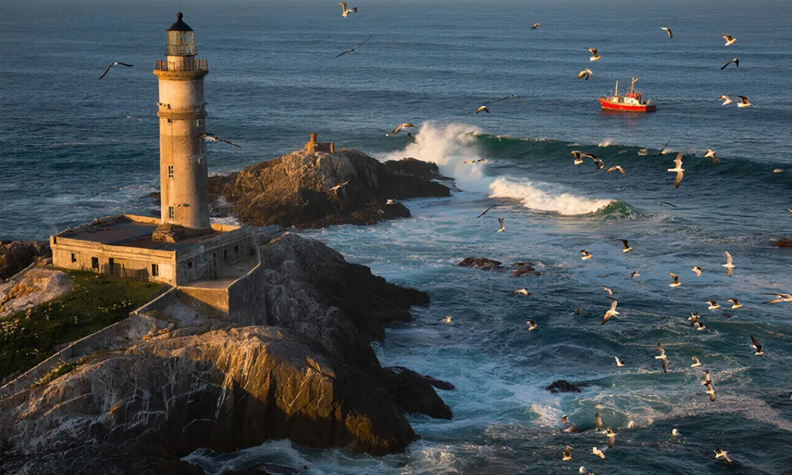
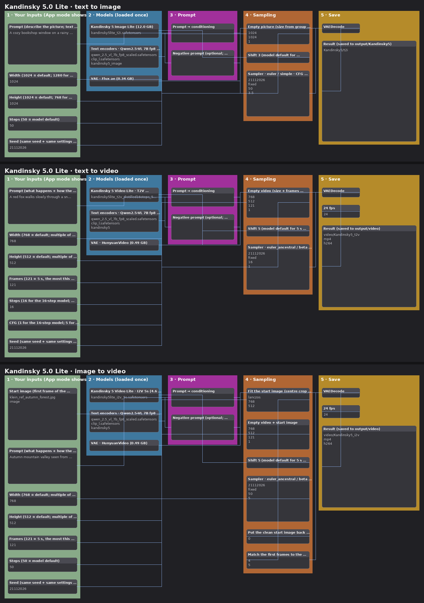

# The_frizzy1 — Kandinsky 5.0 Lite v1.0.0

> Kandinsky 5.0 Lite in three small workflows: text to image, text to video and image to video. Core ComfyUI nodes only, MIT-licensed models.

| | |
|---|---|
| **Model family** | Kandinsky 5.0 Lite (Image Lite 6B · Video Lite 2B) |
| **Tasks** | Text → Image · Text → Video (5 s) · Image → Video (5 s) |
| **Min VRAM** | 12 GB is the target. **Not verified on 12 GB** (see Hardware & VRAM) |
| **Tested on** | RTX PRO 4000 Blackwell 24 GB · 64 GB RAM · ComfyUI 0.45.3 started with `--reserve-vram 12` |
| **CivitAI** | Not published |
| **Hugging Face** | Not published |
| **YouTube explainer** | Not published |
| **License** | Workflow: MIT · Kandinsky 5.0 Lite models: MIT · text encoders and VAEs: see their pages ([Qwen2.5-VL repack](https://huggingface.co/Comfy-Org/HunyuanVideo_1.5_repackaged), [CLIP-L](https://huggingface.co/comfyanonymous/flux_text_encoders) Apache-2.0, [Flux ae](https://huggingface.co/Comfy-Org/z_image_turbo), [HunyuanVideo VAE](https://huggingface.co/Kijai/HunyuanVideo_comfy) "other") |

## Preview

<p align="center">
  
  
</p>
<p align="center">
  
  
</p>

<sub>Top: text to image, 1024x1024 (seed 21112026) and 1280x768 (seed 7), 50 steps. Bottom left: text to video, 16-step model, seed 21112026. Bottom right: image to video from the standard autumn-forest photo, 50 steps, seed 21112026. The animated previews are 12 fps, 576 px wide; the full clips are `samples/preview-1.mp4` and `samples/preview-2.mp4`.</sub>

<p align="center"></p>

<sub>`workflow.png` is a layout diagram drawn from the JSON files (groups, node titles, links), not a ComfyUI screenshot.</sub>

## Overview
Built from ComfyUI's three built-in Kandinsky 5 templates and restructured: numbered groups, every input you change in group 1, two notes per workflow. The one change to the templates' settings is in text to video: it loads the 16-step distilled model at CFG 1, because the template's sft model needed 19 min 55 s for a 5 s clip on the test card and the distilled one 3 min 35 s. Image to video has no distilled Lite model, so it stays at 50 steps.

## Capabilities
- `The_frizzy1_kandinsky-5-t2i_v1.0.0.json`: text to image, 1024x1024 (1280x768 also run), 50 steps · euler / simple · CFG 3.5 · shift 3. Wrote the sign text "NIGHT OWL BOOKS" correctly in the test.
- `The_frizzy1_kandinsky-5-t2v_v1.0.0.json`: text to video, 768x512, 121 frames (5 s, 24 fps), 16 steps · CFG 1 · euler_ancestral / beta · shift 5. No sound.
- `The_frizzy1_kandinsky-5-i2v_v1.0.0.json`: image to video, 768x512, 121 frames, 50 steps · CFG 5 · euler_ancestral / beta · shift 5. The start image is centre-cropped to the video size. No sound.
- Colour-coded groups: your inputs (green) · models (blue) · prompt (purple) · sampling (orange) · save (amber).

## Hardware & VRAM
All numbers are from one machine: RTX PRO 4000 Blackwell 24 GB, ComfyUI 0.45.3 with `--reserve-vram 12`, which makes ComfyUI keep its models within about 12 GB. It is not a hard limit and not a 12 GB card.

| Workflow | Diffusion model file | VRAM while sampling | Peak VRAM |
|---|---|---|---|
| Text to image | 12.0 GB | 12.3 GB | 12.3 GB |
| Text to video | 4.6 GB | 12.4 GB | 17.3 GB (video decode, about 20 s) |
| Image to video | 4.6 GB | 12.4 GB | 17.3 GB (video decode, about 20 s) |

- **Not verified on 12 GB.** The peaks are above 12 GB, so these runs do not prove a 12 GB card is enough.
- ComfyUI uses the memory it finds, so the 12.4 GB while sampling is the cap, not what the 4.6 GB video model needs. What it needs was not measured.
- The 17.3 GB peak is the video VAE decode on a card that had the room. Whether ComfyUI's automatic tiled decode handles it on 12 GB was not tested.
- There are no Comfy-Org repackaged, fp8 or int8 Kandinsky 5 files; the workflows load the authors' bf16 files, as the templates do.

## Required models
See the per-workflow [downloads.md](downloads.md) for the full table with verified links.
Every file below was read from the workflow `.json` files.

```
ComfyUI/models/
├── diffusion_models/   ← kandinsky5lite_t2i.safetensors                        (text to image)
│                       ← kandinsky5lite_t2v_distilled16steps_5s.safetensors   (text to video)
│                       ← kandinsky5lite_i2v_5s.safetensors                     (image to video)
├── text_encoders/      ← qwen_2.5_vl_7b_fp8_scaled.safetensors · clip_l.safetensors   (all three)
└── vae/                ← ae.safetensors (text to image) · hunyuan_video_vae_bf16.safetensors (video)
```

## Required custom nodes
None. Core ComfyUI **0.4.0 or newer** (the release that added Kandinsky 5); run here on 0.45.3 only.

Core nodes used: UNETLoader, DualCLIPLoader, VAELoader, CLIPTextEncode, ModelSamplingSD3, KSampler, VAEDecode, PrimitiveInt, PrimitiveFloat, PrimitiveStringMultiline, EmptySD3LatentImage, SaveImage, Kandinsky5ImageToVideo, CreateVideo, SaveVideo, LoadImage, ImageScale, ReplaceVideoLatentFrames, NormalizeVideoLatentStart. All were checked against `/object_info` of ComfyUI 0.45.3.

## Optional custom nodes
None.

## Installation
1. Update ComfyUI (0.4.0 or newer).
2. Download the files for the workflow you want ([downloads.md](downloads.md), or the Downloads note inside each workflow).
3. Load one of the three `.json` files, fill group 1, press **Run**.

## Recommended settings
| Workflow | Setting | Value | Notes |
|---|---|---|---|
| Text to image | Size | 1024x1024 | 1280x768 also run |
| Text to image | Steps / CFG / shift | 50 / 3.5 / 3 | template defaults; fewer steps not tested |
| Text to video | Model | 16-step distilled | 5.6x faster than sft in my run |
| Text to video | Steps / CFG / shift | 16 / 1 / 5 | sft swap: Steps 50, CFG 5 |
| Image to video | Steps / CFG / shift | 50 / 5 / 5 | template defaults |
| Both video | Size / frames | 768x512 / 121 | other sizes and lengths not tested |

## Inputs / Outputs
- **Inputs:** a text prompt; image to video also takes one start image.
- **Outputs:** a PNG in `output/Kandinsky5/`, or an H.264 MP4 (24 fps, no audio) in `output/video/`.

## Performance
One run each unless noted, model load included, on the machine above:

| Workflow | Settings | Time | Peak VRAM |
|---|---|---|---|
| Text to image | 1024x1024, 50 steps | 1 min 37 s and 1 min 42 s (two runs) | 12.3 GB |
| Text to image | 1280x768, 50 steps | 1 min 28 s | 12.3 GB |
| Text to video (default) | 768x512, 121 frames, 16 steps, CFG 1 | 3 min 34 s and 3 min 35 s (two runs) | 17.3 GB |
| Text to video (sft swap) | 768x512, 121 frames, 50 steps, CFG 5 | 19 min 55 s | 17.3 GB |
| Image to video | 768x512, 121 frames, 50 steps, CFG 5 | 20 min 03 s | 17.3 GB |

RTX 3060 12 GB: Not verified.

## Known issues
- **Image to video is slow:** 20 minutes for 5 s on the test card, and no faster Lite model exists for it. Fewer steps were not tested.
- **The 16-step video model looks more stylised** than the sft model in my one comparison (same prompt and seed): smoother, less photographic.
- **Image to video did not follow "the camera pushes in slowly"** exactly in the test: the view moves and the valley opens up, but it is not a straight push-in. One seed only.
- **Video decode peaked at 17.3 GB** on the 24 GB card. Not verified on smaller cards.
- The sft text-to-video timing comes from the same graph with CFG typed on the sampler, before CFG became an input in group 1. The shipped file was not re-run with the sft model.
- The prompts are my own: the lab's standard `prompts.json` was not in the inputs folder.

## Changelog
See [changelog.md](changelog.md).

## Related workflows
- [Qwen Image 2.1 · 12 GB](../../qwen/image-2.1-12gb) · [Z-Image Turbo](../../z-image/turbo) · [LTX 2.5 Ultimate · 12 GB](../../ltx/ltx-2.5-ultimate-12gb)
