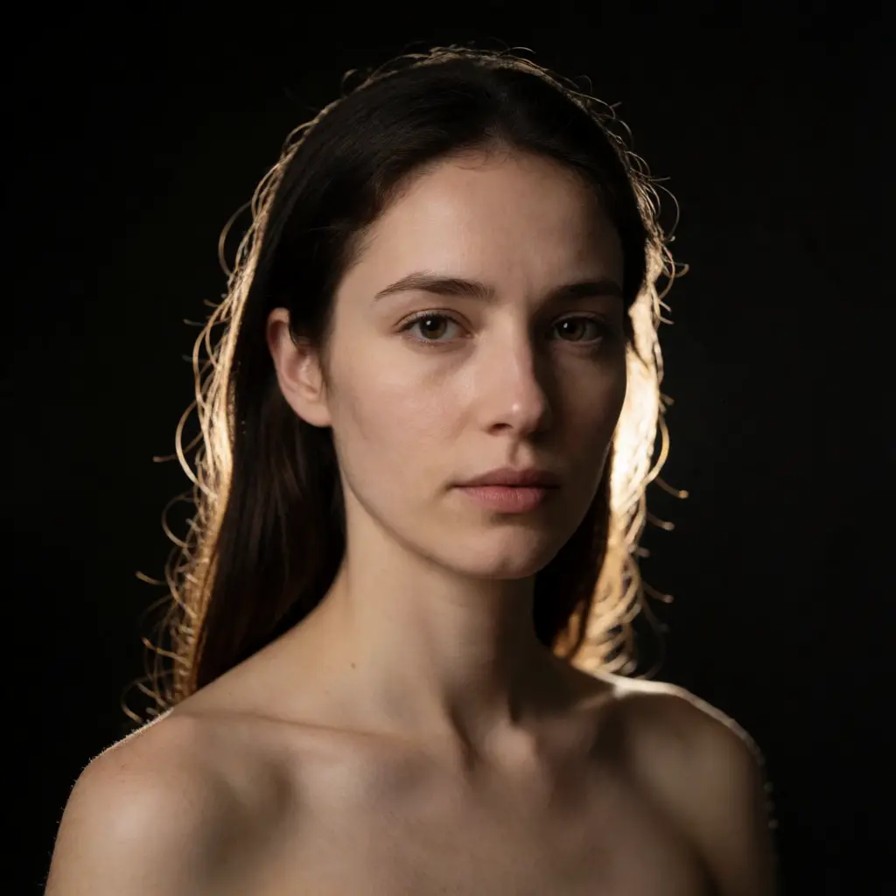
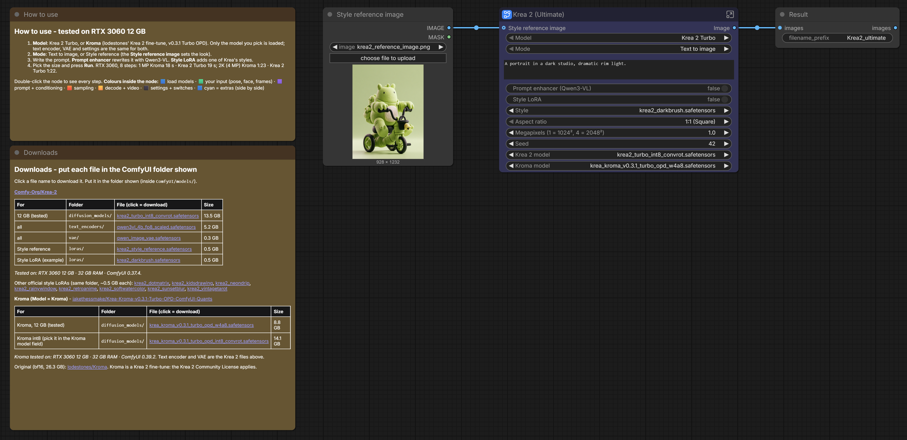

# The_frizzy1 — Krea 2 Ultimate · 12 GB v2.1.0
> Krea 2 Turbo text-to-image and image style reference in one workflow, with the official style LoRAs, and since v2.1.0 a
> **Model** switch for **Kroma** (lodestones' Krea 2 fine-tune). Core nodes only.

| | |
|---|---|
| **Model family** | Krea 2 (Turbo) · Kroma v0.3.1 Turbo OPD |
| **Tasks** | Text → Image · Style reference · style LoRAs |
| **Min VRAM** | 12 GB (tested) |
| **Tested on** | RTX 3060 12 GB · Ryzen 5 5600X · 32 GB DDR4 · ComfyUI 0.39.2 (v2.1.0) |
| **YouTube explainer** | [ PASTE LINK ] |
| **License** | Workflow: MIT · Krea 2 and Kroma: Krea 2 Community License |

## Preview

<p align="center">
<a href="samples/sample-1.webp"></a>
<a href="samples/sample-2.webp"></a>
</p>

<sub>Krea 2 Turbo: text to image, style reference.</sub>

<p align="center">


</p>

<sub>v2.1.0, made by this workflow: Kroma · Krea 2 Turbo (same prompt and seed: the Krea 2 template's) · Kroma with style reference. 1 MP, RTX 3060.</sub>

<p align="center"></p>

## Overview
Both official Krea 2 Turbo templates in one graph: one MODE dropdown, a style-LoRA picker and the optional prompt enhancer.
**Model** picks Krea 2 Turbo or Kroma; only the model you pick is loaded. Kroma is a drop-in fine-tune: same text encoder,
VAE and Turbo settings (8 steps, CFG 1). The tested Kroma file is the w4a8 quant (8.8 GB; the original bf16 is 26.3 GB).

## Modes (two dropdowns)

| Model | Mode | Uses |
|---|---|---|
| Krea 2 Turbo / Kroma | Text to image | prompt |
| Krea 2 Turbo / Kroma | Style reference (image) | prompt + style image |

## Measured on the RTX 3060 (ComfyUI 0.39.2)

*Wall* = queue to finished (median; 1 MP = runs with the text encoder already loaded); *sampling* = time in the sampler.
Same prompts and seeds for both models.

| Model · mode | Size | Wall | Sampling | Peak VRAM | Peak RAM | Runs |
|---|---|---|---|---|---|---|
| Kroma · text to image | 1 MP | 18 s | 16 s | 11.6 GB | 5.5 GB | 3 |
| Krea 2 Turbo · text to image | 1 MP | 19 s | 16 s | 11.3 GB | 6.8 GB | 4 |
| Kroma · text to image | 2K (4 MP) | 1 min 23 s | 1 min 19 s | 11.6 GB | 7.7 GB | 2 |
| Krea 2 Turbo · text to image | 2K (4 MP) | 1 min 22 s | 1 min 18 s | 11.3 GB | 9.4 GB | 2 |
| Kroma · style reference | 1 MP | 45 s | 40 s | 11.3 GB | 10.4 GB | 1 |

## Required models
See [downloads.md](downloads.md) — every file was read from the workflow `.json`. Kroma: only the model file is new.

## Required custom nodes
None - core ComfyUI **0.39+** (v2.0.0 ran on 0.37.4; the Kroma path was tested on 0.39.2).

## Get the models (one command)

```bash
python scripts/frizzy.py doctor krea/krea-2-ultimate-12gb --comfy "C:/path/to/ComfyUI"
```

## Installation
1. Update ComfyUI.
2. Download the files in [downloads.md](downloads.md) (the Kroma file only if you use Kroma).
3. Load `The_frizzy1_krea-2-ultimate-12gb_v2.1.0.json`, pick a **Model** and a **Mode**, add your inputs, **Run**.

If your models live in sub-folders (e.g. `diffusion_models/Kroma/`), the loaders show red until you re-pick them once.
