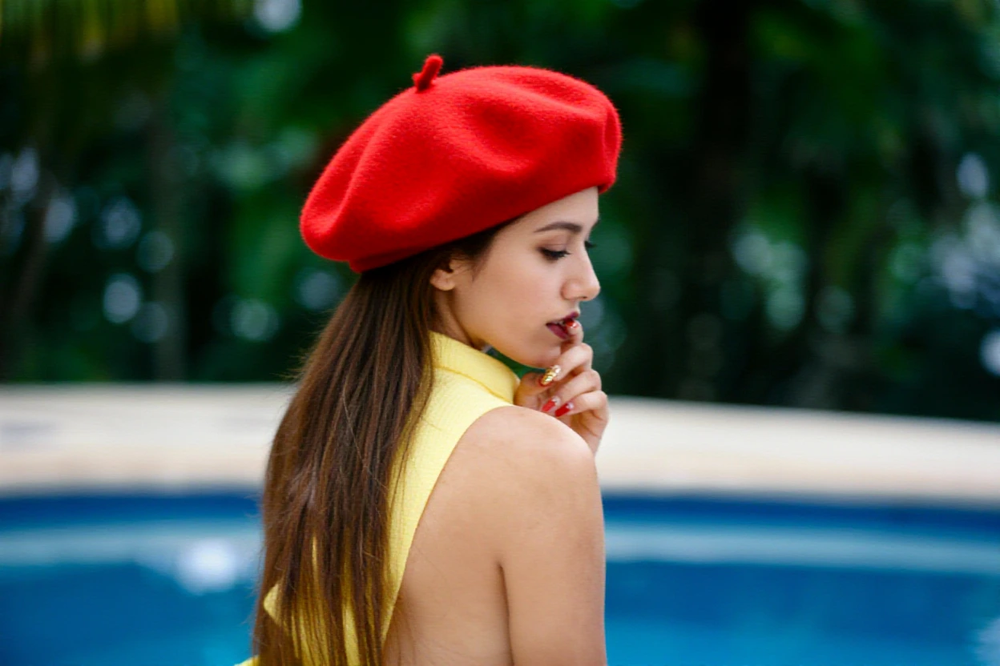
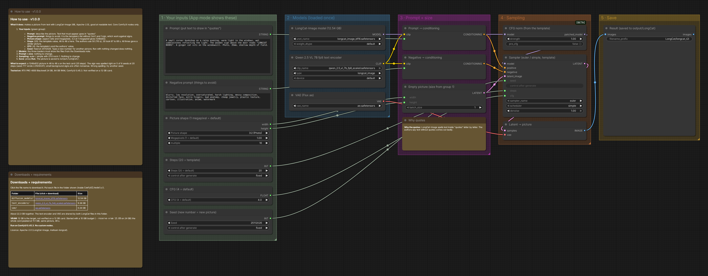
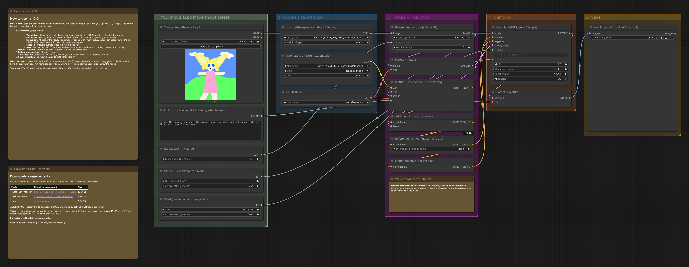

# The_frizzy1 — LongCat-Image · 12 GB v1.0.0

> Text to image with readable text, and one-picture edits in 8 steps, with Meituan's LongCat-Image (6B, Apache-2.0). Core ComfyUI nodes only.

| | |
|---|---|
| **Model family** | LongCat-Image (text to image) and LongCat-Image-Edit-Turbo |
| **Tasks** | T2I · image edit (one picture + instruction) |
| **Min VRAM** | 12 GB is the target. **Not verified on 12 GB** (ran inside a 10 GiB budget on a 24 GB card, see Hardware & VRAM) |
| **Tested on** | RTX PRO 4000 Blackwell 24 GB · 64 GB RAM · ComfyUI 0.45.3 (frontend 1.57.6) |
| **CivitAI** | Not published |
| **Hugging Face** | Not published |
| **YouTube explainer** | Not published |
| **License** | Workflow: MIT · LongCat-Image and Edit-Turbo: Apache-2.0 ([meituan-longcat](https://huggingface.co/meituan-longcat/LongCat-Image)) |

## Preview

<p align="center">
  
  
  
</p>

<sub>Left: the text to image file as shipped, 20 steps, 46 s. Middle and right: the edit file with a sample photo loaded, 8 steps, 27 s each: "Change the straw hat to a red wool beret. Keep the woman, her hair, the yellow dress and the pool background unchanged." and "Turn the scene into a snowy winter day. Snow covers the trees and the hills, keep the trees and the mist where they are." All three use seed 25112026 and are 1248x832. The source pictures, from the lab's standard inputs:</sub>

<p align="center"></p>

<p align="center"></p>
<p align="center"></p>

## Overview
Two files built from ComfyUI's templates `image_longcat_text_to_image` and `image_longcat_image_edit`, taken out of their subgraphs: numbered groups, every input you change in group 1, notes inside. The edit file loads the 8-step Edit-Turbo model; the template loads the 50-step Edit model. This folder does not cover LongCat-Video-Avatar: ComfyUI 0.45.3 has no code for it ([PR 17831](https://github.com/Comfy-Org/ComfyUI/pull/17831) was open on 2026-11-25).

## Capabilities
- `The_frizzy1_longcat-image-t2i_v1.0.0.json`: prompt and negative prompt to a picture, any shape from the list, 1 megapixel by default. Text in "quotes" is spelled letter by letter.
- `The_frizzy1_longcat-image-edit-turbo_v1.0.0.json`: one picture plus an instruction gives an edited picture of the same shape, 1 megapixel by default, sides a multiple of 16.
- App mode shows only the group 1 inputs.

## Hardware & VRAM
All numbers are from one machine: RTX PRO 4000 Blackwell 24 GB. It is not a 12 GB card. Peak VRAM is the highest whole-GPU reading of `nvidia-smi`, sampled once per second, MiB / 1024. Peak RAM is the ComfyUI process (RSS).

| ComfyUI started with | T2I sample: peak / RAM / time | Two edit samples: peak / RAM / time |
|---|---|---|
| no limit | 22.6 GiB / not logged / 46 s | 21.5 GiB / not logged / 27 s |
| a 12 GiB budget (`--reserve-vram 11.89`) | 13.2 GiB / 3.9 GiB / 49 s | 13.2 GiB / 4.1 to 4.2 GiB / 28 s |
| a 10 GiB budget (`--reserve-vram 13.89`) | 11.1 GiB / 5.9 GiB / 49 s | 11.2 GiB / 6.1 to 6.2 GiB / 28 s |

- **Not verified on 12 GB.** The budget runs used a second ComfyUI with `--disable-all-custom-nodes` on the same card. The pictures were pixel-identical in all three rows. About 0.9 GiB of the whole-GPU figure was held by other programs, and ComfyUI went over each budget.
- ComfyUI fills the memory it finds, so the "no limit" row is not what the workflow needs.

## Required models
See [downloads.md](downloads.md) for the full table with verified links. Every file below was read from the workflow `.json`.

```
ComfyUI/models/
├── diffusion_models/   ← longcat_image_bf16.safetensors              (12.54 GB, text to image)
│                       ← longcat_image_edit_turbo_bf16.safetensors   (12.54 GB, edit)
├── text_encoders/      ← qwen_2.5_vl_7b_fp8_scaled.safetensors       (9.38 GB, both)
└── vae/                ← ae.safetensors                              (0.34 GB, both)
```

About 22.3 GB for one file, 34.8 GB for both.

## Required custom nodes
None. Run on ComfyUI 0.45.3 only; older versions were not tested.

## Optional custom nodes
None.

## Installation
1. Update ComfyUI (0.45.3 is the version this was run on).
2. Download the files ([downloads.md](downloads.md), or the Downloads note inside each workflow).
3. Load a workflow, fill group 1, press **Run**. The edit file starts with `example.png`, which ships with ComfyUI.

## Recommended settings
| Setting | Value | Notes |
|---|---|---|
| T2I steps / CFG | 20 / 4 | template values. 30 steps took 67 to 69 s, the authors' 50 took 110 s, with a similar picture on the default seed |
| T2I CFG norm | 1 | template |
| Edit steps / CFG | 8 / 1 | the authors' Turbo settings |
| Sampler / scheduler | euler / simple | template; others not tested |
| Seed | 25112026, fixed | type a new number for another take |

## Inputs / Outputs
- **Inputs:** T2I: prompt, negative prompt, shape, megapixels, steps, CFG, seed. Edit: picture, instruction, megapixels, steps, seed.
- **Outputs:** a PNG in `output/LongCat/`. 3:2 gave 1248x832, 2:3 gave 832x1248. In the edit file a 1776x1184 photo gave 1248x832 and the 768x768 `example.png` was enlarged to 1024x1024.

## Performance
No VRAM limit, one run each, on the machine above:

| Run | Settings | Time | Peak VRAM |
|---|---|---|---|
| T2I default (first run of the night) | 1248x832, 20 steps | 46 s | 22.6 GiB |
| T2I, seeds 777 and 1 to 4 | 1248x832, 20 steps | 46 to 48 s | 20.8 to 21.4 GiB |
| T2I portrait | 832x1248, 20 steps | 47 s | 21.4 GiB |
| T2I, 30 steps (three seeds) | 1248x832 | 67 to 69 s | 21.4 to 22.4 GiB |
| T2I, 50 steps | 1248x832 | 110 s | 20.8 GiB |
| Edit default (`example.png`) | 1024x1024, 8 steps | 28 s | 21.5 GiB |
| Edit, hat and forest, seeds 25112026 and 2 | 1248x832, 8 steps | 27 to 28 s | 21.4 to 23.0 GiB |
| Edit, "SUMMER" on the hedge | 1248x832, 8 steps | 27 s | 21.5 GiB |

RTX 3060 12 GB: Not verified.

## Known issues
- **Spelling:** the main sign was right on 5 of 6 seeds at 20 steps; seed 777 wrote "LONIGCAT BOOKS". Other small signs in the pictures are nonsense. Try another seed. On some seeds the cat sat on the pavement or a table instead of the windowsill, or there were two.
- **Parts you did not name can change:** asking for "SUMMER" on the blurred hedge also made the hedge sharp, and the hat covers part of the word. The beret edits show a face the hat had hidden, so the model invented it.
- **Fine texture:** at 2x, the far hills of the winter sample show a faint woven pattern.
- **The model is bf16:** the Comfy-Org repo has no fp8 or int8 file (listing checked 2026-11-25). GGUF copies exist, but core ComfyUI has no GGUF loader.
- **The 50-step Edit model was not run**, so Turbo was not compared with it.
- The prompts are my own: the lab's `prompts.json` is not in the inputs folder. Reddit reports were not found (the search returned nothing).

## Changelog
See [changelog.md](changelog.md).

## Related workflows
- [FireRed Image Edit 1.1](../../firered/image-edit-1.1) · [Capybara Image Edit](../../capybara/image-edit) · [ERNIE-Image Turbo](../../ernie/ernie-image) · [Mage-Flow](../../mage/mage-flow)
