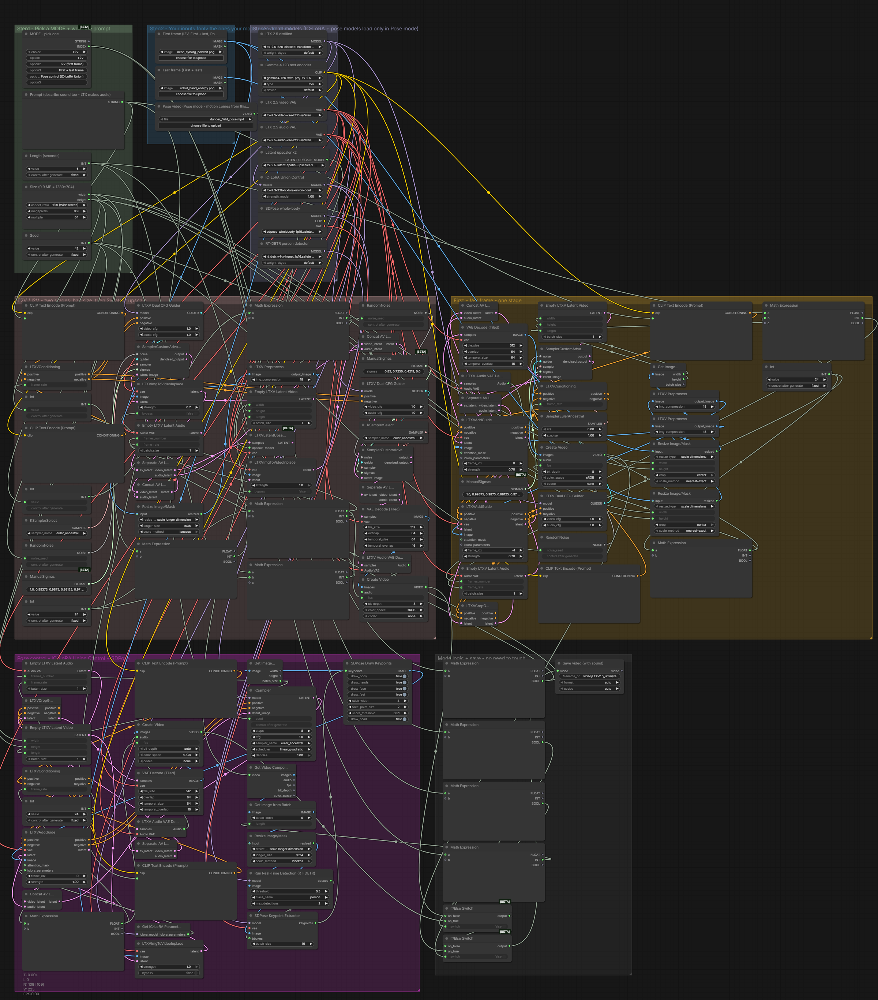

# The_frizzy1 — LTX 2.5 Ultimate · 12 GB v3.1.1

<a href="https://www.youtube.com/watch?v=HeHY6N5hH_M&list=PLQ3PcJNbU2Ls"></a> <a href="https://www.youtube.com/watch?v=TlV72fg9skw&list=PLQ3PcJNbU2Ls"></a>

☕ If this workflow saved you time: **[Buy me a coffee](https://buymeacoffee.com/the_frizzy1)**

> LTX 2.5 text, image, first+last and pose-driven video, plus Lightricks' VFX LoRAs (remove a person, day to night, water, alpha matte, layout to render and more), in one workflow. Video with sound. Core ComfyUI nodes only, tested on an RTX 3060.

| | |
|---|---|
| **Model family** | LTX 2.5 (distilled) |
| **Tasks** | T2V · I2V · First+last frame · Pose control (IC-LoRA Union) · VFX video to video (12 LoRAs) · Layout to Render · Ingredients · Cinemagraph · Slow motion |
| **Min VRAM** | 12 GB (tested) |
| **Tested on** | RTX 3060 12 GB · Ryzen 5 5600X · 32 GB DDR4 · ComfyUI 0.44.0 · frontend 1.57.6 |
| **YouTube explainer** | [▶ LTX 2.5 ComfyUI on RTX 3060 vs MacBook Air M5 (Same Clip)](https://www.youtube.com/watch?v=HeHY6N5hH_M&list=PLQ3PcJNbU2Ls) · [▶ LTX 2.5 Is the New Low-VRAM King (Beats MiniMax H3)](https://www.youtube.com/watch?v=TlV72fg9skw&list=PLQ3PcJNbU2Ls) |
| **License** | Workflow: MIT · LTX 2.5 and the LoRAs: LTX-2.x Community License |

## Preview

<p align="center">
<a href="samples/preview-1.mp4"></a>
<a href="samples/preview-2.mp4"></a>
</p>

<sub>Click a frame to open the clip (T2V, I2V (first frame)).</sub>

<p align="center"></p>

<sub>The graph picture is from v2.0.0. v3 has the same main node with more modes and a VFX LoRA picker.</sub>

## Overview
Built from the official LTX 2.5 T2V / I2V / FLF2V templates, the LTX 2.3 IC-LoRA template (IC-LoRA Union Control runs on 2.5) and Lightricks' LTX-2.5 Creative Lab LoRAs. One MODE dropdown; each path only runs when picked. Every loader carries its download link, so ComfyUI's missing-models panel offers a Download button per file.

## Modes (one dropdown)

| Mode | Uses |
|---|---|
| T2V | prompt only |
| I2V (first frame) | **First frame** |
| First + last frame | **First frame** + **Last frame** |
| Pose control (IC-LoRA Union) | **Pose video** + **First frame** (your character) |
| VFX: video to video | **Source video** + pick the **VFX LoRA** (clean plate, day to night, water, deblur, decompression, colorization, alpha matte, restore, refine, pixel upscaler x2) |
| VFX: Layout to Render | **Source video** = grey 3D layout / playblast + **First frame** = the look you want |
| VFX: Ingredients | **First frame** = your reference sheet (characters, props, location on black) |
| I2V + Cinemagraph | **First frame**; say what moves and what stays still (the trigger is added for you) |
| I2V + Slow motion | **First frame**; set **Slow-motion speed** (1 = real time, 0.2, 0.05 = very slow); no speed words in the prompt |

**Keep the source/pose video's audio**: VFX video to video and Pose mode put the original sound back.

## VFX settings from my tests

Set **VFX LoRA strength** on the node (default 1.0).

| VFX LoRA | Strength | Prompt |
|---|---|---|
| Clean Plate | **1.2** + name the person, for someone sitting in shot; 1.0 for people walking through | describe the EMPTY scene |
| Colorization | **1.3** (at 1.0 the colour is dull and fades) | `Reference shows ... Edited shows ... COLORIZE ...` |
| Day to Night | 1.0 with people moving; 1.3 is a darker night but walkers smear | describe the night scene |
| Water | 1.0 at 1280x704 (Megapixels 0.9); 1.3 darkened the room | start with `ADD WATER` |
| Deblur / Decompression | 1.0 (1.3 changed nothing); both rebuild detail, so text and faces can change | `Reference shows ... Edited shows ... DEBLUR / ENHANCE QUALITY ...` |
| Refine / Pixel upscaler | 1.0 | describe the scene |
| Alpha matte | 1.0 | leave the prompt empty |

- Layout to Render needs the First frame. Without one you get grey clay back.
- Slow motion: use speed 0.2; 0.05 was not slower.
- Strength above 1 did not help Cinemagraph, Slow motion or Ingredients.
- **Ingredients did not work for me:** in 9 of 9 runs it kept the reference sheet's panel grid instead of making one shot.
- Decompression invents text: don't use it on screen recordings.

## Measured on the RTX 3060

Every mode run once from the saved v3.1.1 file, 960×512, 4 s (Ingredients 5 s). *Wall* = queue to finished, including model loading.

| Mode | Wall | Peak VRAM | Peak RAM | Result |
|---|---|---|---|---|
| T2V | 1:43 | 11.6 GB | 18.9 GB | OK |
| I2V (first frame) | 2:00 | 11.3 GB | 19.1 GB | OK |
| First + last frame | 2:32 | 11.3 GB | 19.3 GB | OK |
| Pose control (IC-LoRA Union) | 3:44 | 11.7 GB | 20.6 GB | OK |
| VFX: Clean Plate, person named, strength 1.2 | 3:27 | 11.7 GB | 19.8 GB | OK: person gone, chair and mic left |
| VFX: Layout to Render | 3:30 | 11.7 GB | 20.1 GB | OK |
| VFX: Ingredients | 4:09 | 11.6 GB | 19.4 GB | Ran, but still the panel grid |
| I2V + Cinemagraph | 1:49 | 11.6 GB | 20.0 GB | OK |
| I2V + Slow motion | 1:49 | 11.6 GB | 19.9 GB | OK |

## Required models
See [downloads.md](downloads.md) — every file was read from the workflow `.json`. The VFX LoRAs are optional: download only the ones you use.

## Required custom nodes
None - core ComfyUI **0.44.0+** (0.44.0 changed the core CreateVideo node; older saved files are refused, this one is not).

## Get the models (one command)

```bash
python scripts/frizzy.py doctor ltx/ltx-2.5-ultimate-12gb --comfy "C:/path/to/ComfyUI"
```

## Installation
1. Update ComfyUI to **0.44.0+**.
2. Download the files in [downloads.md](downloads.md). The LTX 2.5 files and every LoRA need **Agree and access** on their Hugging Face page first.
3. Load `The_frizzy1_ltx-2.5-ultimate-12gb_v3.1.1.json`, pick a **MODE**, add your inputs, **Run**.

If your models live in sub-folders (e.g. `diffusion_models/LTX-2.5/`), the loaders show red until you re-pick them once.

Older versions are in `source/`.
