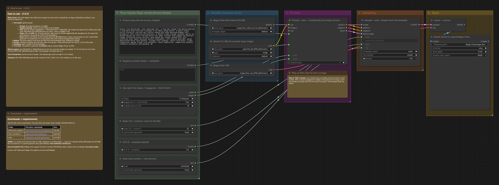

# The_frizzy1 — Mage-Flow v1.0.0

> Microsoft Mage-Flow (4B) text to image from the Comfy-Org int8 file: 20 steps, 1024x1024, about 8 s per picture. Core ComfyUI nodes only.

| | |
|---|---|
| **Model family** | Mage-Flow (Microsoft, 4B NR-MMDiT with a Qwen3-VL 4B text encoder) |
| **Tasks** | Text → Image |
| **Min VRAM** | 12 GB is the target. **Not verified on 12 GB** (see Hardware & VRAM) |
| **Tested on** | RTX PRO 4000 Blackwell 24 GB · 64 GB RAM · ComfyUI 0.45.3 |
| **CivitAI** | Not published |
| **Hugging Face** | Not published |
| **YouTube explainer** | Not published |
| **License** | Workflow: MIT · Mage-Flow: MIT ([github.com/microsoft/Mage](https://github.com/microsoft/Mage/blob/main/LICENSE)) |

## Preview

<p align="center">
  
  
</p>

<sub>Left: the default settings (the template's prompt, 1024x1024, 20 steps, CFG 5, seed 24112026), 11 s on a fresh ComfyUI including the model load. Right: a bakery prompt with a sign in quotes, Shape set to 16:9 (1360x768), seed 4242, 9 s with the models loaded.</sub>

<p align="center"></p>

## Overview
Built from ComfyUI's built-in template `image_mage_flow_t2i_int8` and restructured: the template's subgraph is taken apart into five numbered groups, every input you change is in group 1, and there are two notes (How to use, Downloads + requirements). Files, CFG, sampler, size input and default prompt are the template's. Two settings differ: 20 steps instead of 30, and a fixed seed instead of a random one.

## Capabilities
- Text to image at 1024x1024 by default; the Size input picks the shape (16:9 = 1360x768). Only these two sizes were run. The model card gives 512 to 2048 px per side.
- Short text in the picture: the sign `"MORNING CRUMB"` was spelled right in 3 of 3 seeds.
- 20 steps · CFG 5 · euler / simple.
- Three downloads, 13.38 GB together, all from Comfy-Org.
- Colour-coded groups: your inputs (green) · models (blue) · prompt (purple) · sampling (orange) · save (amber).

## Hardware & VRAM
All numbers are from one machine: RTX PRO 4000 Blackwell 24 GB, ComfyUI 0.45.3. Peak VRAM is from nvidia-smi, read once per second, in GiB (MiB / 1024).

| Setting | ComfyUI process | Whole GPU |
|---|---|---|
| No limit (lab ComfyUI, no VRAM flags) | 12.4 GiB | 12.9 GiB |
| 12 GiB budget (second ComfyUI, `--reserve-vram 11.89`, no custom nodes) | 12.0 GiB | 12.9 GiB |
| 10 GiB budget (`--reserve-vram 13.89`) | 10.1 GiB | 10.9 GiB |

- Both sample pictures came out pixel-identical in all three, so the picture does not depend on how much of the model sits in VRAM. In both budgets the runs took 11 s (first run, with the model load) and 9 s; without a limit, 8 to 9 s with the models loaded.
- The whole-GPU column includes 0.45 to 0.86 GiB held by other programs on this card.
- **Not verified on 12 GB.** A budget on a 24 GB card is not the same as a 12 GB card. ComfyUI fills whatever budget it is given.
- The int8 model is 4.16 GB and the text encoder 8.88 GB; ComfyUI 0.45.3 loads them in parts as needed.

## Required models
See the per-workflow [downloads.md](downloads.md) for the full table with verified links.
Every file below was read from the workflow `.json`.

```
ComfyUI/models/
├── diffusion_models/   ← mage_flow_int8_convrot.safetensors
├── text_encoders/      ← qwen3vl_4b_bf16.safetensors
└── vae/                ← mage_flow_vae_bf16.safetensors
```

## Required custom nodes
None. Run on ComfyUI **0.45.3** only; Mage-Flow support came with ComfyUI PR [#15026](https://github.com/Comfy-Org/ComfyUI/pull/15026). Older versions were not tested.

Core nodes used: UNETLoader, CLIPLoader, VAELoader, TextEncodeMageFlowEdit, ResolutionSelector, KSampler, VAEDecode, SaveImageAdvanced, PrimitiveInt, PrimitiveFloat, PrimitiveStringMultiline, and MarkdownNote (the frontend's note node, not in `/object_info`). The module of each of the 11 backend nodes in `/object_info` of ComfyUI 0.45.3 is `nodes` or `comfy_extras`, and none is marked deprecated.

## Optional custom nodes
None.

## Installation
1. Update ComfyUI (0.45.3 is the tested version).
2. Download the three files ([downloads.md](downloads.md), or the Downloads note inside the workflow) into the folders shown.
3. Load `The_frizzy1_mage-flow_v1.0.0.json`, write your prompt in group 1, press **Run**.

## Recommended settings
| Setting | Value | Notes |
|---|---|---|
| Size | 1:1, megapixels 1 (1024x1024) | template default; 16:9 (1360x768) was also run |
| Steps | 20 | the authors' count for this RL-aligned file. The template's 30 gave nearly the same picture on 3 pictures (2 prompts) and took 12 s instead of 8 s |
| CFG | 5 | template default; other values were not tested |
| Sampler | euler / simple | template default; other samplers were not tested |
| Negative prompt | empty | template default |

## Inputs / Outputs
- **Inputs:** a text prompt and a negative prompt. No picture, video or audio input.
- **Outputs:** a PNG in `output/Mage-Flow/`.

## Performance
On the machine above. Times are from sending the job to the finished file, measured to the second. 14 runs, all through the API.

| Settings | Time | Runs |
|---|---|---|
| 20 steps, 1024x1024 or 1360x768, models loaded | 8 to 9 s | 8 |
| 20 steps, first run of a fresh ComfyUI (12 and 10 GiB budgets) | 11 s | 2 |
| 30 steps (the template's), models loaded | 12 s | 3 |
| 30 steps, very first run with the model load | 14 s | 1 |

RTX 3060 12 GB: Not verified.

## Known issues
- **Faces and hands:** people on Reddit report weaker faces and hands than Krea 2 or Flux 2 Klein. The two people-free prompts here do not test that.
- **App mode was opened, not run:** in a headless browser on ComfyUI 0.45.3 (frontend 1.57.6) App mode listed the seven inputs with their labels, and the prompt the browser builds from the file is the same as the one sent through the API. Run was not clicked there.
- Only the int8 RL-aligned file was tested. The bf16, Base and Turbo files and the edit models in the same repo were not.
- The prompts are the template's and my own: the lab's standard `prompts.json` was not in the inputs folder.
- The authors' Hugging Face repos (`microsoft/Mage-Flow` and its variants) answered 401 on 2026-11-24. The model card was read from a search engine's copy; the licence from the authors' GitHub repo.
- The Reddit posts were read as search excerpts only (2026-07 to 2026-10): a 3060 12 GB comparison found Turbo int8 13 to 18x faster than Krea 2 Turbo but with worse faces and materials, and the 20-step model "did not improve enough"; a 192-prompt benchmark put Mage-Flow Turbo slightly ahead of Flux 2 Klein 4B on prompt following and behind on looks. None of this was checked here.

## Changelog
See [changelog.md](changelog.md).

## Related workflows
- [SDXL](../../sdxl/sdxl) · [Anima](../../anima/anima) · [Z-Image Turbo](../../z-image/turbo)
