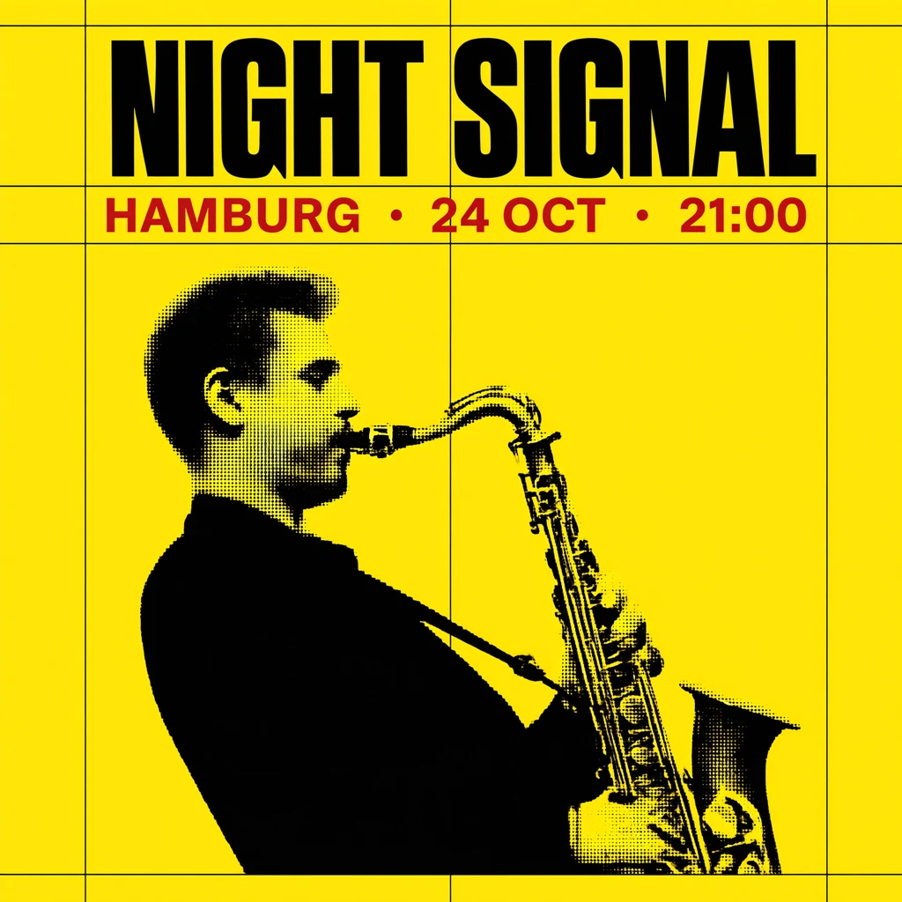
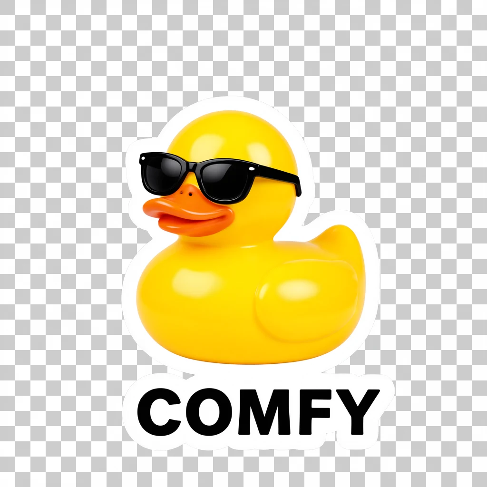
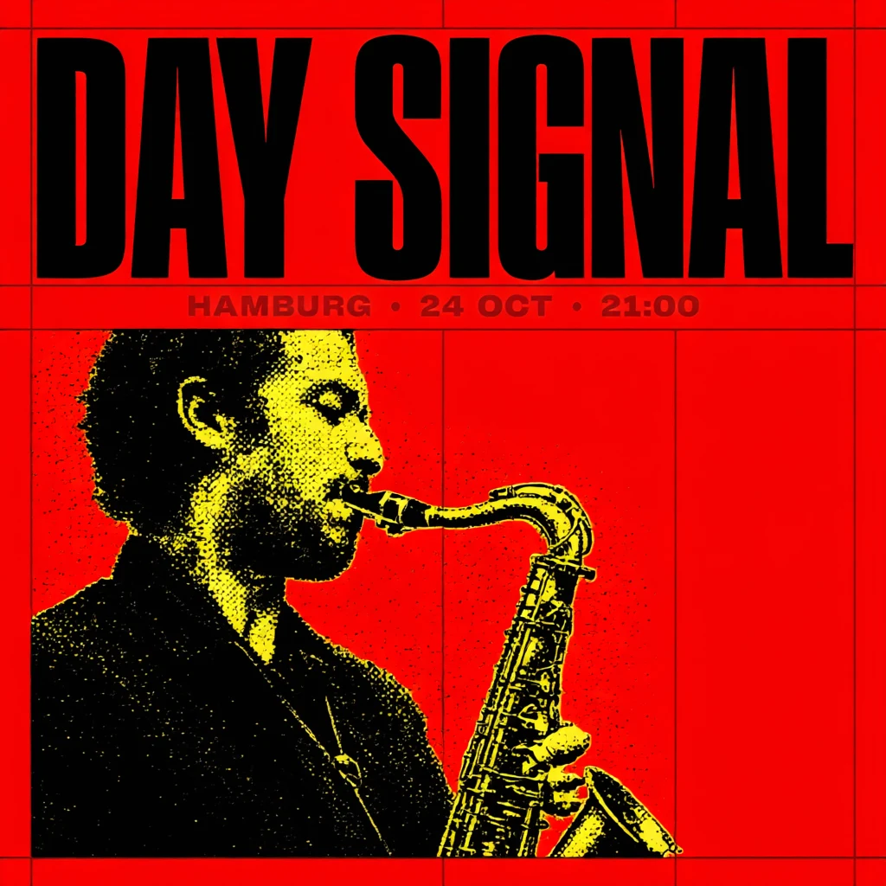
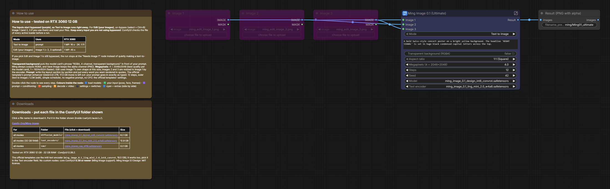

# The_frizzy1 — Ming Image 0.1 Design · 12 GB v1.0.0
> Ming Image 0.1 Design (a 6B design model from inclusionAI / Ant Group) on a 12 GB card: text to image and editing in one
> node, and a switch for real transparent backgrounds. Core ComfyUI nodes only, tested on an RTX 3060.

| | |
|---|---|
| **Model family** | Ming Image 0.1 Design |
| **Tasks** | Text → Image (up to 2K) · Edit (1–3 images) · transparent background (RGBA) |
| **Needs** | 12 GB VRAM · 32 GB system RAM (peaked at 9.8 GB) · ComfyUI **0.39+** |
| **Tested on** | RTX 3060 12 GB · Ryzen 5 5600X · 32 GB DDR4 · ComfyUI 0.39.2 (Comfy Desktop) |
| **YouTube explainer** | [▶ Ming Image 0.1 in ComfyUI: Posters, Text + Real Transparency (12GB)](https://www.youtube.com/watch?v=DTleXeD74vs) |
| **License** | Workflow: MIT · Ming Image 0.1 Design: MIT |

## Quick start
1. Update ComfyUI to **0.39 or newer** (Ming Image support; no custom nodes).
2. Download the 3 files in [downloads.md](downloads.md).
3. Load `The_frizzy1_ming-image-0.1-design-12gb_v1.0.0.json`. It opens on **Text to image**: write your prompt (put every word you want rendered in quotes), **Run**.
4. Editing: pick **Edit (your images)**, un-bypass (select + **Ctrl+B**) Image 1 (and 2, 3 if you use them), load your files.

## Preview

Poster (2K) · sticker with a real alpha channel (checkerboard = transparent) · edit: "DAY SIGNAL" + red background. RTX 3060.

## Modes

| Mode | Uses | RTX 3060 |
|---|---|---|
| Text to image | prompt | 1 MP: 16 s · 2K: 1 min 11 s (median of the warm runs) |
| Edit (your images) | Image 1 (+ 2, 3 optional) | 1 MP: 34 s (1 image) · 56 s (2 images) |

**Transparent background** puts the model card's phrase "RGBA, 4-channel, transparent background." in front of your
prompt. Ming always outputs RGBA and Save Image keeps the alpha channel (PNG). Note: even normal images can come out
partly transparent (my 1K poster had alpha down to 199 on 45 % of its pixels) — flatten onto a background if you need opaque.

## Overview
Built from the two official Ming Image 0.1 Design templates (text to image, image edit) in ComfyUI 0.39:
int8 model, Comfy Kitchen attention, ModelSamplingFlux 1.15 / 0.5, 12 steps, euler (text to image) / LCM (edit),
no negative prompt, no CFG. The template's prompt enhancer (Qwen3.8 27B, 17.3 GB more) is left out: your prompt goes in
exactly as typed. The text encoder is the w4a8 version (12.8 GB) instead of the template's int8 (19.5 GB), for 32 GB of RAM.
Comfy Kitchen vs PyTorch attention, sampling only: 12 s vs 13 s at 1 MP, 1 min 05 s vs 1 min 06 s at 2K.

## Required models
See [downloads.md](downloads.md) — every file was read from the workflow `.json`.

## Required custom nodes
None - core ComfyUI **0.39+**.

## Troubleshooting
- **"Invalid image file" before it starts:** an image input you are not using is un-bypassed. Bypass it (Ctrl+B).
- **Run stops at "Needs Image 1":** you picked Edit and Image 1 is still bypassed.
- **Text spelled wrong:** put the exact words in quotes in the prompt; it's one image per seed, try another seed.
