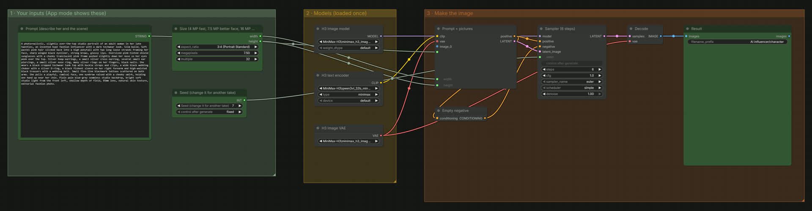
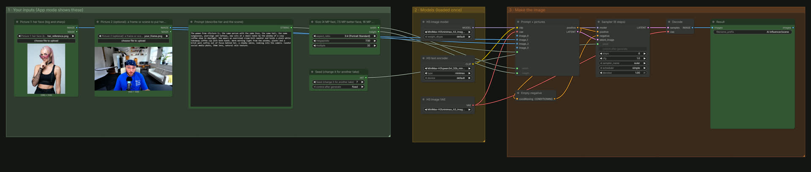
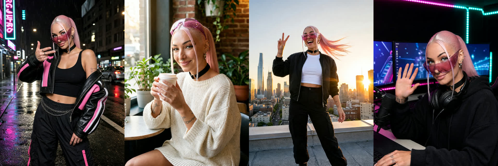
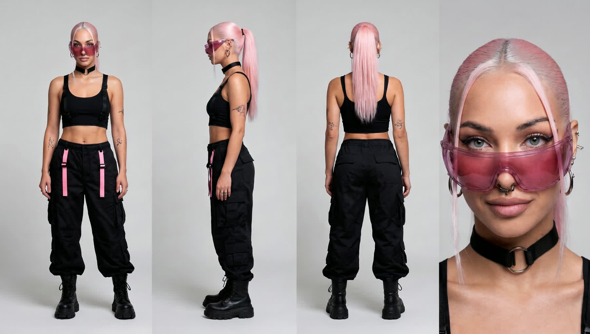

# The_frizzy1 — AI Influencer · 12 GB v1.0.0

☕ If this saved you time: **[Buy me a coffee](https://buymeacoffee.com/the_frizzy1)**

> An invented character, the same face again in any scene, and video of them, on one 12 GB card.
> Four workflows in this folder: two new ones on **MiniMax H3 Image** (core ComfyUI nodes only) and the two video workflows I used with them.
> This page is the step-by-step guide for the video.

| | |
|---|---|
| **Model family** | MiniMax H3 Image (W4A8) for the pictures · Viggle Remake and MiniMax H3 (video) for the clips |
| **Tasks** | Create a character (T2I) · same face in a new scene, outfit or pose (reference image) · reference sheet · keyframe for a video swap |
| **Needs** | 12 GB VRAM · 32 GB system RAM (tested) · ComfyUI **0.45+** · workflows 1 and 2: no custom nodes |
| **Tested on** | RTX 3060 12 GB · Ryzen 5 5600X · 32 GB DDR4 · ComfyUI 0.45.0 |
| **License** | Workflows: MIT · Models: see Credits |

## The four workflows

| # | Workflow | What it does | Where |
|---|---|---|---|
| 1 | **AI Influencer 1 · Create the character** | text prompt → the first picture of an invented person | `The_frizzy1_ai-influencer-1-character-12gb_v1.0.0.json` (this folder) |
| 2 | **AI Influencer 2 · Same face, new scene** | their picture + a prompt → the same person somewhere else; with a second picture it puts them into a frame of your own video | `The_frizzy1_ai-influencer-2-scenes-12gb_v1.0.0.json` (this folder) |
| 3 | **AI Influencer 3 · Viggle Remake swap** | a clip + one painted keyframe → the same clip with your character, the clip's sound kept. The graph I ran, built on [Viggle Remake](https://huggingface.co/Viggle/Viggle-Remake) (needs Viggle's node pack) | `The_frizzy1_ai-influencer-3-viggle-remake-swap-12gb_v1.0.0.json` (this folder) |
| 4 | **MiniMax H3 Ultimate · 12 GB** | a still → a 10 s clip with sound; the last frame of a clip as the first frame of the next for longer ones | `The_frizzy1_ai-influencer-4-minimax-h3-ultimate-12gb (H3 Ultimate 2.3.0).json` (this folder, a copy of v2.3.0; its own page with every mode: [h3-ultimate-12gb](../h3-ultimate-12gb)) |

Workflows 1 and 2 are enough for an account that posts pictures. 3 and 4 are optional: only for video.

## Step by step

### 1 · Install
1. Update ComfyUI to **0.45 or newer** (older versions do not have the MiniMax H3 Image node).
2. Download the three files in [downloads.md](downloads.md) (29.4 GB) into the folders shown.
3. Restart ComfyUI and drag a workflow file into the window. Both open in App mode: you only see the inputs.

If your model files sit in a subfolder (e.g. `diffusion_models/MiniMax-H3/`), click each red loader once and re-pick the file.

### 2 · Create the character (workflow 1)
1. **Prompt**: describe the person like a photo caption: who, hair, glasses, jewellery, outfit, place, light, lens. Long prompts work best. The prompt I used is in [`prompts/1-character.txt`](prompts/1-character.txt).
2. **Size**: 3:4 at 7.5 MP is what I used. MiniMax recommend 4 MP or more; at 3 MP the face gets soft.
3. **Seed**: the same prompt with another seed is another person. Run a few and keep the one you like.
4. **Run**. The picture lands in `ComfyUI/output/AI influencer/`.

### 3 · Make the reference (workflow 1 again)
The picture you reuse must be a **close-up with both eyes visible**. A half-body shot gives the face too few pixels, and every
scene made from it looked worse in my tests. Same character description, framed as a close-up on a plain backdrop:
[`prompts/2-close-up-reference.txt`](prompts/2-close-up-reference.txt).

### 4 · The same face in a new scene (workflow 2)
1. **Picture 1**: the close-up from step 3.
2. **Picture 2**: leave it bypassed (it ships bypassed; Ctrl+B toggles it).
3. **Prompt**: start with *The woman from <Picture 1>, the same person with the same face, the same hair...* and then describe the
   new place and the new outfit. My four scenes: [`prompts/3-scene-*.txt`](prompts).
4. **Size**: 3:4 at 7.5 MP. **Run**.

If an outfit comes out wrong, describe it more exactly (fabric, cut, what it covers). The prompt is the setting here.
Small things drift between pictures (in mine: the shape of the sunglasses, tattoos on the hands).

### 5 · A reference sheet (workflow 2)
Same as step 4, with a prompt that asks for four views on one picture: full body from the front, the side and behind, and a close-up.
Prompt: [`prompts/4-reference-sheet.txt`](prompts/4-reference-sheet.txt). A wide size (16:9) fits four views.

### 6 · Video from a still (workflow 4, optional)
Open workflow 4 (`The_frizzy1_ai-influencer-4-minimax-h3-ultimate-12gb (H3 Ultimate 2.3.0).json`), mode image to video, and load one of the scene pictures as the first frame.
What I ran: 576x736 (0.4 MP, 3:4), 10 s, turbo LoRA. For a longer clip, save the last frame of the clip and use it as the first
frame of the next one. Over three clips (30 s) the face drifted in my test, so check the last frames.

### 7 · Swap the character into a clip (workflows 2 and 3, optional)
This is the "her face, my voice" part. Viggle Remake needs **Viggle's node pack** (`comfyui/ComfyUI-Viggle-Remake` in their
repository) and their swap model, see [downloads.md](downloads.md).

1. **Cut the clip** to a length Viggle accepts: 90 to 345 frames at 24 fps on the grid 17n+5 (90, 107, 124, 141, ...).
2. **Take one frame** of the clip (I used frame 12, half a second in).
3. **Paint the keyframe in workflow 2**: Picture 1 = that frame, Picture 2 = the character's close-up (un-bypass it with Ctrl+B),
   size 16:9. The prompt replaces the person and keeps everything else:
   [`prompts/5-keyframe-two-pictures.txt`](prompts/5-keyframe-two-pictures.txt). Say what must go (hat, glasses, beard, hoodie).
4. **Open workflow 3** (`The_frizzy1_ai-influencer-3-viggle-remake-swap-12gb_v1.0.0.json`) and run it with the clip as source, the keyframe as reference 1 pinned to the frame you took it from, and the
   six-section prompt: [`prompts/6-viggle-remake-video-prompt.txt`](prompts/6-viggle-remake-video-prompt.txt). The duration in the
   prompt has to match the frame count. The clip's own sound is kept, so the mouth follows the voice in the clip.
   The exact API graph I ran is in [`source/viggle_remake_swap_api_12gb.json`](source/viggle_remake_swap_api_12gb.json).
5. **Render bigger than the benchmark.** 832x480 is the size I timed; faces are small at that size. At a short edge of 608
   (1056x608) the result was clearly better on the same card. Viggle's own documented size is 1280x736.

A meme clip works the same way: one frame of the clip, workflow 2, Viggle Remake. The character then has the clip's sound.
That is somebody else's clip: fine for a joke, say that it is AI, and don't build an account on other people's footage.

## Speed (RTX 3060 12 GB, cold start, model loading included)

| Step | Size | Time | Peak VRAM · RAM |
|---|---|---|---|
| Workflow 1, text to image | 3 MP | 0:36 | 11.6 GB · 16.1 GB |
| Workflow 1, text to image | 7.5 MP | 0:51 to 0:54 | 11.6 GB · 17.0 GB |
| Workflow 1, text to image | 16 MP | 1:54 | 11.6 GB · 17.9 GB |
| Workflow 2, one picture | 7.5 MP | 1:46 to 1:48 | 11.6 GB · about 20.7 GB |
| Workflow 2, two pictures (keyframe) | 4.7 MP (2880x1632) | 2:13 to 2:22 | 11.6 GB · about 22 GB |
| Viggle Remake swap | 832x480, 124 frames | 6:37 | 11.6 GB |
| Viggle Remake swap | 1056x608, 90 frames | 8:34 | 11.5 GB · 21.6 GB |
| MiniMax H3 image to video | 576x736, 10 s | 7:55 to 9:05 | |
| Three 10 s clips in a row (30 s) | 576x736 | 24:19 | |

At 16 MP something went wrong in the generation on my setup (same prompt and seed as the 7.5 MP picture), so I stayed at 7.5 MP.
Out of memory: lower the size, or for video make the clip shorter.

## Where the line is
Good uses: UGC-style content, a product video, an ad for your own things, a character for your channel.
Label it as AI when you post it (platforms have a label for that, and in the EU it is required). If you swap a character into
somebody else's clip, say so. Don't use a made-up person to sell things to people who think they are real.
The character in the samples is invented; no real person's photo was used as a reference.

## Troubleshooting
- **Red loaders although you downloaded everything:** your files are in a subfolder. Click each red loader and re-pick the file.
- **"MiniMaxH3ImageConditioning" missing:** ComfyUI is older than 0.45.
- **Workflow 2 says an image is invalid:** Picture 2 is un-bypassed but empty. Bypass it (Ctrl+B) or load a picture.
- **The face changes between scenes:** use a close-up as Picture 1 and start the prompt with *the same person with the same face*.
- **Viggle Remake nodes missing:** install Viggle's node pack from their repository. Workflows 1 and 2 do not need it.

## Files in this folder
- `The_frizzy1_ai-influencer-1-character-12gb_v1.0.0.json`, `The_frizzy1_ai-influencer-2-scenes-12gb_v1.0.0.json`: the two new workflows
- `The_frizzy1_ai-influencer-3-viggle-remake-swap-12gb_v1.0.0.json`: workflow 3, the Viggle Remake swap
- `The_frizzy1_ai-influencer-4-minimax-h3-ultimate-12gb (H3 Ultimate 2.3.0).json`: workflow 4, MiniMax H3 Ultimate
- [`downloads.md`](downloads.md), `models.json`: every model file with its folder and link
- [`prompts/`](prompts): every prompt from the video
- `samples/`: screenshots and results
- `source/`: the scripts that build workflows 1 to 3, and the Viggle Remake API graph I ran

## Credits
- **MiniMax H3 Image** and **MiniMax H3** by MiniMax (MiniMax-H3-Image Community License Agreement / MiniMax H3 Community License).
- **Viggle Remake** by Viggle, built on MiniMax H3: [Viggle/Viggle-Remake](https://huggingface.co/Viggle/Viggle-Remake).
- ComfyUI builds of the model files by Comfy-Org.
- Workflows by **The_frizzy1**: [YouTube](https://www.youtube.com/@the_frizzy1) · [all workflows](https://github.com/Thefrizzy1/The_frizzy1-Workflows)
