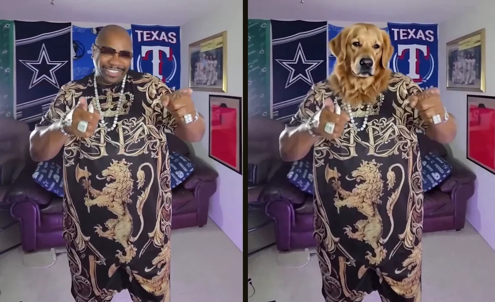
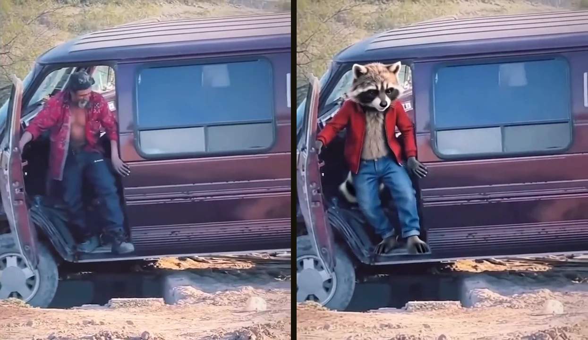
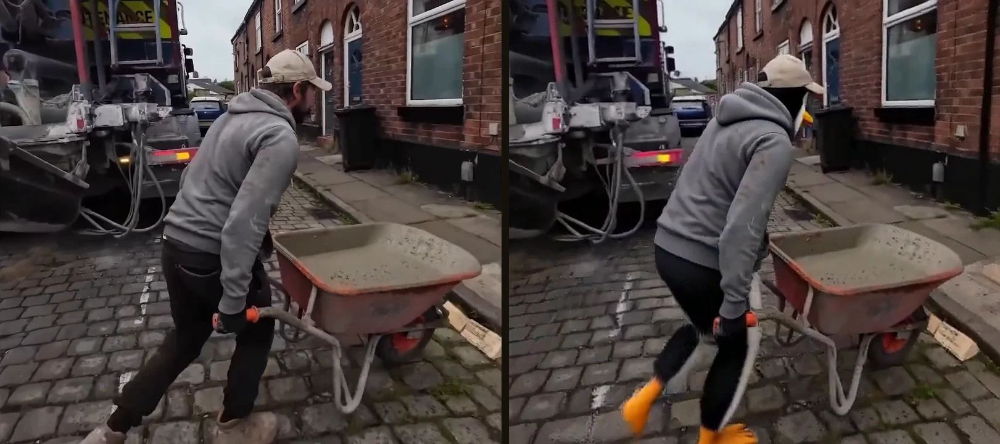

# The_frizzy1 — MiniMax H3 Character Swap · 12 GB v1.0.0
> Your video + one picture of a character → the same clip with the person swapped: same moves, same timing, the clip's
> own sound. Higgsfield's Genjutsu idea, run on your own PC: nothing is uploaded and nothing blocks the clip.
> The whole clip in 5 s passes with ComfyUI's built-in loop nodes. Core ComfyUI nodes only, tested on an RTX 3060.

| | |
|---|---|
| **Model family** | MiniMax H3 (Ref2VA) + the Character Swap LoRA |
| **Task** | Character swap, video → video, with the original sound |
| **Needs** | 12 GB VRAM (peaked at 11892 MiB) · 32 GB system RAM (peaked at 23.1 GB) · ComfyUI **0.39+** |
| **Tested on** | RTX 3060 12 GB · Ryzen 5 5600X · 32 GB DDR4 · ComfyUI 0.39.2 |
| **YouTube explainer** | [ PASTE LINK ] |
| **License** | Workflow: MIT · MiniMax H3 + the LoRA: MiniMax H3 Community License (read it before commercial use) |

## Quick start
1. Update ComfyUI to **0.39 or newer** (MiniMax H3 + the Start Loop / End Loop nodes; no custom nodes).
2. Download the files in [downloads.md](downloads.md).
3. Load `The_frizzy1_h3-character-swap-12gb_v1.0.0.json`, load **your video** and a **character picture** (best: a sheet with a front view, a back view and the face).
4. **Who to replace**: one sentence, e.g. `big man in the black and gold patterned outfit`. **Run**.

## Preview

Left the original, right the local swap (0.4 MP, Turbo). RTX 3060.

## Settings

| Setting | What it does |
|---|---|
| Who to replace | one sentence, goes into the Character Swap LoRA card's prompt |
| Seconds | 0 = the whole clip (5.2 s passes, every pass continues from the last 22 frames of the one before); a number = only the start |
| Megapixels | the time knob: 0.4 MP fits 12 GB, more spills into system RAM |
| Turbo | on = 4 steps (Ref2V turbo LoRA), off = 20 steps |
| Keep the original sound | puts the clip's own audio back on |

## Times on the RTX 3060 (0.4 MP, Turbo, whole clip)

| Clip | Length | Passes | Time |
|---|---|---|---|
| wheelbarrow → penguin | 6.7 s | 2 | 11 min 56 s (this workflow's own graph: 12 min 14 s) |
| van exit → raccoon | 7.0 s | 2 | 10 min 53 s |
| wrestler flip → penguin | 8.3 s | 2 | 11 min 25 s |
| gym guy → dog | 8.1 s | 2 | 11 min 17 s |
| dance → dog | 9.8 s | 3 | 17 min 27 s |
| backbend → raccoon | 5.2 s | 1 | 5 min 37 s |

5 s on its own: 9 min 55 s with the Character Swap LoRA, 7 min 31 s without it, 35 min 10 s with 20 steps.

## Limits
From the LoRA's model card: shots of 4–5 s work best (that's why the loop works in 5 s passes), one person at a time,
hard cuts in the clip confuse it. Swap in characters, not real people's faces.

## Required models
See [downloads.md](downloads.md) — every file was read from the workflow `.json`.

## Required custom nodes
None - core ComfyUI **0.39+**.

## Troubleshooting
- **It swaps the wrong person / nobody:** make the "who to replace" sentence describe what that person wears.
- **Very slow, RAM full:** lower Megapixels; 0.4 MP is what fits 12 GB.
