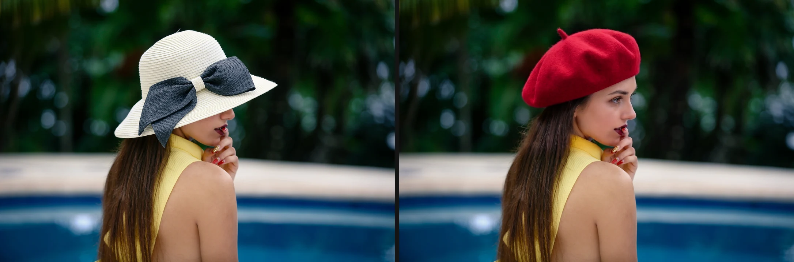
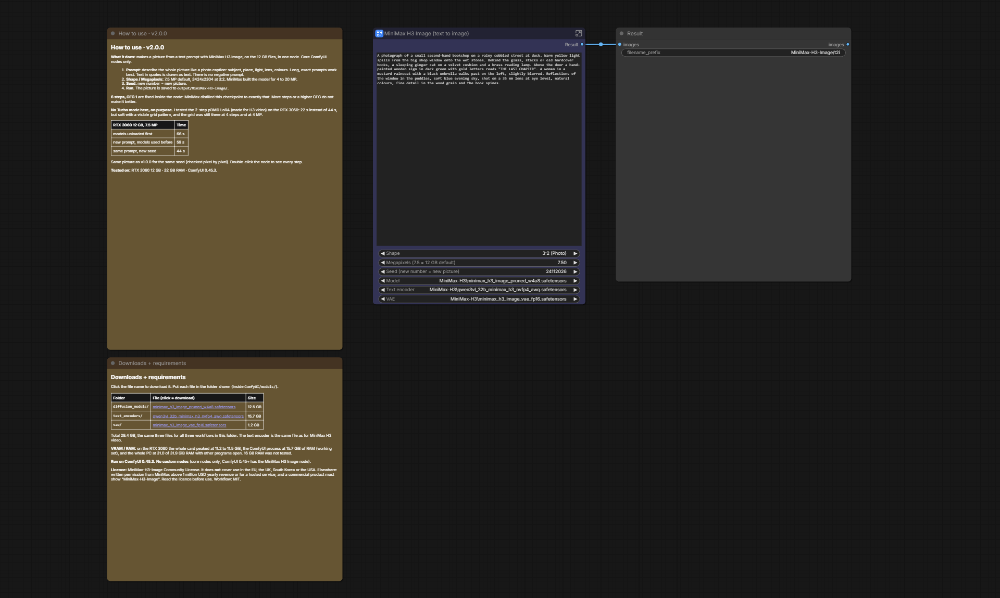
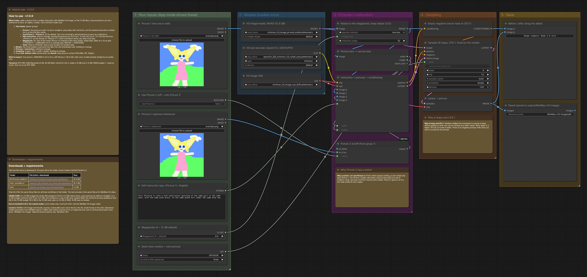
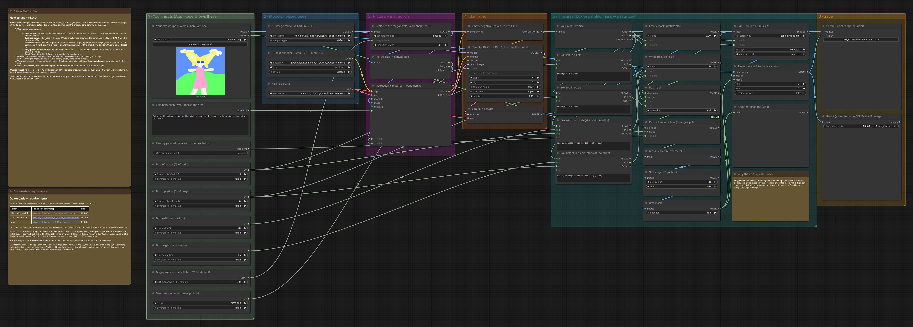

# The_frizzy1 - MiniMax H3 Image · 12 GB v2.0.0

> MiniMax H3 Image on the 12 GB files: text to image, edit a picture (with an optional second picture), and an area edit that changes only a box or a painted mask. Three workflows, core ComfyUI nodes only. New in v2.0.0: text to image is one node and ran on an RTX 3060 12 GB.

| | |
|---|---|
| **Model family** | MiniMax H3 Image (33.1B, distilled to 6 steps), Comfy-Org W4A8 model + NVFP4 text encoder |
| **Tasks** | T2I · edit (1 or 2 pictures) · area edit (box or painted mask) |
| **Min VRAM** | 12 GB. Text to image v2.0.0 ran on an RTX 3060 12 GB (whole card 11.2 to 11.5 GiB). Edit and area edit (v1.0.0) ran inside a 10 GiB VRAM budget, **not verified on a real 12 GB card** |
| **System RAM** | 32 GB recommended: the ComfyUI process peaked at 20.6 GiB in the 10 GiB budget. 16 GB not tested |
| **Tested on** | Text to image v2.0.0: RTX 3060 12 GB · 32 GB RAM · ComfyUI 0.45.3. v1.0.0 files: RTX PRO 4000 Blackwell 24 GB · 64 GB RAM · ComfyUI 0.45.3, with and without `--reserve-vram` budgets |
| **CivitAI** | Not published |
| **Hugging Face** | Not published |
| **YouTube explainer** | Not published |
| **License** | Workflows: MIT · MiniMax H3 Image: [MiniMax-H3-Image Community License](https://huggingface.co/MiniMaxAI/MiniMax-H3-Image/blob/main/LICENSE): **does not cover use in the EU, the UK, South Korea or the USA** (see Known issues) |

## Preview

<p align="center"></p>
<sub>Text to image, the default settings (3:2, 7.5 MP = 3424x2304, seed 24112026), 31 s in a 10 GiB VRAM budget including the model load. The sign text came out as written.</sub>

<p align="center"></p>
<sub>Edit, left the input, right the result: "Turn &lt;Picture 1&gt; into the same view in deep winter… Keep the same composition, the same trees and the same viewpoint." 4 MP (2496x1664), 43 s.</sub>

<p align="center"></p>
<sub>Area edit, left the input, right the result: box 27/8/46/50 % over the hat, "Replace the straw hat in &lt;Picture 1&gt; with a red wool beret…". The result keeps the input size (1776x1184); 44 s.</sub>

<p align="center"></p>
<sub>Edit with Use Picture 2 on: Picture 1 the forest, Picture 2 the woman; "Put the woman from &lt;Picture 2&gt;… into &lt;Picture 1&gt;…". 68 s.</sub>

<p align="center"></p>
<p align="center"></p>
<p align="center"></p>

## Overview
Three workflows on the same three files. Built from ComfyUI's templates *MiniMax-H3-Image: Text to Image* and *MiniMax-H3-Image: Image Edit* (template pack 0.11.104+, fetched from Comfy-Org/workflow_templates; the lab's pack 0.11.101 does not have them), Text to image (v2.0.0) is one node with the inputs on the outside; edit and area edit (v1.0.0) are numbered groups with every input in group 1. App mode is set up in all three. The sampler is the template's (6 steps, CFG 1, euler / simple). Changes to the templates:

- The 12 GB files: the W4A8 model (12.5 GB) and the NVFP4 text encoder (15.7 GB) instead of the templates' int8 files (21.0 GB and 27.1 GB).
- No Qwen3.5 9B prompt expander (the templates have it on). Write the full prompt yourself.
- Default size 7.5 MP for text to image (template 16 MP) and 4 MP for edits (template 16 MP), to keep the times down. 16 MP was run: 66 s.
- New: **area edit**. The model has no mask input, so the workflow lets it edit the whole picture, then pastes only the area (a box in percent, or a mask painted in ComfyUI's MaskEditor, with a 31 px soft edge) back into the untouched picture.
- New: an optional **Picture 2** in the edit workflow behind an on/off switch.

Already using the [AI Influencer · 12 GB](../ai-influencer-12gb) pack? Its workflows 1 and 2 run the same three files for a character and its scenes; this folder is the general-purpose version.

## Capabilities
- `The_frizzy1_h3-image-12gb-t2i_v2.0.0.json`: text to image in one node. Shape (8 ratios) + megapixels. Writes text that is in quotes in the prompt.
- `The_frizzy1_h3-image-12gb-edit_v1.0.0.json`: edit Picture 1 from an instruction; optional Picture 2 as a reference (`<Picture 1>`, `<Picture 2>` in the prompt). The result has Picture 1's shape at the chosen megapixels.
- `The_frizzy1_h3-image-12gb-area-edit_v1.0.0.json`: change only a box (left, top, width, height in % of the picture) or a painted mask. The result keeps the input's own size; outside the area the pixels stay the original's.
- Edit and area edit: every input in group 1; App mode shows only those (labels checked in App mode in a headless browser).

## Text to image v2.0.0 on the RTX 3060, and why there is no Turbo mode
RTX 3060 12 GB, 32 GB RAM, ComfyUI 0.45.3, 7.5 MP (3424x2304), 6 steps. Time = sending the job to the saved picture, one run each.
"Models unloaded" = ComfyUI kept running, models and cache freed first (not a fresh start).

| Run | 6 steps (the file) | 2-step pDMD LoRA (test, not in the file) |
|---|---|---|
| Models unloaded first | 66 s | 39 s |
| New prompt, models used before | 59 s | 26 s |
| Same prompt, new seed | 44 s | 22 s |
| Peak VRAM, whole card | 11.4 to 11.5 GiB | 11.3 to 11.4 GiB |
| Peak RAM, ComfyUI process (working set) | 15.7 GiB | 16.1 GiB |

The whole PC was at up to 31.0 of 31.9 GiB RAM with other programs open, so 32 GB is tight. The file gives the same pixels as v1.0.0
(checked once).

The model is already distilled to 6 steps. The [2-step pDMD LoRA](https://huggingface.co/Iwannapose/minimax_h3_pdmd_2nfe_comfyui)
(Apache-2.0, 1.96 GB, made for H3 video) was tested on the W4A8 model with shift 12 and strength 1: pictures came out soft with a visible
grid pattern. At 4 steps (35 s for a new seed) the grid was weaker but still there and small text went wrong; at 4 MP it was the same. So there is no
Turbo mode. The LoRA's own page suggests a second detail pass; that was not tested.

## Hardware & VRAM (v1.0.0 files on the lab card)
All runs on one machine: RTX PRO 4000 Blackwell 24 GB, 64 GB RAM, ComfyUI 0.45.3. VRAM is the peak from nvidia-smi, read once per second, in GiB (MiB / 1024); 0.5 to 0.9 GiB of the whole-GPU figure belonged to other programs. RAM is the ComfyUI process's resident memory (RSS), read once per second.

| How ComfyUI was started | ComfyUI process VRAM | Whole GPU | ComfyUI RAM (RSS) | Time | Pictures |
|---|---|---|---|---|---|
| No limit (the lab instance) | 22.7 GiB | 23.2 GiB | 8.5 to 9.9 GiB | same as below | |
| 12 GiB budget (`--reserve-vram 11.89`, no custom nodes) | 11.9 to 12.5 GiB | 12.8 to 13.4 GiB | 13.0 to 16.5 GiB | same | identical to 10 GiB |
| 10 GiB budget (`--reserve-vram 13.89`, no custom nodes) | 9.9 to 10.7 GiB | 10.8 to 11.4 GiB | 17.3 to 20.6 GiB | same | identical to 12 GiB |

- ComfyUI fills the VRAM it gets and keeps the rest of the model in system RAM, so less VRAM means more RAM. In the 12 GiB budget it went up to 0.5 GiB over the budget; in the 10 GiB budget the whole GPU stayed under 11.5 GiB.
- The pictures were pixel-identical in both budgets; against the unlimited run the text-to-image picture differed by at most 2 of 255 and the three edits were identical.
- System RAM in use on the machine rose to 26.3 GiB during the 10 GiB batch (9.4 GiB before it). **Plan on 32 GB of RAM.** 16 GB was not tested.
- **Not verified on a 12 GB card.** A budget on a 24 GB card is the closest the lab gets; an RTX 3060 is a slower card. Edit and area edit were not run on it; text to image was (above).

## Required models
See [downloads.md](downloads.md) for the table with links. Every file below was read from the workflow `.json` files. SHA-256 of all three downloads matched the Hugging Face listing (2026-11-24).

```
ComfyUI/models/
├── diffusion_models/  ← minimax_h3_image_pruned_w4a8.safetensors
├── text_encoders/     ← qwen3vl_32b_minimax_h3_nvfp4_awq.safetensors
└── vae/               ← minimax_h3_image_vae_fp16.safetensors
```

## Required custom nodes
None. Core nodes used: UNETLoader, CLIPLoader, VAELoader, MiniMaxH3ImageConditioning, ConditioningZeroOut, KSampler, VAEDecode, SaveImage, LoadImage, ResolutionSelector, ImageScaleToTotalPixels, GetImageSize, ComfySwitchNode, ImageCompare, ComfyMathExpression, SolidMask, MaskComposite, MaskToImage, ImageBlur, ImageToMask, ResizeImageMaskNode, ImageCompositeMasked, MaskPreview, PrimitiveStringMultiline, PrimitiveInt, PrimitiveFloat, PrimitiveBoolean, and MarkdownNote (frontend note). In `/object_info` of ComfyUI 0.45.3 each backend node's module is `nodes` or `comfy_extras.*` and none is marked deprecated.

## Optional custom nodes
None.

## Installation
1. Update ComfyUI to 0.45 or newer (0.45.3 tested). Older versions do not have `MiniMaxH3ImageConditioning`.
2. Download the three files ([downloads.md](downloads.md), 29.4 GB) into the folders shown.
3. Load one of the three `.json` files. Each opens with `example.png` (ships with ComfyUI) and a default written for it, so the first **Run** works.

## Recommended settings
| Setting | Value | Notes |
|---|---|---|
| Steps / CFG / sampler | 6 / 1 / euler, simple | fixed by the distilled model; MiniMax's own server refuses other values. No negative prompt |
| Text to image | 7.5 MP (3424x2304 at 3:2) | RTX 3060: 66 s with the models unloaded first, 44 s for a new seed. Lab card: 30 to 31 s, 16 MP (5024x3360) 65 to 66 s; MiniMax say 4 to 20 MP, best near 16 |
| Edit / area edit | 4 MP | 42 to 44 s for one picture; the area edit's result keeps the input size anyway |
| Edit instruction | short, name `<Picture 1>`, say what stays | a full scene description in the instruction was not tested |
| Area | cover the whole old object, with room around it | see Known issues |

## Inputs / Outputs
- **Inputs:** a prompt (T2I); one or two pictures + an instruction (edit); a picture + an instruction + a box or painted mask (area edit). Any size; Picture 1 is resized to the megapixels on a 32 px grid, Picture 2 goes in as it is.
- **Outputs:** PNG in `output/MiniMax-H3-Image/` (`t2i_`, `edit_`, `area-edit_`). Before / after slider in the edit workflows.

## Performance
On the machine above, 17 successful API runs (one more failed validation because its second picture was not in the input folder). Time = from sending the job to the finished file; the first run after a start includes loading the models (from the file cache).

| Run | Size | Time | Runs |
|---|---|---|---|
| Text to image, first run after start | 7.5 MP, 3424x2304 | 30 to 31 s | 3 (one per setup) |
| Text to image | 16 MP, 5024x3360 | 65 to 66 s | 2 (12 and 10 GiB budget) |
| Edit, one picture | 4 MP, 2496x1664 | 42 to 44 s | 3 |
| Edit, one picture (`example.png`) | 4 MP, 2048x2048 | 38 s | 1 |
| Edit, two pictures | 4 MP, 2496x1664 | 66 to 68 s | 3 |
| Area edit, box | 4 MP edit, 1776x1184 result | 43 to 44 s | 3 |
| Area edit, box (`example.png`) | 4 MP edit, 768x768 result | 37 s | 1 |
| Area edit, painted mask | 4 MP edit, 1776x1184 result | 43 s | 1 |

RTX 3060 12 GB: text to image see above, edit and area edit not verified.

## Known issues
- **Licence territory:** the MiniMax-H3-Image Community License does not cover use in the EU, the UK, South Korea or the USA (people there have to ask MiniMax for a licence). Elsewhere, above 1 million USD yearly revenue or for a hosted service you need MiniMax's written permission, a commercial product must show "MiniMax-H3-Image", and outputs may not be used to train other models. Read [the licence](https://huggingface.co/MiniMaxAI/MiniMax-H3-Image/blob/main/LICENSE).
- **Area edit, leftovers at the mask edge:** whatever is outside the mask stays. In the painted-mask test the mask missed the left brim of the straw hat and a piece of the brim stayed next to the new beret → paint (or box) over the whole old object with some room around it.
- **Area edit, painted mask on a JPEG:** a JPEG has no transparency, so with **Use my painted mask** on and nothing painted, nothing changes. Paint in MaskEditor (it saves a PNG with the mask) before turning it on.
- **Area edit on JPEG inputs:** outside the area the result differed from my own decode of the JPEG by up to 3 of 255 (on a PNG input: 0 pixels changed). Not visible.
- **Edit moves things slightly:** the edit redraws the whole picture, so in plain edits small details shift (the forest's trees are the same trees, not the same pixels). Use the area edit when the rest must stay exactly.
- **"Image compare: Node 2.0 only":** the Before / after node shows this text in the classic node view of frontend 1.57.6; the result is saved either way.
- **Picture 2 loader is always checked:** ComfyUI checks every loader even when Use Picture 2 is off, so Picture 2 must point to a file that exists (it ships with `example.png`).
- **The model sees the area only through the instruction:** it does not know where the box is. Say in the instruction what goes there ("the hat", "on her head").
- The prompts and test pictures are the lab's; the standard `prompts.json` was not in the inputs folder. Pictures were looked at by eye (whole picture and 1:1 crops); nobody checked them on other seeds.
- Reddit threads were read only as search excerpts (the Reddit tool was not used). A September 2026 post (H3 video weights as an image editor) puts the RAM need at about 36 GB on a Mac; not checked here.

## Changelog
See [changelog.md](changelog.md).

## Related workflows
- [AI Influencer · 12 GB](../ai-influencer-12gb) (same files, character + scenes guide) · [MiniMax H3 Ultimate · 12 GB](../h3-ultimate-12gb) (video) · [Qwen Image 2.1 Ultimate · 12 GB](../../qwen/image-2.1-ultimate-12gb)
