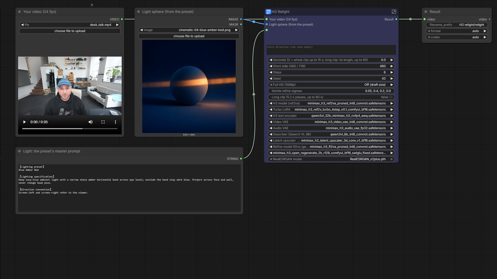

# The_frizzy1 — H3 Relight · 12 GB v1.0.0

☕ If this workflow saved you time: **[Buy me a coffee](https://buymeacoffee.com/the_frizzy1)**

> Your video + a light sphere + a light text → the same shot in a new light. Same people, room, camera, timing and sound.
> A local ComfyUI rebuild of [Sirio Berati's open-source relight](https://github.com/sirioberati/relight-open-source)
> (built for one rented 80 GB GPU) on MiniMax H3, tested on an RTX 3060. Core ComfyUI nodes only.

| | |
|---|---|
| **Model family** | MiniMax H3 Ref2VA int8 + ref2v turbo LoRA · Qwen3-VL 8B (describer) |
| **Tasks** | Relight a video (V2V) · original sound · optional Full HD (1088p) · optional long clip (up to 60 s in 5.2 s passes) |
| **Needs** | 12 GB VRAM · 32 GB system RAM (tested) · ComfyUI **0.44+** · no custom nodes |
| **Tested on** | RTX 3060 12 GB · Ryzen 5 5600X · 32 GB DDR4 · ComfyUI 0.44.0 (renders) · ComfyUI 0.45.0 + frontend 1.58.5 (the saved file) |
| **License** | Workflow: MIT · Light presets + spheres: MIT, Sirio Berati · Models: see Credits |

## Quick start
1. Update ComfyUI to **0.44 or newer**.
2. Download the files in [downloads.md](downloads.md) (51.5 GB for Full HD off).
3. Load `The_frizzy1_h3-relight-12gb_v1.0.0.json`. You see five nodes: your three inputs on the left, the **H3 Relight** node with every setting, the **Result** on the right.
4. Fill in the inputs:
   - **Your video**: 24 fps, up to 15 s in one pass
   - **Light sphere**: a preset's sphere image (`spheres/` in Sirio's repo) or your own
   - **Light text**: that preset's master prompt (the `master` text in `presets.json`), or your own in the same headings
5. On **H3 Relight** set **Short side** (480 fast, 736 sharper), **Seconds** (0 = the whole clip) and **Full HD**, then **Run**.
6. The video lands in `ComfyUI/output/H3 relight/`.

If your model files sit in a subfolder (e.g. `MiniMax-H3/`), pick them once on the main node: every loader is there.

## Preview

The workflow as it opens: three inputs, one settings node, the result. Double-click H3 Relight to see every step.

## Settings (on the H3 Relight node)

| Setting | Default | What it does |
|---|---|---|
| Light text (master prompt) | socket | the light, from the text node on the left |
| Extra direction | empty | one more line for the prompt writer, e.g. *keep the monitor glow* |
| Seconds | 0 | 0 = the whole clip, up to 15 s (362 frames) in one pass. Long clip: the length to relight, up to 60 |
| Short side | 480 | 480 or 736. Size is the clip's shape at that short side, multiples of 32 |
| Steps | 6 | H3 steps with the turbo LoRA |
| Seed | 42 | the same seed is used for every pass of a long clip |
| Full HD (1088p) | Off | Off · Gentle H3 refine (sigma 0.55) · RealESRGAN x2 (no redraw) |
| Gentle refine sigmas | 0.55, 0.4, 0.2, 0.0 | a lower start keeps more of the draft (NVIDIA's default 0.909 redrew the face in my test) |
| Long clip | off | on: up to 60 s in 5.2 s passes (see below). Full HD does not apply to long clips |
| 10 model files | | every loader, so you can point them at your own folders |

## Full HD

| Full HD | What happens |
|---|---|
| Off (draft size) | the H3 draft at your short side |
| Gentle H3 refine | H3 latent upscaler to 1088p, then 3 Regenerate-2K steps on H3 fl2va from sigma 0.55 (the NVIDIA Open-H3-Regenerate-2K recipe at 1080p instead of 1440p), CFG 1 |
| RealESRGAN x2 | RealESRGAN x2 on every draft frame, Lanczos to 1088p. Nothing is redrawn |

1088p = short side 1088 (1920×1088 for a 16:9 clip). Only the chosen path runs.

## Long clip (new, not GPU-tested yet)
Switch **Long clip** on and set **Seconds** to the clip's length (up to 60; 0 = one pass). The clip is relit in passes of 124 frames
(5.2 s, the length every test used) with ComfyUI's core Start Loop / End Loop nodes:

- the prompt is written once, from the first frame, so every pass gets the same prompt, the same sphere and the same seed
- from pass 2 on, the last 22 frames of the pass before are anchored at the start (core MiniMax H3 Add Guide, as in my H3 Character Swap) and then dropped, so light and motion carry over the join
- each pass decodes only its own 5.2 s of the clip and is stored as a small H.264 clip with its own slice of the original sound; the passes are joined in order at the end

Seconds must not be longer than the clip. A 60 s clip is 14 passes, so about 14× the time of one 480 run (one 480 pass took 6:40 – 6:49 below).

## Measured on the RTX 3060
5.2 s desk clip (1920×1088), 6 steps, Blue Amber Bed preset, cold start. VRAM is the whole GPU, RAM the ComfyUI process.

| Run | Wall | Peak VRAM | Peak RAM |
|---|---|---|---|
| 480, Full HD off (3 presets) | 6:40 – 6:49 | 11,841 MiB | 21.4 GB |
| 736, Full HD off (3 presets) | 21:03 – 24:02 | 11,938 MiB | 22.6 GB |
| 736 + gentle refine to 1920×1088 | 31:48 | 11,945 MiB | 22.5 GB |
| RealESRGAN x2 of a finished 736 clip (its own graph) | 3:54 – 5:49 | 7,744 MiB | 14.4 GB |

These runs used the same graph as this workflow, built in API form (`source/build_h3_relight.py`). The saved `.json` was checked
against it node by node (ComfyUI's own conversion of the saved file, see below). RealESRGAN inside this workflow and the long clip have
not been rendered yet.

## How it works
1. Qwen3-VL 8B describes the first frame (people, room, current light, camera): Sirio's *describe* step.
2. Qwen3-VL 8B rewrites the light text for this shot in five sections: Sirio's *adapt* step, with H3's tags (`<Picture 1>` = the sphere, `<Video 1>` = your clip).
3. H3 Ref2VA renders the clip again from the sphere, the clip and its sound with that prompt. euler / simple, shift 12 / 2.

## How it was checked
- The saved file was loaded in ComfyUI 0.45.0 (frontend 1.58.5), turned into a run graph with the frontend's own `graphToPrompt` for four
  settings (480 off, 736 gentle, 736 RealESRGAN, long clip 10 s) and passed ComfyUI's server-side `validate_prompt` for all four.
- 480 off and 736 gentle were compared node by node with the tested graph: the same computation. The only differences: the
  frontend writes SaveVideo's codec twice, and the tested 1080p graph also saved the 736 draft as a second file.
- Frontend 1.58.5 put 14 links on the wrong input when it built the subgraphs (Math Expression, MiniMax H3 Reference to Video,
  Start Loop). They were moved back before saving (`source/relight_fix.js`), and the check above runs on the saved file.

## Known limits
- Clips are read as 24 fps.
- One pass is 15 s at most; longer clips need Long clip.
- Full HD does not apply to long clips.

## Required custom nodes
None: core ComfyUI 0.44+.

## Source
`source/build_h3_relight.py` builds the tested run graph (API format). `source/ultimate2_relight.py` is the spec the
subgraph layout is built from (house builder), `source/relight_fix.js` the link repair, `source/relight_post.js` the labels +
layout pass, `source/relight_api_diff.py` the node-by-node check.

## Credits & license
- Relight pipeline, describe + adapt prompts, 67 light presets and spheres: [Sirio Berati, relight-open-source](https://github.com/sirioberati/relight-open-source) (MIT, `source/LICENSE_MIT_Sirio_Berati.txt`)
- [MiniMax H3](https://huggingface.co/MiniMaxAI/MiniMax-H3) by MiniMax, ComfyUI files by [Comfy-Org](https://huggingface.co/Comfy-Org/MiniMax-H3) (MiniMax H3 Community License)
- Latent upscaler: [NVIDIA Open-H3-Regenerate-2K](https://huggingface.co/Efficient-Large-Model/Open-H3-Regenerate-2K) (MiniMax H3 Community License); ComfyUI LoRA conversion by [DrakenZA](https://huggingface.co/DrakenZA/Open-H3-Regenerate-2K-ComfyUI)
- Qwen3-VL 8B: [Comfy-Org/Qwen3-VL](https://huggingface.co/Comfy-Org/Qwen3-VL) (Apache-2.0)
- [Real-ESRGAN](https://github.com/xinntao/Real-ESRGAN) by Xintao Wang (BSD-3-Clause)

Workflow: MIT, by **The_frizzy1** · [YouTube](https://www.youtube.com/@the_frizzy1)
