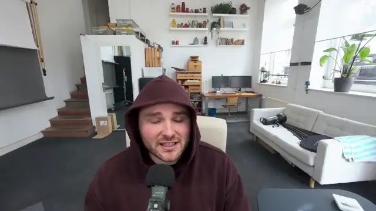

# The_frizzy1 — H3 Singularity Swap · 12 GB v1.0.0

☕ If this workflow saved you time: **[Buy me a coffee](https://buymeacoffee.com/the_frizzy1)**

> Swap one real person in your video for the person in your photo, with MiniMax H3 Singularity V2.
> The room, the camera and the sound stay. One H3 pass over the whole clip, no seams, App mode.
> Built on the idea of [OPENjutsu](https://github.com/D3voz/openjutsu), as one ComfyUI workflow.

| | |
|---|---|
| **Model family** | MiniMax H3 Singularity V2 pruned int8 + SAM 3.1 + Qwen3-VL 8B |
| **Tasks** | Person-to-person swap (V2V) · up to 15 s in one pass · lip-sync on or off · original sound |
| **Needs** | 12 GB VRAM · 32 GB system RAM (tested) · ComfyUI **0.43.1** (tested) · 2 custom node packs |
| **Tested on** | RTX 3060 12 GB · Ryzen 5 5600X · 32 GB RAM · ComfyUI 0.43.1 · Windows 11 |
| **License** | Workflow: MIT · Models: see Credits |

## Quick start
1. Update ComfyUI (tested on **0.43.1**).
2. Install the 2 custom node packs and download the 7 files in [downloads.md](downloads.md) (53.2 GB). Already running H3? You only need the first file.
3. Load `The_frizzy1_h3-singularity-swap-12gb_v1.0.0.json`. It opens in **App mode**.
4. Fill in the inputs and press **Run**:
   - **Your video**: 24 fps, no mirrors, up to 15 s
   - **Person photo**: one sharp photo with a big face, plain background
   - **Who to replace**: what SAM 3.1 looks for, e.g. *person* or *bald man*. The biggest match is taken.
   - **Describe the new person**: one line (hair, beard, glasses, outfit)
   - **Seconds**: `0` = the whole clip (try 3 s first)
   - **Short side**: 480 for speed, 736 for close-ups
   - **Lip-sync**: on for talking, off for music
5. The video lands in `ComfyUI/output/H3 simple swap/`.

## Important: full-body clips
**If your clip shows the legs and your photo stops at the waist, add the trousers and shoes to the description**
(e.g. *Dark jeans and sneakers.*). Without them, Singularity made the head too big in my tests.

## Preview

Made by this workflow on the RTX 3060: my desk clip, swapped from one photo at 1312×736 (3.5 s shown).

## How it works
SAM 3.1 tracks the person. Qwen3-VL 8B looks at four frames and writes one line about the framing and the action.
The person is turned into a grey figure that keeps pose, hands and mouth but not the face or clothes.
H3 then regenerates only the masked area from your photo and the grey figure, in one pass.

**Why the describer is in here:** without that shot line, Singularity V2 ignored the grey figure in my tests and drew
a giant head in the middle of the frame. Plain H3 didn't. Singularity follows the prompt harder, so the prompt has
to say what the shot is.

Settings: ref2v turbo LoRA 1.0 · 6 steps · euler / simple · shift 12 / 2 · motion reference 512 px · mask grown 4% of the long side.

## Measured on the RTX 3060
Cold start, seed 42. VRAM is the whole GPU, RAM is the ComfyUI process.

| Run | Size | Wall | Peak VRAM | Peak RAM |
|---|---|---|---|---|
| 9.4 s dance clip, full body, whole clip | 480×864 | 13:01 | 11,622 MiB | 23.3 GB |
| 5.2 s desk clip, close-up, lip-sync on | 1312×736 | 12:13 | 11,731 MiB | 23.1 GB |
| 3 s kitchen clip, medium shot | 768×736 | 5:18 | 11,598 MiB | 22.6 GB |

## Known limits
- One person per run. Mirrors and reflections are not handled.
- Clips are read as 24 fps.
- In full-body clips the head can still run a little large. A sharp photo and a clear outfit line help.

## Required models
See [downloads.md](downloads.md): 7 files, 53.2 GB, every file name read from the workflow `.json`.

## Required custom nodes
[comfyui-h3-oneclick-swap](https://github.com/D3voz/comfyui-h3-oneclick-swap) (person mask, grey figure) and
[ComfyUI-Fantastic-MiniMaxH3-PromptBuilder](https://github.com/Adudeguyman/ComfyUI-Fantastic-MiniMaxH3-PromptBuilder) (masked edit latent).

## Source
`source/build_h3_swap.py` builds the run graph (API format) and, with `--polish`, the shareable workflow.

## Credits & license
- Singularity V2 by [WarmBloodAban](https://huggingface.co/WarmBloodAban/Minimax-h3_Singularity), built on [MiniMax H3](https://huggingface.co/MiniMaxAI/MiniMax-H3) by MiniMax (MiniMax H3 Community License)
- ComfyUI files by [Comfy-Org](https://huggingface.co/Comfy-Org/MiniMax-H3)
- SAM 3.1 by Meta ([Comfy-Org/sam3.1](https://huggingface.co/Comfy-Org/sam3.1)), Qwen3-VL ([Comfy-Org/Qwen3-VL](https://huggingface.co/Comfy-Org/Qwen3-VL)): see their licenses on the model pages
- Mask, grey figure and prompt idea from [OPENjutsu](https://github.com/D3voz/openjutsu) by D3voz (MIT)

Workflow: MIT, by **The_frizzy1** · [YouTube](https://www.youtube.com/@the_frizzy1)
