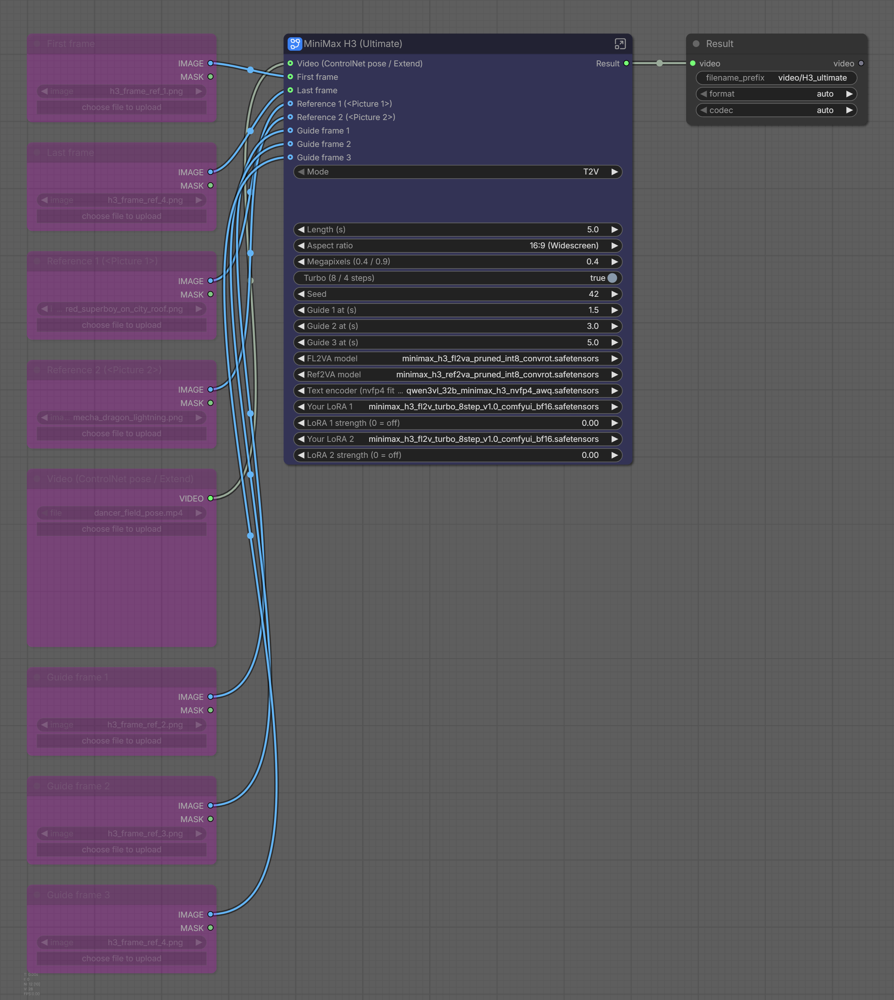

# The_frizzy1 — MiniMax H3 Ultimate · 12 GB v2.3.0

<a href="https://www.youtube.com/watch?v=KJNksY9Ur3w&list=PLMztlpsP7Bgg"></a>

☕ If this workflow saved you time: **[Buy me a coffee](https://buymeacoffee.com/the_frizzy1)**

> Every local MiniMax H3 mode in one workflow - pick it from a dropdown. Video with sound. Core ComfyUI nodes only, tested on an RTX 3060.

| | |
|---|---|
| **Model family** | MiniMax H3 |
| **Tasks** | T2V · I2V · Last frame · First+last · R2V · Multiframe · ControlNet pose · Extend a clip (all with audio) |
| **Needs** | 12 GB VRAM · **32 GB system RAM** (it peaks at 17–22 GB, close other big apps) · ~42 GB disk for T2V/I2V, ~69 GB for every mode |
| **Tested on** | RTX 3060 12 GB · Ryzen 5 5600X · 32 GB DDR4 · ComfyUI 0.37.4 (Sage attention); v2.3.0 on ComfyUI 0.39.2 |
| **YouTube explainer** | [MiniMax H3 Ultimate workflow explained](https://www.youtube.com/watch?v=KJNksY9Ur3w&list=PLMztlpsP7Bgg) |
| **License** | Workflow: MIT · MiniMax H3: MiniMax H3 Community License |

## Quick start
1. Update ComfyUI (v2.3.0 tested on **0.39.2**; no custom nodes needed).
2. Download the files in [downloads.md](downloads.md) into the folders it shows. Every mode = all 10 files (~69 GB).
   Only text/image to video (incl. last frame, first + last, extend)? Then you need 5 files, ~42 GB: the FL2VA model, the
   FL2V turbo LoRA, the text encoder and both VAEs.
3. Load `The_frizzy1_minimax-h3-ultimate-12gb_v2.3.0.json`. It opens ready for **T2V**: write your prompt, **Run**.
4. Other modes: pick the **Mode** on the node, un-bypass (select + **Ctrl+B**) only the inputs that mode uses (table
   below) and load your files. **Keep every input you are not using bypassed** (purple).

Keep **Megapixels at 0.4 or 0.9** on 12 GB. 1.5 MP spills out of VRAM and didn't finish in 30 minutes.

**Downloaded only the 42 GB set?** ComfyUI checks every loader before it runs, also the ones your mode skips. Click the
red Ref2VA / Ref2V LoRA / ControlNet / SDPose / RT-DETR loaders and pick any file you have in that folder: they are never
loaded in the FL2VA modes, so it doesn't matter which.

## Preview

<p align="center">
<a href="samples/preview-1.mp4"></a>
<a href="samples/preview-2.mp4"></a>
</p>

<sub>Click a frame to open the clip (T2V, I2V (first frame)).</sub>

<p align="center"></p>

## Modes (one dropdown)

The inputs start **bypassed** (purple). Un-bypass only the ones your mode uses (select + Ctrl+B) and **keep everything you
are not using bypassed**: ComfyUI checks the file of every active loader before it runs, also in modes that never read it.
If the mode needs the First frame, Last frame or Video and it is still bypassed, the run stops at a "Needs ..." node
instead of quietly making a T2V. References and guide frames are optional: bypassed ones are left out.

| Mode | Uses |
|---|---|
| T2V | prompt |
| I2V (first frame) | First frame |
| Last frame | Last frame |
| First + last frame | First frame + Last frame |
| R2V (references) | Reference 1 + 2 (write `<Picture 1>`, `<Picture 2>` in the prompt) |
| Multiframe | References + 3 guide frames at the times you set |
| ControlNet (pose) | Reference 1 + video (the pose is read from it) |
| Extend (continue a clip) | Video: its last 22 frames (~0.9 s) **and their sound** start the new clip, so the join doesn't jump; after that H3 makes the picture and sound for your prompt. Switch **Extend: keep the clip's sound** off for a silent clip. The result begins with those frames, so trim ~0.9 s when you join the clips. **Long video:** load the result back in and run Extend again, one clip after another. |

## Extend with the clip's sound (v2.3.0)
Core `Add Guide for MiniMax H3` takes audio as well as frames. With **Extend: keep the clip's sound** on, the clip's last 0.9 s of sound go in with its last 22 frames. My test: a clip with music under its last seconds, extended with the switch on and off (same seed + prompt). The first 0.9 s of the new clip followed the music's loudness almost exactly with the switch on (envelope match 0.961), and not at all with it off (-0.016). After the join H3 makes new sound for your prompt in both cases: it did not keep the song going.

**Why not a "context loop"?** The long-video loop workflows going around use custom node packs (e.g. ComfyUI-MiniMaxH3-Context-Loop). Core ComfyUI has no loop node yet, so here a long video = Extend, again and again.

## Character swap (the 9th H3 mode) → its own workflow

MiniMax H3 can do nine things; eight are in this workflow. The ninth, a full character swap, runs on Viggle's H3 finetune
and needs the [comfyui-viggle-animate-h3](https://registry.comfy.org/nodes/comfyui-viggle-animate-h3) node pack plus
~22 GB of extra models. I decided to keep it separate so this workflow stays core ComfyUI nodes only:
**[Viggle-Animate (H3) · 12 GB](../viggle-animate-h3)** (tested on the same RTX 3060).

## Overview
Built from the six official MiniMax H3 templates in ComfyUI 0.37.4. One node outside carries the settings; double-click it
to see the 50 nodes inside, colour-coded (blue models, green inputs, purple prompt, orange sampling, yellow decode, grey
switches). The Mode dropdown picks the model (FL2VA or Ref2VA), which inputs are read, the ControlNet and the multiframe
guides. Switch nodes are lazy, so only the model your mode needs is loaded. Turbo LoRAs on by default (8 steps FL2VA,
4 steps Ref2VA, 20 with turbo off). Length in seconds is turned into a valid H3 frame count for you (5 s = 124 frames).
**Your LoRAs:** two slots on the node (core LoRA loaders). Strength 0 = off, the file isn't even opened; pick your LoRA
and set a strength, it goes on the chosen H3 model on top of the turbo LoRA.

## Measured on the RTX 3060

Each mode was run once through this workflow (5 s clips, turbo on). *Wall* = queue to finished, including model loading;
*sampling* = time in the sampler nodes.

| Mode | Size | Wall | Sampling | Peak VRAM | Peak RAM |
|---|---|---|---|---|---|
| T2V | 0.4 MP | 3 min 02 s | 2 min 28 s | 11.3 GB | 16.9 GB |
| I2V (first frame) | 0.4 MP | 3 min 20 s | 2 min 46 s | 11.3 GB | 17.1 GB |
| Last frame | 0.4 MP | 3 min 19 s | 2 min 46 s | 11.4 GB | 17.1 GB |
| First + last frame | 0.4 MP | 3 min 29 s | 2 min 54 s | 11.3 GB | 16.9 GB |
| R2V (references) | 0.4 MP | 2 min 10 s | 1 min 33 s | 11.4 GB | 16.9 GB |
| Multiframe | 0.4 MP | 2 min 18 s | 1 min 42 s | 11.3 GB | 16.9 GB |
| ControlNet (pose) | 0.4 MP | 4 min 59 s | 2 min 43 s | 11.3 GB | 20.1 GB |
| Extend (continue a clip) | 0.4 MP | with the clip's sound 3 min 51 s–3 min 53 s · without 3 min 31 s–3 min 33 s (v2.3.0, ComfyUI 0.39.2) | — | 11.4 GB | 19.1 GB |

At **0.9 MP** (1280×736) every mode also ran (v2.0.0, Comfy Kitchen attention): 6 min 31 s (Multiframe) to 13 min 07 s
(ControlNet), peak VRAM 11.6 GB, peak RAM 18.5–21.8 GB. **1.5 MP** (T2V) timed out after 32 min, so stay at 0.9 MP or below.

## Required models
See [downloads.md](downloads.md) — every file was read from the workflow `.json`.

## Required custom nodes
None - core ComfyUI (v2.3.0 tested on **0.39.2**: native MiniMax H3, SDPose, Switch / Custom Combo / Math Expression, Trim Audio Duration).

## Get the models (one command)

```bash
python scripts/frizzy.py doctor minimax/h3-ultimate-12gb --comfy "C:/path/to/ComfyUI"
```

## Troubleshooting
- **"Invalid image file" / "Invalid video file" before it starts:** an input you are not using is un-bypassed. Bypass it (Ctrl+B).
- **Run stops at "Needs the First frame / Last frame / Video":** your mode uses that input and it is still bypassed.
- **Loaders are red for models you didn't download:** see "Downloaded only the 42 GB set?" above.
- **Loaders are red although you downloaded everything:** your models live in sub-folders (e.g. `diffusion_models/MiniMax-H3/`). Click each red loader and
  re-pick the file once.
- **Out of memory / very slow:** go back to 0.4 MP and close other apps; it needs ~17–22 GB of system RAM on top of the
  12 GB GPU.
