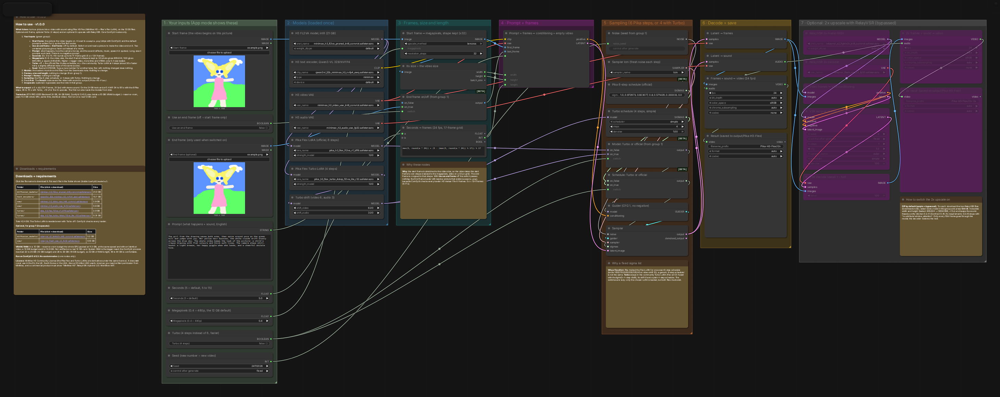

# The_frizzy1 — Pika H3 Flex I2V · 12 GB v1.0.0

> Turn one picture and a prompt into a 5 s video **with sound** using Pika H3 Flex (MiniMax H3 + Pika's Flex LoRA, 6 steps). Optional end frame, an optional 4-step Turbo switch and an optional RelayVSR 2x upscale. Core ComfyUI nodes only.

| | |
|---|---|
| **Model family** | Pika H3 Flex (on MiniMax H3 FL2VA) |
| **Tasks** | I2V with audio · optional end frame · Turbo (4 steps) · optional RelayVSR 2x upscale |
| **Min VRAM** | 12 GB is the target. **Not verified on 12 GB** (ran inside a 10 GiB budget, see Hardware & VRAM) |
| **Tested on** | RTX PRO 4000 Blackwell 24 GB · 64 GB RAM · ComfyUI 0.45.3 (frontend 1.57.6) |
| **CivitAI** | Not published |
| **Hugging Face** | [Pika-Labs/Pika-H3-Flex](https://huggingface.co/Pika-Labs/Pika-H3-Flex) · [Pika-Labs/Pika-H3-Flex-Turbo-LoRA](https://huggingface.co/Pika-Labs/Pika-H3-Flex-Turbo-LoRA) · [Comfy-Org/MiniMax-H3](https://huggingface.co/Comfy-Org/MiniMax-H3) · [Comfy-Org/RelayVSR](https://huggingface.co/Comfy-Org/RelayVSR) |
| **YouTube explainer** | Not published |
| **License** | Workflow: MIT · MiniMax H3 and the Pika Flex / Turbo LoRAs: [MiniMax H3 Community License](https://huggingface.co/Pika-Labs/Pika-H3-Flex/blob/main/LICENSE), which **does not cover use in the EU, the UK, South Korea or the USA**, needs written permission above 20 million USD yearly revenue, and a commercial product must show "MiniMax H3" · RelayVSR: Apache-2.0 ([kopper/RelayVSR](https://huggingface.co/kopper/RelayVSR), [lightx2v/RelayVSR_X2](https://huggingface.co/lightx2v/RelayVSR_X2)) |

## Preview

<p align="center">
  <a href="samples/preview-1.mp4"></a>
  <a href="samples/preview-2.mp4"></a>
</p>

<sub>Click a picture to open the clip with sound. Left: the default settings (6 Pika steps, 0.4 MP, seed 24112026) with the woman-with-hat picture, 800x544, 124 frames; she says the prompted line "Perfect day for a swim." (Whisper read it back; nobody listened). Right: the autumn-forest picture with group 7 (RelayVSR 2x) switched on, 1600x1088, same seed. The animated previews are 12 fps, 640 px wide; `preview-1.mp4` is the file as saved, `preview-2.mp4` re-encoded to 4 MB (CRF 26). The prompts are in the run's API files, not in the workflow: the workflow opens with a prompt written for `example.png`. Source pictures, from the lab's standard inputs:</sub>

<p align="center"></p>

<p align="center"></p>

## Overview
Pika H3 Flex is Pika's post-trained adapter for MiniMax H3: a LoRA on the H3 FL2VA model that makes a video with synchronized stereo sound in six steps. This workflow is built from ComfyUI's built-in template `video_pika_h3_flex_fl2va` (same files, same 6-step sigma list, `lcm`, CFG 1), taken out of its subgraph into numbered groups with every input in group 1 for App mode. It adds three things the template does not have: the video size follows your picture's shape at a megapixel setting (the template used the picture's full size), a **Turbo** switch for the community 4-step Pika Flex Turbo LoRA, and a bypassed **RelayVSR 2x** group for the "upscale it" requests.

## Capabilities
- `The_frizzy1_pika-h3-flex-i2v-12gb_v1.0.0.json`: one start picture + a prompt (action, camera, sound) → an mp4 with stereo sound, 24 fps, 5 to 15 s (H3 rounds up to its 17-frame grid: 5 s = 124 frames).
- **End frame** (optional): a Boolean switch plus a second picture; the video ends on it.
- **Size**: the start frame is resized to the megapixels (0.4 = 480p-class), shape kept, sides on a 32 px grid: 800x544 from a 3:2 photo, 864x480 from 16:9, 640x640 from a square (all three were run).
- **Turbo** (off by default): swaps the official Flex LoRA + Pika 6-step list for the community Turbo LoRA (Flex at 0.5 fused with the lightx2v 4-step distill), video shift 6 / audio shift 3, 4 steps `simple`, as its model card says.
- **Group 7, bypassed**: RelayVSR x2 (int8) + its Flash decoder, 1 step, CFG 1, euler / simple, as in the built-in `utility_relayvsr_video_x2_upscale` template; saves a second mp4 at 2x width and height with the same sound.
- Colour-coded groups: inputs (green) · models (blue) · frames, size and length (teal) · prompt (purple) · sampling (orange) · decode + save (amber) · optional upscale (grey).

## Hardware & VRAM
All numbers are from one machine: RTX PRO 4000 Blackwell 24 GB, 64 GB RAM. It is not a 12 GB card.

| Run | Peak VRAM (whole GPU) | ComfyUI process RAM (RSS) |
|---|---|---|
| No VRAM limit (any setting) | 23.1 to 23.4 GiB (ComfyUI fills the card) | 7.0 to 10.3 GiB |
| 12 GiB budget (`--reserve-vram 11.89`), 6 steps / Turbo / forest + 2x | 13.3 GiB | 22.1 to 25.3 GiB |
| 10 GiB budget (`--reserve-vram 13.89`), same three runs | **11.3 GiB** | 26.0 to 29.2 GiB |

- **Not verified on 12 GB.** The budget rows are a second ComfyUI on the same 24 GB card with `--reserve-vram` and `--disable-all-custom-nodes`: ComfyUI's own soft limit, not a 12 GB card. The 12 GiB budget went over 12 (13.3 GiB); the 10 GiB budget stayed at 11.3 GiB, including the plain VAE decode and the RelayVSR group at 0.4 MP.
- The budget did not change the result: the videos from the 12 and 10 GiB runs are identical to the unlimited runs (PSNR inf, all three prompts), and the runs were 1.6 to 6.2 s slower.
- **System RAM is the bigger need:** the 21 GB model and the 15.7 GB text encoder are streamed from RAM when VRAM is short, so the less VRAM, the more RAM (up to 29.2 GiB RSS, 34.3 GiB used on the whole machine). 32 GB of RAM is tight; 48 to 64 GB is comfortable. Not tested on a 32 GB machine.
- Only 0.4 MP was run. Higher megapixels mean more VRAM and time; a 16 GB benchmark site reports 1280x720 working with a tiled decode and a shape error at a height of 720 (this graph keeps sides on a 32 px grid, so 720 cannot happen).
- VRAM: highest `nvidia-smi` reading once per second, MiB / 1024. RAM: the ComfyUI process VmRSS once per second.

## Required models
See the per-workflow [downloads.md](downloads.md) for the full table with verified links (SHA-256 checked).
Every file below was read from the workflow `.json`.

```
ComfyUI/models/
├── diffusion_models/  ← minimax_h3_fl2va_pruned_int8_convrot.safetensors        (21.0 GB)
│                      ← relayvsr_x2_lightx2v_int8_convrot.safetensors          (5.2 GB, group 7 only)
├── text_encoders/     ← qwen3vl_32b_minimax_h3_nvfp4_awq.safetensors           (15.7 GB)
├── vae/               ← minimax_h3_video_vae_int8_convrot.safetensors          (2.8 GB)
│                      ← minimax_h3_audio_vae_fp32.safetensors                  (0.6 GB)
│                      ← relayvsr_flash_vae_x2_fp32.safetensors                 (0.13 GB, group 7 only)
└── loras/             ← pika_h3_flex_fl2va_v1_bf16.safetensors                 (2.0 GB)
                       ← pika_h3_flex_turbo_4step_fl2va_lite_r32.safetensors    (0.31 GB)
```

42.4 GB without group 7, 47.7 GB with it. The Turbo LoRA is needed even with Turbo off: the switch is lazy (only the chosen LoRA is loaded) but ComfyUI checks every loader before it runs. If you already have the MiniMax H3 Ultimate set, only the two Pika LoRAs are new.

## Required custom nodes
None. Run on ComfyUI 0.45.3 only. Core nodes used (28, plus MarkdownNote): BasicGuider, BasicScheduler, CLIPLoader, ComfyMathExpression, ComfySwitchNode, CreateVideo, GetImageSize, ImageScaleToTotalPixels, KSampler, KSamplerSelect, LoadImage, LoraLoaderModelOnly, ManualSigmas, MiniMaxH3ImageToVideo, MiniMaxH3SigmaShift, PrimitiveBoolean, PrimitiveFloat, PrimitiveInt, PrimitiveStringMultiline, RandomNoise, RelayVSRConditioning, SamplerCustomAdvanced, SaveVideo, UNETLoader, VAEDecode, VAEDecodeAudio, VAELoader, VSRDecode. Each one's module in `/object_info` is `nodes` or `comfy_extras.*`, none is deprecated, and every run on the second instance used `--disable-all-custom-nodes`.

**RelayVSR needs comfy-kitchen 0.2.41** (the version ComfyUI 0.45.3's requirements ask for). With 0.2.40 the VSR sampler stops with `module 'comfy_kitchen' has no attribute 'window_attention'`. Update with ComfyUI's `requirements.txt` if you see that.

## Optional custom nodes
None.

## Installation
1. Update ComfyUI to 0.45.3 (and its requirements, for RelayVSR).
2. Download the six files from [downloads.md](downloads.md) (or the Downloads note inside the workflow). Add the two RelayVSR files if you want group 7.
3. Load `The_frizzy1_pika-h3-flex-i2v-12gb_v1.0.0.json`. It opens with `example.png` and a prompt written for it, so **Run** works straight away. Then load your picture in **Start frame** and describe the action, the camera and the sound.
4. For the 2x upscale: select every node in group 7 and press **Ctrl+B**.

## Recommended settings
| Setting | Value | Notes |
|---|---|---|
| Megapixels | 0.4 | 480p-class, the only size run. Pika lists 480p and 768p as native |
| Seconds | 5 | 124 frames. Pika supports 5 to 15 s; only 5 s was run |
| Turbo | off | 6 Pika steps, the official schedule. On = 4 steps, about 30 s faster here |
| Sampler / CFG | lcm / 1 | from the template; `lcm` adds fresh noise each step, like Pika's "renoise" sampling |
| Sigmas (official) | 1.0, 0.972973, 0.923077, 0.8, 0.571429, 0.333333, 0.0 | Pika's knots 1000/750/500/250/100/40/0 at video shift 12 (from the template) |
| Turbo | 4 steps, simple, shift 6 / audio 3 | the Turbo LoRA model card's FL2VA values |
| Seed | 24112026, fixed | type a new number for another take |

## Inputs / Outputs
- **Inputs:** a start picture (any shape), optionally an end picture, a prompt in English (action, camera, sound; speech in quotes). App mode shows the 8 inputs of group 1.
- **Outputs:** an H.264 mp4 with AAC stereo sound (32 kHz), 24 fps, in `output/Pika-H3-Flex/`; with group 7 on, a second mp4 at 2x size (`i2v-2x_…`).

## Performance
RTX PRO 4000 Blackwell 24 GB, ComfyUI 0.45.3, no sage attention, models on a fast disk; each row is one run:

| Run | Settings | Time |
|---|---|---|
| Hat picture, first run (models loaded from disk) | 800x544, 5 s, 6 steps | 94.6 s (6 steps × 12.1 s) |
| Hat picture, seed 777 | same | 96.2 s |
| Hat picture, 12 / 10 GiB budget | same | 99.4 / 100.8 s |
| Hat picture, Turbo (lite LoRA / full 3.9 GB LoRA) | 800x544, 4 steps | 65.1 / 65.2 s |
| Hat picture, Turbo, 12 / 10 GiB budget | same | 66.7 / 66.9 s |
| Forest picture | 800x544, 6 steps | 97.4 s |
| Forest picture + group 7 (2x) | 1600x1088 | 110.1 s (12 / 10 GiB budget: 111.9 / 112.3 s) |
| Forest picture, Turbo | 800x544, 4 steps | 70.1 s |
| `example.png` (the shipped defaults) | 640x640, 6 steps | 86.1 s |
| End frame on (two unrelated pictures) | 864x480, 6 steps | 99.2 s |

Every run re-encodes the prompt with the 32B text encoder and swaps it with the 21 GB model, so a new seed costs about as much as a first run. RTX 3060 12 GB: Not verified.

## Known issues
- **End frame with an unrelated picture:** with two different pictures the model holds the start frame for about 2 s and then hard-cuts to the end frame (at 2.08 s, mean frame difference 52 of 255). That follows the pictures, but it is not a camera move. A start/end pair from the same scene was not tried.
- **Quiet sound on calm scenes:** the forest clip's sound came out quiet (mean −45 dB against −19 dB for the hat clip) and fades out in the last second; the spectrogram shows the low strings and a bird call, so it is there. Turbo gave the same (−49 dB). Raise the volume in an editor, or ask for louder sound in the prompt (not tested).
- **Turbo is a different take, not a faster copy:** at the same seed Turbo gave the same scene and line, with small changes (an earring appeared). The lite Turbo LoRA (0.31 GB) and the full one (3.9 GB) gave nearly the same frames, so the workflow loads the lite one. Turbo's quality on fast action was not tested; Reddit users doubt the "better than official" claim of its model card.
- **Hidden faces get invented:** the hat picture shows little of the face; "turns her head toward the camera" makes the model draw one.
- **2x upscale darkens a little:** at 2x crop the RelayVSR forest clip is sharper with slightly more contrast than the 800x544 clip. One clip.
- **Loaders must point at existing files:** both picture loaders hold `example.png` (ships with ComfyUI); the End frame loader is checked even with the end frame off.
- Not run: 768p / other megapixels, lengths over 5 s, Pika's T2V and Ref2VA modes, the 8-step HD Turbo file, an RTX 3060. The prompts are my own (the lab's `prompts.json` was missing). The model card says Pika's sampling "renoises" with fresh noise; whether core `lcm` matches it exactly was not checked.
- The browser checks (screenshot, App mode view) used frontend 1.57.6, older than the 1.58.5 ComfyUI 0.45.3 asks for. No run was started from App mode.

## Changelog
See [changelog.md](changelog.md).

## Related workflows
- [MiniMax H3 Ultimate · 12 GB](../h3-ultimate-12gb) (every H3 mode, same base files) · [LTX 2.5 Ultimate · 12 GB](../../ltx/ltx-2.5-ultimate-12gb) (also has RelayVSR x2) · [Hunyuan Video 1.5 I2V · 12 GB](../../hunyuan/video-1.5-i2v-12gb)
