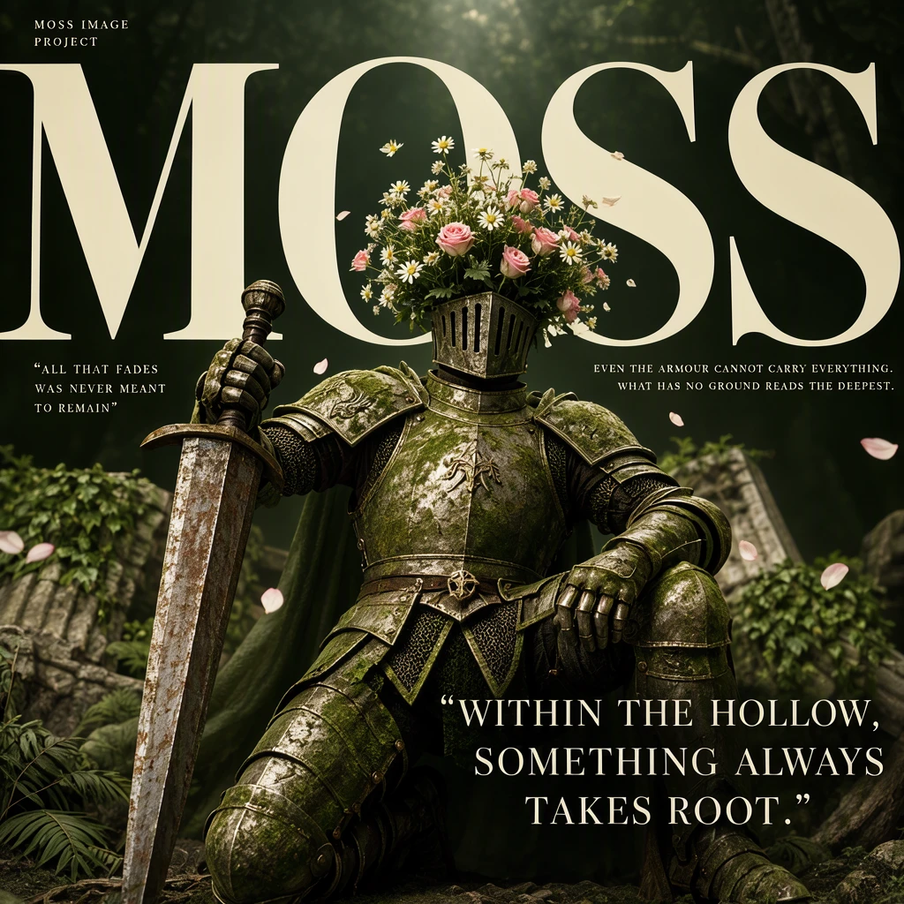
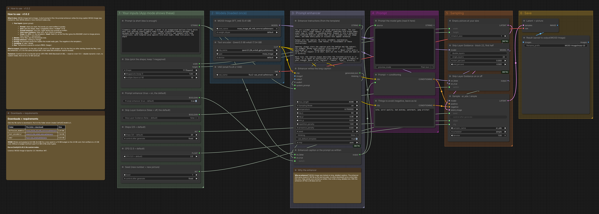

# The_frizzy1 — MOSS-Image · 12 GB v1.0.2

☕ If this workflow saved you time: **[Buy me a coffee](https://buymeacoffee.com/the_frizzy1)**

> MOSS-Image in four workflow files: text to image, layout with boxes, edit, and a new picture in your photo's shape.
> Core ComfyUI nodes only, one text encoder file for all four.

| | |
|---|---|
| **Model family** | MOSS-Image SFT (OpenMOSS, 5B DiT, int8 file) |
| **Tasks** | Text → Image · Layout (boxes) · Edit · Control (MoGe shape) |
| **Min VRAM** | 12 GB (v1.0.1 measured 11.0 to 11.5 GB on an RTX 3060; v1.0.2 not run on a 12 GB card) |
| **Tested on** | v1.0.2: ComfyUI 0.45.3, lab server (24 GB card) in a 10 GiB VRAM budget · v1.0.1: RTX 3060 12 GB, ComfyUI 0.43.1 |
| **CivitAI** | Not published there yet |
| **Hugging Face** | [Comfy-Org/MOSS-Image](https://huggingface.co/Comfy-Org/MOSS-Image) · [OpenMOSS-Team/MOSS-Image-SFT](https://huggingface.co/OpenMOSS-Team/MOSS-Image-SFT) |
| **YouTube explainer** | (no video yet) |
| **License** | Workflow: MIT · MOSS-Image: Apache-2.0 · MoGe repackage: MIT · edit and control LoRAs: no licence stated |

## Overview
MOSS-Image is a 5B image model with a Qwen3.5 9B text encoder and the FLUX.2 VAE. It is good at text in pictures and takes a
layout of boxes. This folder has one file per job, each built from Comfy's own template and laid out in numbered groups: the
inputs you change are all in group 1 (and in App mode). v1.0.2 is the same settings as v1.0.1, rebuilt for ComfyUI 0.45.3.

## Preview

Left: the text to image file as saved (prompt enhancer on, seed 1). Middle: the layout file as saved (Comfy's template
boxes, seed 7). Right: the control file with the standard full-body photo (`ref_doll_realistic.png`) and an astronaut
prompt, not the saved `example.png` and prompt. No edit sample: see Known issues. All made on ComfyUI 0.45.3 in a 10 GiB budget.

Graphs of the other files: [layout](samples/workflow-layout.png) · [edit](samples/workflow-edit.png) · [control](samples/workflow-control.png).

## Capabilities

| File | What it does |
|---|---|
| `The_frizzy1_moss-image-t2i-12gb_v1.0.2.json` | Text to image. A short prompt is fine: the prompt enhancer (same Qwen3.5 file) writes the long caption |
| `The_frizzy1_moss-image-layout-12gb_v1.0.2.json` | Text to image with boxes: say what goes where, and which words go in which box |
| `The_frizzy1_moss-image-edit-12gb_v1.0.2.json` | Edit one picture with the edit LoRA (see Known issues) |
| `The_frizzy1_moss-image-control-12gb_v1.0.2.json` | New picture in the shape of your photo: MoGe 3 reads the shape, no map to prepare |

## Hardware & VRAM
Measured on ComfyUI 0.45.3 on the lab server (RTX PRO 4000 Blackwell 24 GB) with `--reserve-vram 13.5`, which leaves ComfyUI
about 10 GiB. VRAM is the whole card from nvidia-smi, in GiB. This is not a 12 GB proof: the card is 24 GB and ComfyUI fills
whatever budget it gets (without a budget the same runs used 13.4 to 17.4 GiB).

| Run (v1.0.2, 10 GiB budget) | Size | Wall | Peak VRAM |
|---|---|---|---|
| Text to image, first run after starting ComfyUI | 1024×1024 | 40 s | 8.9 GiB |
| Text to image, same prompt, new seed | 1024×1024 | 27 s | 6.8 GiB |
| Layout, saved boxes (3 runs, seeds 7 and 8) | 1024×1024 | 32 to 35 s | 9.1 to 9.2 GiB |
| Edit (2 runs) | 1024×1024 / 1248×832 | 44 to 45 s | 10.4 GiB |
| Control (4 runs) | 1024×1024 / 768×1360 | 32 to 33 s | 9.0 to 9.5 GiB |

The pictures did not depend on the budget: text to image, layout and edit were pixel-identical with and without it; control
differed in small details only (same picture).

RTX 3060 12 GB, v1.0.1 on ComfyUI 0.43.1 with sage attention (same settings, older layout): text to image 55 s new prompt,
43 s new seed, 1 min 16 s first run, 11.3 GB; layout 45 s, 11.5 GB; edit 1 min 11 s, 11.3 GB; control 58 s, 11.3 GB.

## Required models
See [downloads.md](downloads.md): every file name read from the workflow `.json` files. Text to image and layout need three
files (13.0 GB), edit adds the edit LoRA, control adds the control LoRA and MoGe 3 ViT-L.

## Required custom nodes
None. Core ComfyUI 0.45.3 (every node's `python_module` is `nodes` or `comfy_extras.*`, none deprecated; run with
`--disable-all-custom-nodes`).

| Node | Link |
|---|---|
| (none) | |

## Optional custom nodes
| Node | Link | Why |
|---|---|---|
| (none) | | |

## Installation
1. Update ComfyUI to 0.45.3 or newer.
2. Download the files in [downloads.md](downloads.md) into the folders shown. MoGe goes in `models/geometry_estimation/`.
3. Load the `.json` for the job, change the inputs in group 1, **Run**.

## Recommended settings

| Setting | Value | Notes |
|---|---|---|
| Size | 1 megapixel, any shape | the templates' size; edit and control follow your picture's shape at about 1 MP |
| Text to image / layout | 25 steps, CFG 2.5, er_sde / simple | template |
| Prompt enhancer | on for text to image, off for layout | template defaults |
| Skip Layer Guidance | off for text to image, on for layout (block 22, first half) | template defaults |
| Edit | 30 steps, CFG 4, euler / normal, seed 42 | template |
| Control | 25 steps, CFG 3, ER-SDE, shift 5, follow the map until 0.6 | template |
| Control map | depth (*mask* = outline only, looser) | in group 3 on purpose, so App mode does not show it |

## Inputs / Outputs
- **Inputs:** a prompt (all files); boxes drawn in the box editor (layout, needs Nodes 2.0); one picture (edit, control).
  The edit and control files open with `example.png` (ships with ComfyUI) and a prompt written for it.
- **Outputs:** one PNG in `output/MOSS-Image/`.

## Performance
See Hardware & VRAM. Wall time is queue to finished on the lab server; not verified on a 12 GB card for v1.0.2.

## Known issues
- **Edit changes more than asked.** Hat swap on the standard portrait: the hat was right, the head turned toward the camera
  (2 of 2 seeds). Forest to winter: a new snowy scene, not the same trees and mountains (3 of 3 runs, two instructions, two
  seeds). The saved instruction on `example.png`: half a yellow vest (seed 42), no change (seed 43). Reddit reports the same
  about MOSS edit. Try several seeds, and use another edit model when the rest of the picture must stay.
- **Text in the layout file** came out spelled right in all five boxes on seeds 7 and 8. v1.0.1 on the 3060 (seed 1) got one
  garbled title and three empty boxes, so check a second seed before trusting it.
- **Lab note, ComfyUI 0.45.3:** on the lab server (comfy-kitchen 0.2.40, ComfyUI asks for 0.2.41) the prompt enhancer failed
  with `module 'comfy_kitchen' has no attribute 'memmove'`; every v1.0.2 number is with `--disable-dynamic-vram`. Installing
  ComfyUI's requirements should avoid it; not verified.
- The edit and control LoRAs have no licence on their Hugging Face pages (the control LoRA's original repo no longer opens);
  check before commercial use.

## Changelog
See [changelog.md](changelog.md).

## Related workflows
- [Qwen Image 2.1 · 12 GB](../../qwen/image-2.1-12gb)
- [FireRed Image Edit 1.1](../../firered/image-edit-1.1)
