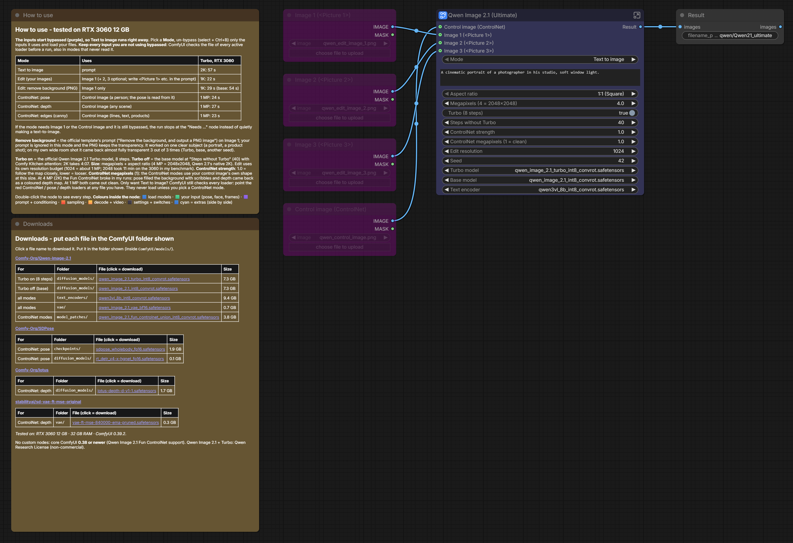

# The_frizzy1 — Qwen Image 2.1 Ultimate · 12 GB v2.1.0
> Every Qwen Image 2.1 mode in one workflow: text to image, editing with your images, ControlNet pose / depth / edges,
> and the new Turbo model. Core ComfyUI nodes only, tested on an RTX 3060.

| | |
|---|---|
| **Model family** | Qwen Image 2.1 |
| **Tasks** | Text → Image (native 2K) · Edit (1–3 images) · ControlNet pose · ControlNet depth · ControlNet edges (canny) |
| **Needs** | 12 GB VRAM · 32 GB system RAM · ComfyUI **0.38+** (0.39.2 tested) |
| **Tested on** | RTX 3060 12 GB · Ryzen 5 5600X · 32 GB DDR4 · ComfyUI 0.39.2 (Comfy Desktop) |
| **YouTube explainer** | [ PASTE LINK ] |
| **License** | Workflow: MIT · Qwen Image 2.1 + Turbo: Qwen Research License (non-commercial) |

## Quick start
1. Update ComfyUI to **0.38 or newer** ("Apply Fun ControlNet" is a core node since 0.38; no custom nodes).
2. Download the files in [downloads.md](downloads.md). Text to image + edit with Turbo needs 3 files; ControlNet adds the rest.
3. Load `The_frizzy1_qwen-image-2.1-ultimate-12gb_v2.1.0.json`. It opens on **Text to image** with Turbo on: write your prompt, **Run**.
4. Other modes: pick the **Mode** on the node, un-bypass (select + **Ctrl+B**) only the inputs that mode uses and load
   your files. **Keep every input you are not using bypassed.**

## Preview

<p align="center">


</p>

<sub>Text to image (Turbo, 2048×2048) · ControlNet pose from a frame of my video (Turbo, 1 MP) · Edit (Turbo, 1 MP). RTX 3060.</sub>

<p align="center"></p>

## Modes (one dropdown)

| Mode | Uses | Turbo, RTX 3060 |
|---|---|---|
| Text to image | prompt | 2K: 57 s · 1 MP: 13 s |
| Edit (your images) | Image 1 (+ 2, 3 optional; write `<Picture 1>` etc. in the prompt) | 1 MP: 22 s |
| Edit: remove background (PNG) | Image 1 only | 1 MP: 29 s (base model: 54 s) |
| ControlNet: pose | Control image (a person; SDPose reads the pose) | 1 MP: 24 s |
| ControlNet: depth | Control image (any scene; Lotus makes the depth map) | 1 MP: 27 s |
| ControlNet: edges (canny) | Control image (lines, text, products) | 1 MP: 23 s |

The inputs start **bypassed** (purple), so text to image runs straight away. If your mode needs Image 1 or the Control
image and it is still bypassed, the run stops at a "Needs …" node instead of quietly making a text-to-image.

## Remove background (v2.1.0)
From the official template (ComfyUI 0.39): the edit path with the prompt "Remove the background, and output a PNG image" on Image 1. Your prompt is ignored in this mode, Images 2 and 3 are not used, and the PNG keeps the transparency. My tests (1 MP): a portrait (Turbo and base) and a product shot came out cut out cleanly; my own wide room shot came back almost fully transparent 3 out of 3 times (Turbo, base, another seed).

## Turbo on / off
- **On** (default): the official Qwen Image 2.1 Turbo model, 8 steps: 2K in 57 s.
- **Off**: the base model at "Steps without Turbo" (40) with Comfy Kitchen attention: 2K in 4 min 07 s (base 25 steps: 3 min 02 s).
- Same prompt, same seed. The quality is your call.

## ControlNet: keep "ControlNet megapixels" at 1
The ControlNet modes run at their own size: your control image's shape at **ControlNet megapixels** (default 1).
At native 2K (4 MP) the Fun ControlNet broke in my test: the pose result filled the background with scribbles and the
depth result came back as a coloured depth map. At 1 MP all three modes were clean. 2K ControlNet also took
1 min 23 s–1 min 30 s instead of 23 s–27 s.

## Overview
Built from the official Qwen Image 2.1 templates in ComfyUI 0.39 (text to image, edit, Fun ControlNet with SDPose and
Lotus depth). One node outside carries the settings; double-click it to see the groups inside, colour-coded (blue
models, green inputs, purple prompt, orange sampling, yellow decode, grey switches). The Mode dropdown drives lazy
switches, so only what your mode needs loads (in text to image the ControlNet, SDPose and Lotus never load).
Peak on the 3060 (Turbo, 2K): 11.6 GB VRAM, 2.6 GB system RAM.

## Required models
See [downloads.md](downloads.md) — every file was read from the workflow `.json`.

## Required custom nodes
None - core ComfyUI **0.38+**.

## Get the models (one command)

```bash
python scripts/frizzy.py doctor qwen/image-2.1-ultimate-12gb --comfy "C:/path/to/ComfyUI"
```

## Troubleshooting
- **"Apply Fun ControlNet" / "ZImageFunControlnet" missing:** update ComfyUI to 0.38 or newer.
- **"Invalid image file" before it starts:** an input you are not using is un-bypassed. Bypass it (Ctrl+B).
- **Run stops at "Needs Image 1" / "Needs the Control image":** your mode uses that input and it is still bypassed.
- **Loaders are red for models you didn't download:** ComfyUI checks every loader. Point the red ControlNet / SDPose /
  Lotus loaders at any file you have; they never load outside the ControlNet modes.
- **ControlNet result looks wrong at 2K:** set ControlNet megapixels back to 1.
