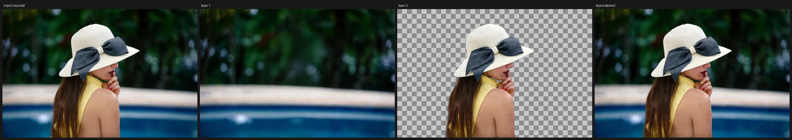
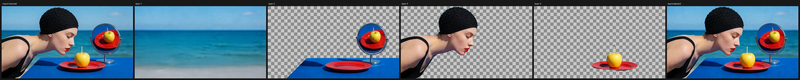
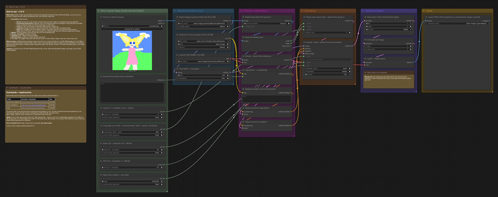

# The_frizzy1 — Qwen-Image-Layered v1.0.0

> Split one picture into separate transparent layers (background + objects, PNG with alpha) with Qwen-Image-Layered. Core ComfyUI nodes only, Apache-2.0 model.

| | |
|---|---|
| **Model family** | Qwen-Image-Layered (Qwen, 20B MMDiT, loads like Qwen-Image in ComfyUI) |
| **Tasks** | Picture → RGBA layers |
| **Min VRAM** | 12 GB is the target. **Not verified on 12 GB** (see Hardware & VRAM) |
| **Tested on** | RTX PRO 4000 Blackwell 24 GB · ca. 64 GB RAM · ComfyUI 0.45.3 (frontend 1.57.6) |
| **CivitAI** | Not published |
| **Hugging Face** | Not published |
| **YouTube explainer** | Not published |
| **License** | Workflow: MIT · Qwen-Image-Layered: Apache-2.0 ([Qwen/Qwen-Image-Layered](https://huggingface.co/Qwen/Qwen-Image-Layered)) · Comfy-Org repackaged files: Apache-2.0 tag on [Comfy-Org/Qwen-Image-Layered](https://huggingface.co/Comfy-Org/Qwen-Image-Layered) · text encoder: see [Comfy-Org/Qwen-Image](https://huggingface.co/Comfy-Org/Qwen-Image) |

## Preview

<p align="center"></p>

<sub>The default settings with a description, 2 layers, seed 24112026, 78 s. From left: the input picture (from the lab's standard inputs), layer 1 (the background, with the woman removed and the gap filled in), layer 2 (the woman on transparency, shown on a checkerboard), the two layers stacked again.</sub>

<p align="center"></p>

<sub>Same settings with Layers set to 4, 102 s. Layer 1 sea and sky, layer 2 table, plate and mirror, layer 3 the woman, layer 4 the apple on a plate, then all four stacked.</sub>

<p align="center"></p>

## Overview
Built from ComfyUI's built-in template `image_qwen_image_layered` and restructured: the template's "Image to Layers" subgraph is laid out flat in six numbered groups, every input you change is in group 1, and the How to use and Downloads notes are inside. It loads the 20.5 GB fp8mixed model instead of the template's 40.9 GB bf16 file. Sampler settings are the template's. You get one PNG with transparency per layer, bottom layer first, ready to move, recolour or delete in an image editor.

## Capabilities
- `The_frizzy1_qwen-image-layered_v1.0.0.json`: one picture in, N RGBA layers out (2 by default). 2 and 4 layers were run.
- Optional description of the whole picture. It helps the model know what is there (also hidden parts); it does not choose what goes on which layer. An empty description gave a very similar split in one test.
- Long side 640 px by default (the authors' recommended size), set in group 1.
- euler / simple, 20 steps, CFG 2.5, flow shift 1: all from the template. The authors' own code uses 50 steps and CFG 4.
- Colour-coded groups: your inputs (green) · models (blue) · picture + description (purple) · sampling (orange) · split into layers (violet) · save (amber).

## Hardware & VRAM
All numbers are from one machine: RTX PRO 4000 Blackwell 24 GB. It is not a 12 GB card.

| Run | Peak VRAM, ComfyUI | Peak VRAM, whole GPU |
|---|---|---|
| ComfyUI with no VRAM limit, 2 and 4 layers | 22.2 to 22.8 GiB | 22.6 to 23.2 GiB |
| Second ComfyUI, 12 GiB budget (`--reserve-vram 11.89`, custom nodes off), both samples | 12.3 GiB | 13.2 GiB |
| Second ComfyUI, 10 GiB budget (`--reserve-vram 13.89`, custom nodes off), both samples | 10.2 GiB | 11.1 GiB |

- **Not verified on 12 GB.** With no limit ComfyUI fills the memory it finds, so the first row shows what a 24 GB card uses, not what the workflow needs. In the smaller budgets the runs finished with pixel-identical layers and took 4 to 12% longer. That is a budget on a 24 GB card, not a test on a 12 GB card.
- About 0.9 GiB of each capped whole-GPU figure was held by other programs, among them the idle first ComfyUI.
- The model file is 20.5 GB, more than 12 GB, so ComfyUI keeps part of it in system RAM. RAM use was not measured.
- Peak VRAM is the highest `nvidia-smi` reading, sampled once per second, MiB / 1024.

## Required models
See the per-workflow [downloads.md](downloads.md) for the full table with verified links.
Every file below was read from the workflow `.json`.

```
ComfyUI/models/
├── diffusion_models/   ← qwen_image_layered_fp8mixed.safetensors   (20.5 GB)
├── text_encoders/      ← qwen_2.5_vl_7b_fp8_scaled.safetensors     (9.38 GB)
└── vae/                ← qwen_image_layered_vae.safetensors        (0.25 GB)
```

About 30.2 GB. The text encoder is the Qwen-Image / HunyuanVideo 1.5 file.

## Required custom nodes
None. Run on ComfyUI 0.45.3 only; older versions were not tested. Qwen-Image-Layered support came with ComfyUI PR #11408 (diffusion model) and #11460 (Empty Qwen Image Layered Latent node).

Core nodes used (19, plus the frontend's MarkdownNote for the notes): CLIPLoader, CLIPTextEncode, EmptyQwenImageLayeredLatentImage, GetImageSize, ImageScaleToMaxDimension, KSampler, LatentCut, LatentCutToBatch, LoadImage, ModelSamplingAuraFlow, PrimitiveFloat, PrimitiveInt, PrimitiveStringMultiline, ReferenceLatent, SaveImage, UNETLoader, VAEDecode, VAEEncode, VAELoader. Each one's module in `/object_info` of ComfyUI 0.45.3 is `nodes` or `comfy_extras.*`, and the budget runs were done with `--disable-all-custom-nodes`.

## Optional custom nodes
None.

## Installation
1. Update ComfyUI (0.45.3 is the version this was run on).
2. Download the three files ([downloads.md](downloads.md), or the Downloads note inside the workflow).
3. Load `The_frizzy1_qwen-image-layered_v1.0.0.json`, load your picture in **Picture to split into layers**, set **Layers**, press **Run**.

## Recommended settings
| Setting | Value | Notes |
|---|---|---|
| Layers | 2 | template default. 4 was run once (102 s instead of 78 s) |
| Long side in px | 640 | the authors' recommended size. 1024 (their high-res setting) was not run |
| Steps / CFG | 20 / 2.5 | template values. The authors use 50 / 4; not run here |
| Sampler / scheduler | euler / simple | from the template |
| Description | empty or one or two sentences | optional; describe the whole picture |
| Seed | 24112026, fixed | a new number gives a different split |

## Inputs / Outputs
- **Inputs:** one picture; optionally a description of it.
- **Outputs:** one PNG with transparency per layer in `output/Qwen-Image-Layered/`, bottom layer first, the size of the resized picture rounded down to a multiple of 8 (1776x1184 gave 640x424, 1368x768 gave 640x352, the 768x768 `example.png` gave 640x640).

## Performance
On the machine above, one run each:

| Run | Settings | Time |
|---|---|---|
| Hat picture, with model load | 640x424, 2 layers | 78 s |
| Hat picture, other seed (777) | 640x424, 2 layers | 78 s |
| Hat picture, empty description | 640x424, 2 layers | 85 s |
| Still life | 640x352, 4 layers | 102 s |
| Shipped file unchanged (`example.png`, empty description), models reloaded | 640x640, 2 layers | 138 s |
| 12 GiB budget: hat / still life | as above | 83 s / 106 s |
| 10 GiB budget: hat / still life | as above | 87 s / 110 s |

Sampling took about 3.6 s per step at 640x424 with 2 layers.

RTX 3060 12 GB: Not verified.

## Known issues
- **Slow:** the model works on the picture plus every layer at once, so more layers and a bigger long side cost time. 1024 px and 8 layers were not run.
- **Which object lands on which layer is the model's choice.** The description does not control it. In the still life the plate appears in two layers (on the table layer and under the apple).
- **The first entry is dropped on purpose:** the model also redraws the whole picture; the LatentCut node removes it so only layers are saved (see the note in group 5).
- **Picture size:** the picture is resized to a long side of 640 and its sides rounded down to a multiple of 8 (427 → 424). The odd latent height (53) of the 1776x1184 picture showed no edge defect in the stacked result.
- **Only two pictures were split** (plus ComfyUI's `example.png`). One Reddit post (r/comfyui, December 2025) reports that posters split best and that text to layers (not in this workflow) is weak; neither was tested here.
- **Picture loader** is set to `example.png`, which ships with ComfyUI; load your own picture there.
- The descriptions are my own: the lab's standard `prompts.json` was not in the inputs folder.
- The browser checks (screenshot, App mode view) used frontend 1.57.6, older than the 1.58.5 that ComfyUI 0.45.3 asks for. No run was started from App mode.

## Changelog
See [changelog.md](changelog.md).

## Related workflows
- [Qwen Image 2.1 Ultimate · 12 GB](../image-2.1-ultimate-12gb) (has remove background) · [Ming Image 0.1 · 12 GB](../../ming/image-0.1-design-12gb) (RGBA design images) · [Qwen Image & Edit 2509](../image-edit-2509)
