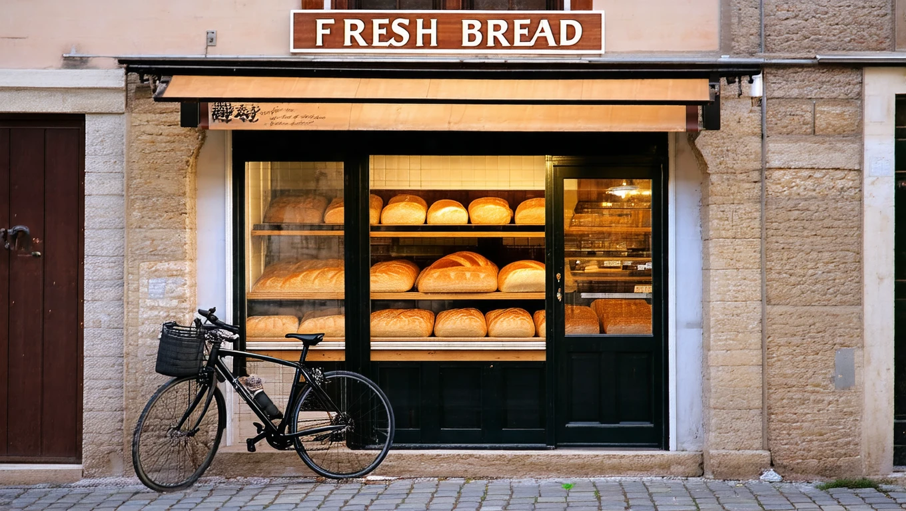
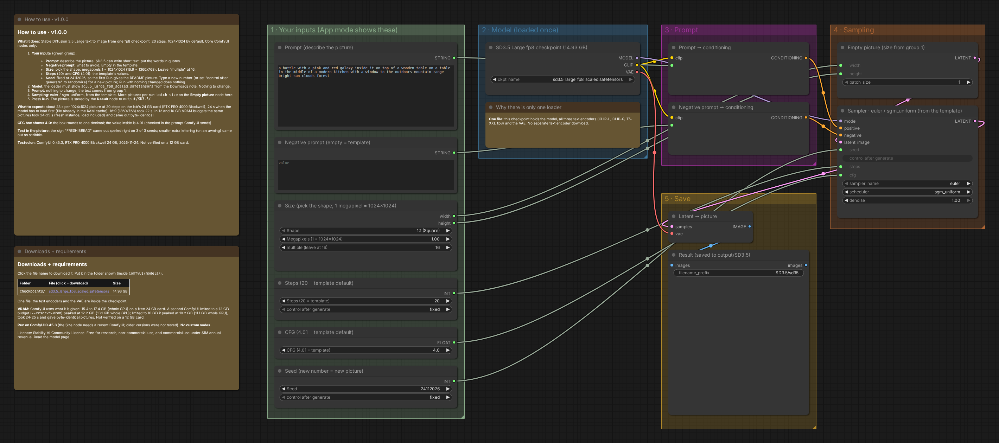

# The_frizzy1 — Stable Diffusion 3.5 Large v1.0.0

> SD3.5 Large text to image from one fp8 checkpoint (text encoders and VAE inside): 20 steps, 1024x1024. Core ComfyUI nodes only.

| | |
|---|---|
| **Model family** | Stable Diffusion 3.5 (SD3.5 Large, 8.1B, Stability AI) |
| **Tasks** | Text → Image |
| **Min VRAM** | 12 GB is the target. **Not verified on 12 GB** (see Hardware & VRAM) |
| **Tested on** | RTX PRO 4000 Blackwell 24 GB · 64 GB RAM · ComfyUI 0.45.3 |
| **CivitAI** | Not published |
| **Hugging Face** | Not published |
| **YouTube explainer** | Not published |
| **License** | Workflow: MIT · SD3.5 Large: [Stability AI Community License](https://huggingface.co/stabilityai/stable-diffusion-3.5-large/blob/main/LICENSE.md) (free under $1M annual revenue) |

## Preview

<p align="center">
  
  
</p>

<sub>Left: the default settings (template prompt, 1024x1024, 20 steps, CFG 4.01, seed 24112026), 24 s including the model load. Right: a bakery prompt with a sign that should read "FRESH BREAD", Shape set to 16:9 (1360x768), same seed, 22 s.</sub>

<p align="center"></p>

## Overview
Built from ComfyUI's built-in template `sd3.5_simple_example` and restructured: five numbered groups, every input you change in group 1, and two notes (How to use, Downloads + requirements). The model, prompt, empty negative prompt and sampler settings are the template's. Three things differ from the template: the fixed 1024x1024 size is now a Size input, the seed is fixed at 24112026 (the template randomizes it every run), and pictures are saved to `output/SD3.5/` instead of `output/`.

## Capabilities
- Text to image at 1024x1024 by default; the Size input picks the shape. 1024x1024 and 1360x768 (16:9) were run.
- Short text in the picture: "FRESH BREAD" was spelled right on 3 of 3 seeds.
- SD3.5 Large at 20 steps · CFG 4.01 · euler / sgm_uniform (the template's settings).
- One download: CLIP-L, CLIP-G, T5-XXL (fp8) and the VAE are inside the checkpoint (read from the file's tensor names).
- Colour-coded groups: your inputs (green) · model (blue) · prompt (purple) · sampling (orange) · save (amber).

## Hardware & VRAM
All numbers are from one machine: RTX PRO 4000 Blackwell 24 GB, ComfyUI 0.45.3. Peak VRAM is read from nvidia-smi once per second, in GiB (MiB / 1024).

| Setting | Peak VRAM, ComfyUI process | Peak VRAM, whole GPU | Time |
|---|---|---|---|
| No limit (the lab ComfyUI, started without VRAM flags), 6 runs | 15.0 to 17.0 GiB | 15.4 to 17.4 GiB | 22 to 24 s |
| Second ComfyUI in a 12 GiB budget (`--reserve-vram 11.89`), 2 runs | 12.2 GiB | 13.0 to 13.1 GiB | 24 to 25 s |
| Second ComfyUI in a 10 GiB budget (`--reserve-vram 13.89`), 2 runs | 10.0 to 10.2 GiB | 10.9 to 11.1 GiB | 24 to 25 s |

- The budget runs used the same two sample prompts and gave **byte-identical pictures** (same SHA-256) to the unlimited runs. Each budget instance was fresh, so both of its times include the model load.
- The whole-GPU column includes about 0.45 GiB (no limit) and 0.86 GiB (budget runs) held by other programs.
- **Not verified on 12 GB.** A VRAM budget on a 24 GB card is not a 12 GB card; ComfyUI fills whatever budget it gets.
- The checkpoint file is 14.93 GB, so a 12 GB card has to offload part of it to system RAM. 64 GB RAM was available here; less RAM was not tested.

## Required models
See the per-workflow [downloads.md](downloads.md) for the full table with verified links.
Every file below was read from the workflow `.json`.

```
ComfyUI/models/
└── checkpoints/   ← sd3.5_large_fp8_scaled.safetensors
```

## Required custom nodes
None. Run on ComfyUI **0.45.3** only; older versions were not tested.

Core nodes used: CheckpointLoaderSimple, CLIPTextEncode, ResolutionSelector, EmptySD3LatentImage, KSampler, VAEDecode, SaveImage, PrimitiveInt, PrimitiveFloat, PrimitiveStringMultiline, and MarkdownNote (the frontend's note node, not in `/object_info`). The module of each of the 10 backend nodes in `/object_info` of ComfyUI 0.45.3 is `nodes` or `comfy_extras`, and none is marked deprecated.

## Optional custom nodes
None.

## Installation
1. Update ComfyUI (0.45.3 is the tested version).
2. Download the one file ([downloads.md](downloads.md), or the Downloads note inside the workflow) into `ComfyUI/models/checkpoints/`.
3. Load `The_frizzy1_sd3.5_v1.0.0.json`, write your prompt in group 1, press **Run**.

## Recommended settings
| Setting | Value | Notes |
|---|---|---|
| Size | 1:1, megapixels 1 (1024x1024) | Stability AI calls 1 megapixel the model's resolution; other megapixel values were not tested |
| Steps / CFG | 20 / 4.01 | template defaults. The model card's example uses 28 steps / CFG 3.5; that was not tested here |
| Sampler | euler / sgm_uniform | template default; other samplers were not tested |
| multiple (on the Size node) | 16 | gives 1360x768 for 16:9; other values were not tested |
| Negative prompt | empty | as in the template |

## Inputs / Outputs
- **Inputs:** a text prompt and a negative prompt. No picture, video or audio input.
- **Outputs:** a PNG in `output/SD3.5/`.

## Performance
On the machine above, from sending the job to the finished file. 10 runs, all through the API.

| Settings | Time | Runs |
|---|---|---|
| 1024x1024, model load included (file already in the RAM cache) | 24 s | 2 |
| 1024x1024, model already loaded | 23 s | 1 |
| 1360x768, model already loaded | 22 s | 3 |
| Both sizes in a 12 or 10 GiB budget, fresh instance | 24 to 25 s | 4 |

RTX 3060 12 GB: Not verified.

## Known issues
- **CFG box shows 4.0:** the PrimitiveFloat box rounds to one decimal. The value inside is 4.01: the prompt the browser builds from the file sends `cfg: 4.01`.
- **Small extra text comes out as scribble:** in the 16:9 sample the main sign is right, but lettering on the awning below it is not real text.
- **App mode was opened, not run:** in a headless browser on ComfyUI 0.45.3 (frontend 1.57.6) App mode listed the seven inputs with their labels, and the prompt the browser builds from the file is the same as the one sent through the API. Run was not clicked there.
- Only `sd3.5_large_fp8_scaled.safetensors` was tested. SD3.5 Medium, Large Turbo, the full-precision Large and separate text encoder files were not.
- comfyanonymous wrote on Reddit (October 2024) that this fp8 scaled file is "slightly experimental", tuned for fp8 matrix multiplication on newer cards, and likely somewhat lower quality than a Q8 GGUF. Not compared here (core ComfyUI has no GGUF loader).
- The bakery prompt is my own: the lab's standard `prompts.json` was not in the inputs folder.

## Changelog
See [changelog.md](changelog.md).

## Related workflows
- [SDXL](../../sdxl/sdxl) · [Anima](../../anima/anima) · [Z-Image Turbo](../../z-image/turbo)
