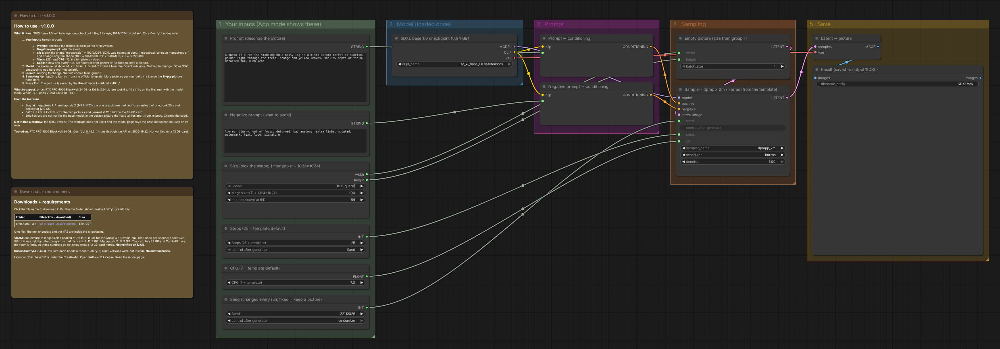

# The_frizzy1 — SDXL v1.0.0

> SDXL base 1.0 text to image: one checkpoint file, 25 steps, 1024x1024. Core ComfyUI nodes only.

| | |
|---|---|
| **Model family** | SDXL (Stable Diffusion XL base 1.0, Stability AI) |
| **Tasks** | Text → Image |
| **Min VRAM** | 12 GB is the target. **Not verified on 12 GB** (see Hardware & VRAM) |
| **Tested on** | RTX PRO 4000 Blackwell 24 GB · 64 GB RAM · ComfyUI 0.45.3 |
| **CivitAI** | Not published |
| **Hugging Face** | Not published |
| **YouTube explainer** | Not published |
| **License** | Workflow: MIT · SDXL base 1.0: [CreativeML Open RAIL++-M](https://huggingface.co/stabilityai/stable-diffusion-xl-base-1.0/blob/main/LICENSE.md) |

## Preview

<p align="center">
  
  
</p>

<sub>Left: the default settings (1024x1024, 25 steps, CFG 7, seed 22112026), 11 s including the model load. Right: an oil painting prompt with Shape set to 16:9 (1344x768), same seed, 10 s.</sub>

<p align="center"></p>

## Overview
Built from ComfyUI's built-in template `image_sdxl_simple` and restructured: five numbered groups, every input you change in group 1, and two notes (How to use, Downloads + requirements). The model and the sampler settings are the template's. Three things differ from the template: the fixed 1024x1024 size is now a Size input, the default prompt is new, and the negative prompt is the template's without `color, colored`, which belonged to the template's black-and-white statue prompt.

## Capabilities
- Text to image at 1024x1024 by default; the Size input picks the shape. 1344x768 (16:9), 1280x832 (3:2) and 832x1280 (2:3) were run.
- SDXL base 1.0 at 25 steps · CFG 7 · dpmpp_2m / karras.
- One download: the text encoders and the VAE are inside the checkpoint.
- No refiner. The template does not use it, and the model page says the base model can be used on its own.
- Colour-coded groups: your inputs (green) · model (blue) · prompt (purple) · sampling (orange) · save (amber).

## Hardware & VRAM
All numbers are from one machine: RTX PRO 4000 Blackwell 24 GB, ComfyUI 0.45.3, started without any VRAM flags. It is not a 12 GB card. Peak VRAM is the whole-GPU peak from nvidia-smi, read once per second, in GiB (MiB / 1024); about 0.45 GiB of it was held by other programs.

| Setting | Peak VRAM |
|---|---|
| One picture at megapixels 1 (1024x1024, 1344x768, 1280x832, 832x1280) | 7.6 to 10.0 GiB |
| 1024x1024, batch_size 2 | 12.5 GiB |
| Megapixels 2 (1472x1472) | 12.9 GiB |

- **Not verified on 12 GB.** The card had 24 GB and ComfyUI uses the room it finds, so these numbers do not show what a 12 GB card needs.
- The checkpoint file is 6.94 GB.
- No Comfy-Org repackaged, fp8 or int8 SDXL file was found (see [downloads.md](downloads.md)); the workflow loads the authors' file, as the template does.

## Required models
See the per-workflow [downloads.md](downloads.md) for the full table with verified links.
Every file below was read from the workflow `.json`.

```
ComfyUI/models/
└── checkpoints/   ← sd_xl_base_1.0.safetensors
```

## Required custom nodes
None. Run on ComfyUI **0.45.3** only; older versions were not tested.

Core nodes used: CheckpointLoaderSimple, CLIPTextEncode, ResolutionSelector, EmptyLatentImage, KSampler, VAEDecode, SaveImage, PrimitiveInt, PrimitiveFloat, PrimitiveStringMultiline, and MarkdownNote (the frontend's note node, not in `/object_info`). The module of each of the 10 backend nodes in `/object_info` of ComfyUI 0.45.3 is `nodes` or `comfy_extras`.

## Optional custom nodes
None.

## Installation
1. Update ComfyUI (0.45.3 is the tested version).
2. Download the one file ([downloads.md](downloads.md), or the Downloads note inside the workflow) into `ComfyUI/models/checkpoints/`.
3. Load `The_frizzy1_sdxl_v1.0.0.json`, write your prompt in group 1, press **Run**.

## Recommended settings
| Setting | Value | Notes |
|---|---|---|
| Size | 1:1, megapixels 1 (1024x1024) | the ComfyUI SDXL examples page says to stay at the pixel count of 1024x1024 and change only the shape |
| Steps / CFG | 25 / 7 | template defaults; other values were not tested |
| Sampler | dpmpp_2m / karras | template default; other samplers were not tested |
| multiple (on the Size node) | 64 | gives 1344x768 for 16:9; other values were not tested |
| Negative prompt | the template's list without `color, colored` | |

## Inputs / Outputs
- **Inputs:** a text prompt and a negative prompt. No picture, video or audio input.
- **Outputs:** a PNG in `output/SDXL/`.

## Performance
On the machine above. Times are from sending the job to the finished file, measured to the second. 11 runs, all through the API.

| Settings | Time | Peak VRAM | Runs |
|---|---|---|---|
| 1024x1024, first run with the model load | 11 s | 9.8 GiB | 1 |
| 1024x1024, model already loaded | 9 to 10 s | 7.7 to 10.0 GiB | 4 |
| 1344x768, 1280x832, 832x1280 | 9 to 10 s | 7.6 to 10.0 GiB | 4 |
| 1024x1024, batch_size 2 | 19 s for the two pictures | 12.5 GiB | 1 |
| Megapixels 2 (1472x1472) | 20 s | 12.9 GiB | 1 |

The same settings peaked at 7.7 GiB in some runs and 10.0 GiB in others. VRAM is read once per second, so a short peak can be missed.

RTX 3060 12 GB: Not verified.

## Known issues
- **Small errors in the picture:** in the default picture the fox's tail lies apart from its body. The other eight 1-megapixel pictures were looked at only as small thumbnails, where nothing stood out → change the seed.
- **Two subjects at megapixels 2:** the one 1472x1472 test picture had two foxes instead of one → leave megapixels at 1.
- **The seed changes every run:** the Seed input is on `randomize`, so the default picture (seed 22112026) comes out on the first run only. Set "control after generate" to `fixed` to keep a picture.
- **App mode was opened, not run:** in a headless browser on ComfyUI 0.45.3 (frontend 1.57.6) App mode listed the seven inputs with their labels, and the prompt the browser builds from the file is the same as the one sent through the API. Run was not clicked there.
- Only the base checkpoint was tested. Other SDXL checkpoints, LoRAs and the refiner were not.
- The prompts are my own: the lab's standard `prompts.json` was not in the inputs folder. Two prompts were used (a fox photo, a lighthouse oil painting).
- The Reddit search tool failed. Two 2023 Reddit posts found through a web search were read as search excerpts only: one reports SDXL 1.0 on an RTX 3060 12 GB using 6.5 GB of VRAM at 47 s per picture, one finds CFG 7 to 10 best for the base model. Neither was checked here.

## Changelog
See [changelog.md](changelog.md).

## Related workflows
- [Anima](../../anima/anima) · [Z-Image Turbo](../../z-image/turbo) · [Qwen Image 2.1 · 12 GB](../../qwen/image-2.1-12gb)
