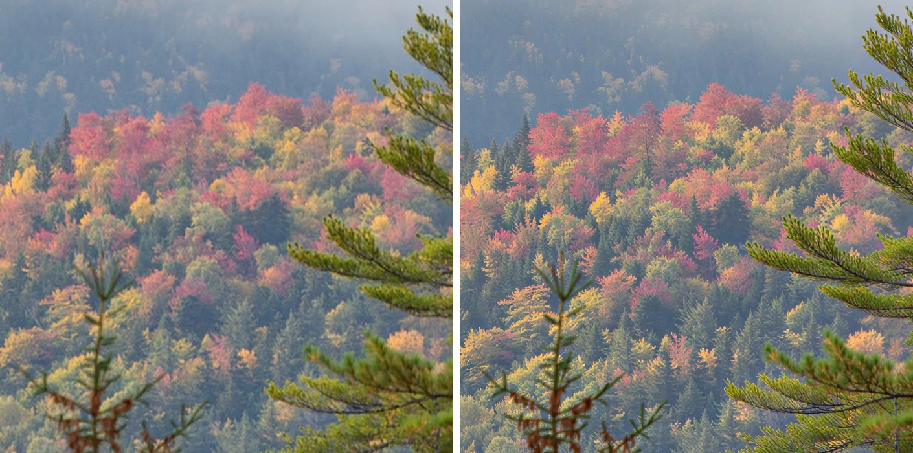
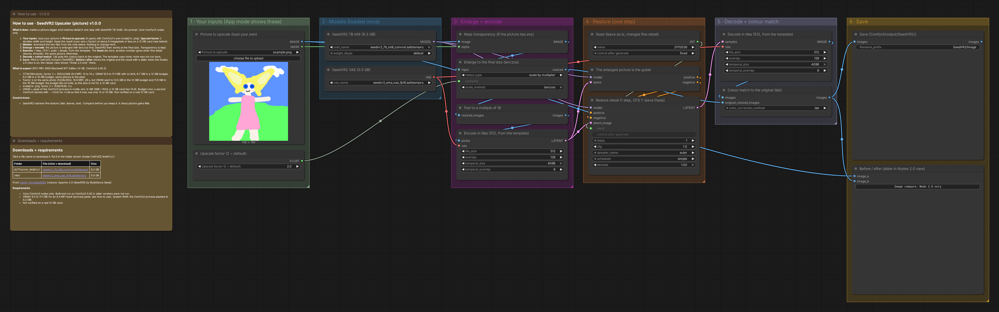
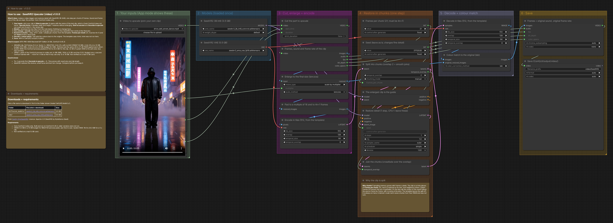

# The_frizzy1 — SeedVR2 Upscaler v1.0.0

> Upscale and restore a **picture** or a **video** in one step with SeedVR2 (int8). Two small workflows,
> core ComfyUI nodes only, no prompt. Not verified on a 12 GB card; measured on a 24 GB card in 12 and 10 GiB budgets.

| | |
|---|---|
| **Model family** | SeedVR2 (ByteDance Seed) |
| **Tasks** | Picture upscale + restore (7B) · Video upscale + restore (3B), original sound and frame rate kept |
| **Min VRAM** | Not verified on 12 GB. ComfyUI process peak 9.5 GiB (picture, 8.4 MP result) and 9.3 GiB (video, 960x1728) in a 10 GiB budget |
| **Tested on** | RTX PRO 4000 Blackwell SFF Edition 24 GB · ComfyUI 0.45.3 · no VRAM flag, plus a second instance in 12 and 10 GiB `--reserve-vram` budgets |
| **CivitAI** | Not published |
| **Hugging Face** | Not published |
| **YouTube explainer** | None yet |
| **License** | Workflow: MIT · SeedVR2 models: Apache-2.0 |

## Preview

  
  

Left: 700 px crop of the 1776x1184 forest photo at factor 2, plain lanczos against SeedVR2 7B. Right: 480 px crop of frame 60 of
the 480x864 test clip at factor 2, plain lanczos against SeedVR2 3B. Full outputs: [sample-1.webp](samples/sample-1.webp) (the photo,
3552x2368) and [sample-2.webp](samples/sample-2.webp) (the clip at factor 2, first 3 s as an animated WebP at half size and 12 fps, no sound).

## Overview
Built from the two official ComfyUI templates (*SeedVR2 7B Int8 upscale image* and *SeedVR2 3B Int8 upscale video*).
The template's subgraph is opened into numbered groups, and everything you change sits in group 1 (App mode shows only
those inputs). SeedVR2 is a one-step restoration model: it takes the enlarged picture or clip as its guide and redraws
the detail. There is no prompt.

Files:
- `The_frizzy1_seedvr2-upscaler-image_v1.0.0.json`: one picture in, one PNG out. SeedVR2 7B int8.
- `The_frizzy1_seedvr2-upscaler-video_v1.0.0.json`: one clip in, one MP4 out with the clip's sound and frame rate. SeedVR2 3B int8.

## Capabilities
- Picture: any factor (default 2), transparency kept, a before/after node (Compare Images)
- Video: any factor (default 2; 1 = restore without enlarging), cut a part with Start / Seconds, sound and frame rate kept
- Video is restored in chunks of 21 frames that overlap by 2 latent frames (8 frames) and are crossfaded
- Colour match to the original (`lab`) in both
- Numbered groups: inputs · models · enlarge + encode · restore · decode + colour match · save

## Hardware & VRAM
**Not verified on 12 GB**: no 12 GB card was used. Budget runs use a second ComfyUI started with `--reserve-vram` so that it
may use only 12 or 10 GiB of the 24 GB card, and without custom nodes.

VRAM below is the peak of the ComfyUI process in nvidia-smi, logged once per second, in GiB (MiB / 1024; a 12 GB card has
12.0). Other programs on the test server held a further 0.5 to 1.1 GiB. RAM is the peak resident memory of the ComfyUI process.

| Run | Result | No limit | 12 GiB budget | 10 GiB budget | RAM |
|---|---|---|---|---|---|
| Picture 1776x1184, factor 2 | 3552x2368 (8.4 MP) | 10.0 to 11.1 GiB | 9.7 GiB | 9.5 GiB | 3.9 to 4.2 GiB |
| Picture 1776x1184, factor 3 | 5328x3552 (18.9 MP) | not run | 13.5 GiB (over budget) | 11.9 GiB (over budget) | 5.4 to 6.4 GiB |
| Video 480x864, 124 frames, factor 2 | 960x1728 | 11.8 GiB | 10.5 GiB | 9.3 GiB | 19.0 to 20.3 GiB |

At factor 2 the budget held and the results were the same: the picture to the pixel, the video at 45 to 47 dB PSNR against
the unlimited run. At factor 3 the picture went past both budgets, so an 18.9 MP result is not for a 12 GB card.
The video needs about 20 GiB of system RAM for a 5 s clip at 960x1728; 32 GB of RAM is the safe size (less was not tried).

## Required models
See [downloads.md](downloads.md) - every file below was read from the workflow `.json` files.

| Folder | File | Size | Used by |
|---|---|---|---|
| `diffusion_models/` | [seedvr2_7b_int8_convrot.safetensors](https://huggingface.co/Comfy-Org/SeedVR2/resolve/main/diffusion_models/seedvr2_7b_int8_convrot.safetensors) | 8.3 GB | picture |
| `diffusion_models/` | [seedvr2_3b_int8_convrot.safetensors](https://huggingface.co/Comfy-Org/SeedVR2/resolve/main/diffusion_models/seedvr2_3b_int8_convrot.safetensors) | 3.5 GB | video |
| `vae/` | [seedvr2_ema_vae_fp16.safetensors](https://huggingface.co/Comfy-Org/SeedVR2/resolve/main/vae/seedvr2_ema_vae_fp16.safetensors) | 0.5 GB | both |

## Required custom nodes
None. Core ComfyUI only.

Core nodes used: LoadImage, LoadVideo, PrimitiveFloat, PrimitiveInt, UNETLoader, VAELoader, JoinImageWithAlpha,
ResizeImageMaskNode, SeedVR2Preprocess, VAEEncodeTiled, SeedVR2Conditioning, KSampler, VAEDecodeTiled,
SeedVR2PostProcessing, SaveImage, ImageCompare, and for video Video Slice (Trim Video), GetVideoComponents,
SeedVR2TemporalChunk, SeedVR2TemporalMerge, CreateVideo, SaveVideo. All are core in ComfyUI 0.45.3 (`comfy_extras` or
`nodes`), none deprecated. The SeedVR2 nodes came with [PR #14424](https://github.com/Comfy-Org/ComfyUI/pull/14424).
Only 0.45.3 was run.

## Optional custom nodes
None.

## Installation
1. Update ComfyUI (built and run on 0.45.3).
2. Download the files above. Pictures only: 7B + VAE. Video only: 3B + VAE.
3. Load the picture or the video `.json`, load your file in group 1, **Run**. The video workflow opens with the name of
   the test clip, which a fresh ComfyUI does not have: pick your own clip first.

## Recommended settings
| Setting | Value | Notes |
|---|---|---|
| Upscale factor | 2 | the template's picture default is 4. Keep picture results at about 8 MP or less on 12 GB (factor 3 to 18.9 MP went over a 12 GiB budget) |
| Steps / CFG / sampler | 1 / 1 / euler, simple | from the templates; one-step model |
| Colour match | `lab` | the node's first option; the templates use `none`, which was not run |
| Enlarge method | lanczos | from the templates |
| VAE tiles | 512, overlap 128 | from the templates; other tile sizes were not run tonight |
| Frames per chunk (video) | 21 | must be 4n+1. In group 4, leave it |
| Chunk overlap (video) | 2 latent frames | 8 frames, crossfaded; on the test clip no jump at the joins (frame-to-frame motion follows the source) |
| Seed | 21112026, fixed | seed 7 on the forest photo gave the same picture with other fine detail in leaves and branches (mean difference 5/255 per channel). In group 4, leave it |

## Inputs / Outputs
- **Inputs:** picture workflow: one picture (PNG / JPG, transparency allowed). Video workflow: one clip.
- **Outputs:** picture: PNG in `ComfyUI/output/SeedVR2/` (RGBA; fully opaque when the input has no transparency). Video: MP4 (H.264, AAC sound from the clip) in `ComfyUI/output/video/`.

## Performance
Measured with these exact files (the browser's own API prompt of each file for the samples), RTX PRO 4000 Blackwell SFF Edition 24 GB, ComfyUI 0.45.3.

| Run | Result | Time | VRAM (process) |
|---|---|---|---|
| Picture 1776x1184 forest, factor 2 (sample 1; three runs incl. seed 7) | 3552x2368 | 12 to 13 s | 10.0 to 11.1 GiB |
| Picture 1776x1184 portrait with hat, factor 2 | 3552x2368 | 12 s | 10.1 GiB |
| Picture `example.png` 768x768, factor 2 | 1536x1536 | 3 s | 9.6 GiB |
| Picture forest, factor 2, 12 / 10 GiB budget | 3552x2368 | 14 s / 14 s | 9.7 / 9.5 GiB |
| Picture forest, factor 3, 12 / 10 GiB budget | 5328x3552 | 28 s / 28 s | 13.5 / 11.9 GiB |
| Video 480x864, 124 frames (5.2 s), factor 2 (sample 2; two runs) | 960x1728 | 4 min 25 s and 4 min 26 s | 11.8 GiB |
| Same clip, 12 / 10 GiB budget | 960x1728 | 4 min 30 s / 4 min 33 s | 10.5 / 9.3 GiB |

The video result has all 124 frames at 24 fps, no frozen or black frames, and the sound at the clip's level (mean -14.0 dB).

## Known issues
- **It changes small detail.** Leaf, thread and skin texture are redrawn, and a different seed redraws them differently. Compare before you keep the result.
- **A sharp input gains little.** The test photos were already sharp; the gain shows in fine texture only.
- **Big picture results break a 12 GB budget**: 18.9 MP went to 13.5 GiB in a 12 GiB budget. People on Reddit report the same at 4K: the tiled VAE does not tile the sampler.
- **Video needs a lot of system RAM**: about 20 GiB for a 5 s clip at 960x1728.
- **Frames per chunk must be 4n+1** (13, 21, 41, ...); the node stops the run otherwise. The chunk mode `auto` was not run.
- **Before / after slider**: in the classic canvas the Compare Images node shows "Node 2.0 only"; the slider needs the Nodes 2.0 view, which was not looked at. The node ran and wrote both pictures.
- App mode was opened for both files (inputs and labels checked) but its Run button was not clicked.

## Changelog
See [changelog.md](changelog.md).

## Related workflows
- [LTX 2.5 Ultimate · 12 GB](../../ltx/ltx-2.5-ultimate-12gb) (has a RelayVSR x2 video upscale) · [H3 Relight · 12 GB](../../minimax/h3-relight-12gb) (Full HD refine)
