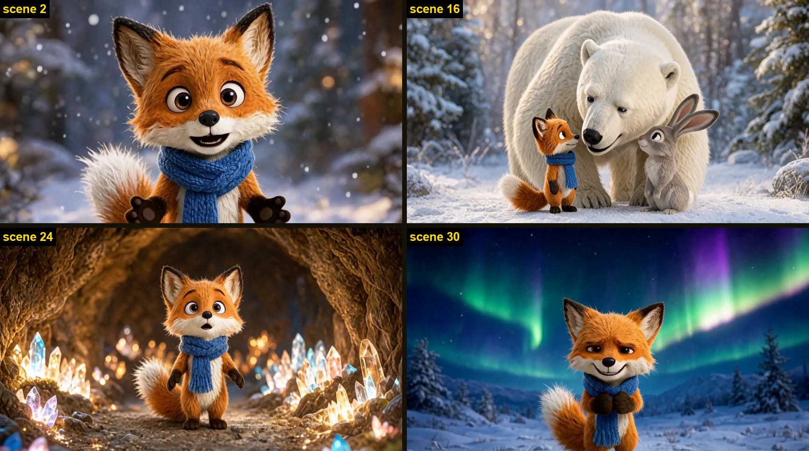
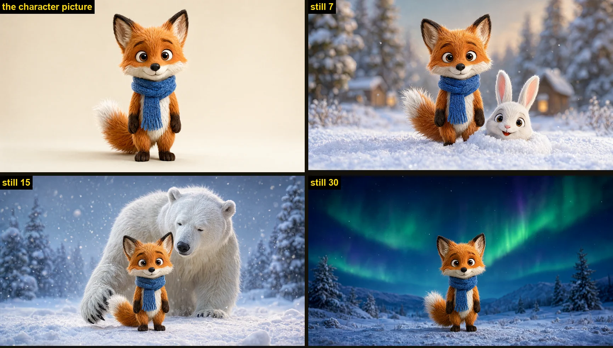
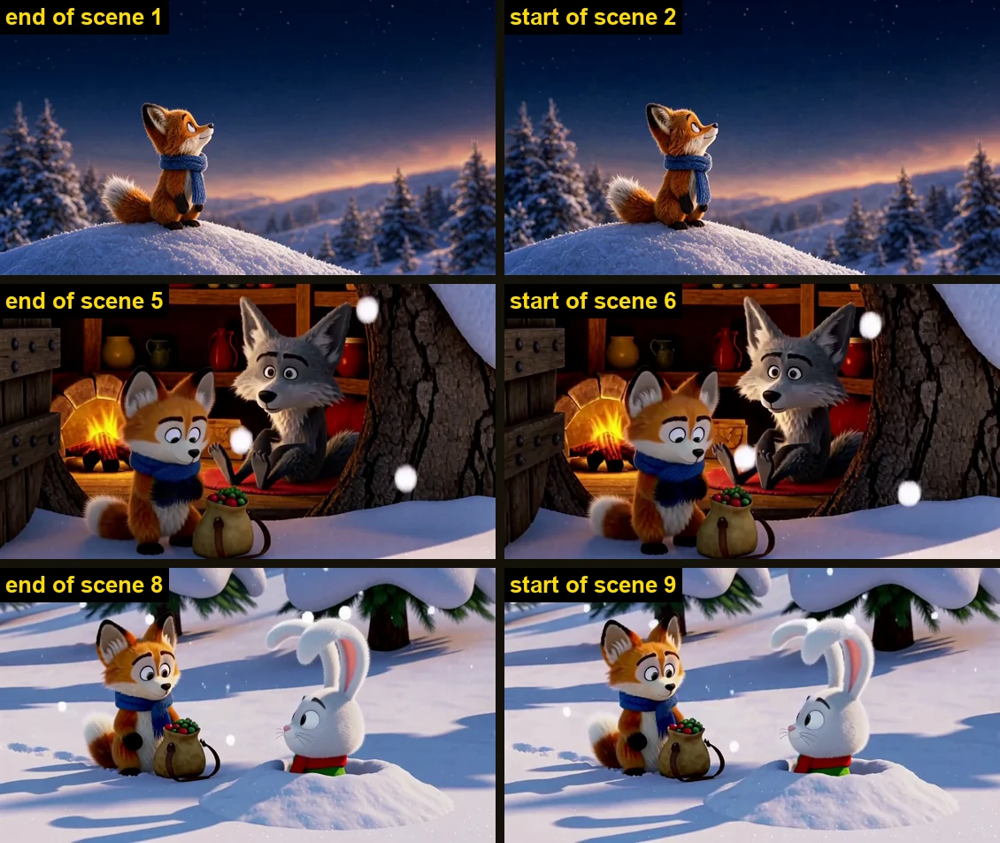
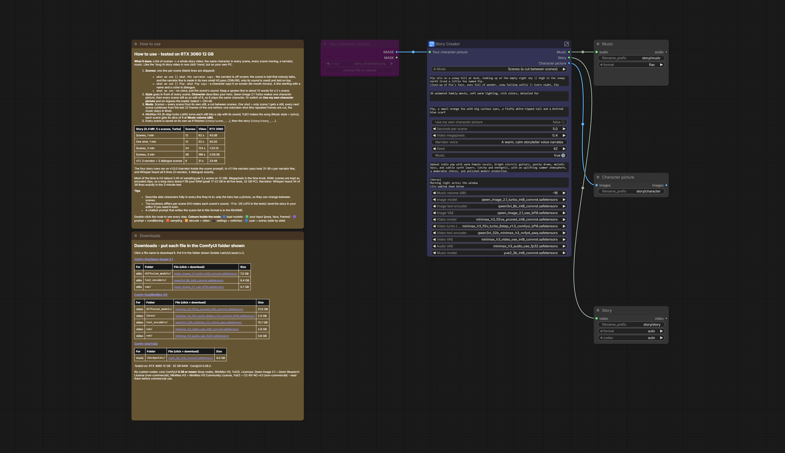

# The_frizzy1 — Story Creator · 12 GB v1.1.0
> A list of scenes → a whole story video: the same character in every scene, every scene moving, a narrator, music.
> The "long AI story video in one click" trend, run on your own PC. Qwen Image 2.1 Turbo makes the stills, MiniMax H3
> turns each one into a moving scene with sound, YuE2 makes the song. Core ComfyUI nodes only, tested on an RTX 3060.

| | |
|---|---|
| **Model families** | Qwen Image 2.1 (stills) · MiniMax H3 (video + sound) · YuE2 (music) |
| **Task** | Story video from a scene list: scenes with cuts, or one unbroken shot |
| **Workflow file** | `The_frizzy1_story-creator-12gb_v1.1.0.json` |
| **Needs** | 12 GB VRAM (peaked at 11805 MiB) · 32 GB system RAM (peaked at 22.3 GB) · ComfyUI **0.39+** |
| **Tested on** | RTX 3060 12 GB · Ryzen 5 5600X · 32 GB DDR4 · ComfyUI 0.39.2 |
| **License** | Workflow: MIT · Qwen Image 2.1: Qwen Research License (non-commercial) · MiniMax H3: MiniMax H3 Community License · YuE2: CC-BY-NC-4.0 (non-commercial) |

## Quick start
1. Update ComfyUI to **0.39 or newer** (Start Loop / End Loop, MiniMax H3, YuE2; no custom nodes).
2. Download the files in [downloads.md](downloads.md) (9 files: 3 for the stills, 5 for the video, 1 for the music).
3. Load `The_frizzy1_story-creator-12gb_v1.1.0.json`. Write your **Scenes**, one per line:
   - `what we see || what the narrator says` — the narrator is off screen: nobody in the scene talks,
   - `what we see || Pip: what Pip says` — a character says it on screen (its mouth moves),
   - `what we see` — no voice, just the scene's sound.
4. Set the **Style** and describe your **Character** (or switch on *Use my own character picture* and un-bypass the loader). **Run**.

## Preview

<p align="center"></p>
<p align="center">


</p>

<sub>Top: the 3-minute test story (36 scenes, one click). Left: one character picture, then every still is an edit of it,
so it stays the same fox. Right: *One shot* mode, the last frame of a scene and the first frame of the next. RTX 3060.</sub>

<p align="center"></p>

## How it works
1. **Music first** (if on): YuE2 makes a song from the *Music style* + *lyrics*; every scene later gets its own slice.
2. **Stills**: Qwen Image 2.1 Turbo makes one character picture, then every scene's still as an edit of it (`<Picture 1>`).
3. **Scenes**: a Start Loop / End Loop goes through the stills; MiniMax H3 (8-step turbo LoRA) turns each one into a
   5 s clip with sound. Dialogue lines go into the scene; narrator lines get their own small H3 pass (256×160, only its
   sound is used), laid on top of the scene, whose prompt says nobody talks.
4. Each scene is saved as it finishes and kept as an encoded clip (so a long story doesn't fill your RAM); at the end
   they're joined into the story.

**Mode — One shot:** only scene 1 gets a still; every next scene continues from the last 22 frames of the one before
(core *Add Guide*), so the whole story is one unbroken shot. The look drifts more than with stills for every scene.

## Times on the RTX 3060 (0.4 MP, 5 s scenes, Turbo)

| Story | Scenes | Video | Time | Narration (Whisper, exact lines) |
|---|---|---|---|---|
| Scenes, 1 min | 12 | 62 s | 43 min 38 s | 10 / 12 |
| One shot, 1 min | 12 | 52 s | 45 min 20 s | 9 / 12 |
| Scenes, 2 min | 24 | 124 s | 1 h 23 min | 22 / 24 |
| Scenes, 3 min | 36 | 186 s | 2 h 05 min | 34 / 36 |
| v1.1 narrator pass (3 narrator + 3 dialogue scenes) | 6 | 31 s | 23 min 48 s | 6 / 6 |

The four story rows ran on v1.0.0 (narrator inside the scene prompt); in v1.1 the narrator pass adds 31–36 s per
narrator line. Most of the time is H3: about 2:40 of sampling per 5 s scene. A 10-minute story is about 116 scenes.
Megapixels is the time knob.

## Write the scene list with any chatbot
Fill in the three `{…}` and paste this into ChatGPT, Gemini, Claude or a local LLM, then copy the lines it gives back
into **Scenes**. One minute ≈ 12 scenes.

```
Write a story for an AI video as a scene list.

Main character: {one sentence: who, what they look like, e.g. "Pip, a small orange fox with a blue scarf"}
Story idea: {one or two sentences}
Number of scenes: {12 for 1 minute, 24 for 2, 36 for 3}

Rules:
- Exactly one line per scene. No numbers, no titles, no empty lines, nothing else before or after the list.
- Every line is:   what we see || what we hear
- "What we see": one sentence. Who is in the shot (call the main character by name), where, what they do, and the camera
  (wide shot, close-up...). Describe side characters fully every time, e.g. "an old grey fox with a white beard".
- "What we hear" is one of:
    the narrator: one sentence of at most 12 words (it has to fit in 5 seconds), OR
    a character on screen speaking:  Name: what they say  (at most 10 words, the Name starts with a capital letter), OR
    nothing: leave out the "||" part completely for a silent scene.
- Mix them: mostly narrator, some dialogue, a few silent scenes.
- Tell a real story with a beginning, a problem, and an ending, not a list of moments.
```

## Limits
- The main character stays the same (one character picture); side characters can change from scene to scene, so
  describe them fully in every line they're in.
- The narrator's voice is made per scene by H3, so it can sound a little different from scene to scene.
- The loudness differs per scene (H3 makes each scene's sound: -11 to -28 LUFS in the tests). Level it in your editor
  if you need it even.
- Keep narrator lines to about 12 words for a 5 s scene.

## Required models
See [downloads.md](downloads.md) — every file was read from the workflow `.json`.

## Required custom nodes
None - core ComfyUI **0.39+**.
