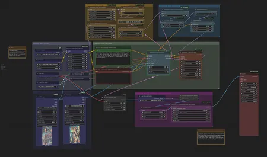

# The_frizzy1 - Wan 2.1 FLF2V v2.0.1

> Simple first-frame → last-frame video generation with Wan 2.1. Low-VRAM / laptop friendly (**4 GB**).

| | |
|---|---|
| **Model family** | Wan 2.1 (FLF2V 14B) |
| **Tasks** | First frame → Last frame video |
| **Workflow file** | `The_frizzy1_wan-2.1-flf2v_v2.0.1.json` |
| **Min VRAM** | 4 GB |
| **ComfyUI** | a recent ComfyUI with the core `WanFirstLastFrameToVideo` node, plus the custom packs below |
| **CivitAI** | https://civitai.com/models/1624167 |
| **License** | Apache-2.0 |
| **Newer** | [MiniMax H3 Ultimate](../../minimax/h3-ultimate-12gb) (first + last frame) · [LTX 2.5 Ultimate](../../ltx/ltx-2.5-ultimate-12gb) (12 GB). |

## Preview

<p align="center"></p>

<sub>Example outputs from this workflow.</sub>

## Overview
Give a start image and an end image; Wan 2.1 FLF2V interpolates a video between them. This is the standalone
CivitAI release; the same graph also ships inside the [Wan 2.1 pack](../gguf-lowvram) as
`Wan2.1-FirstFrameLastFrame.json`.

## How to use
Open the json: the **How to use** and **Downloads** notes on the left of the graph explain the inputs and settings.

## Nodes
- Core: WanFirstLastFrameToVideo, CLIPLoader, CLIPVisionLoader, CLIPVisionEncode, CLIPTextEncode, VAELoader, VAEDecodeTiled,
  ModelSamplingSD3, UpscaleModelLoader, ImageUpscaleWithModel, ImageScale.
- [gguf](https://github.com/calcuis/gguf): LoaderGGUF.
- [tiled_ksampler](https://github.com/FlyingFireCo/tiled_ksampler): Asymmetric Tiled KSampler.
- [ComfyUI-KJNodes](https://github.com/kijai/ComfyUI-KJNodes): LoadAndResizeImage, TorchCompileModelWanVideoV2, WanVideoTeaCacheKJ,
  ApplyRifleXRoPE_WanVideo, PathchSageAttentionKJ (needs the sageattention package, else bypass it), SkipLayerGuidanceWanVideo,
  WanVideoEnhanceAVideoKJ, CFGZeroStarAndInit, WanVideoNAG.
- [rgthree-comfy](https://github.com/rgthree/rgthree-comfy): Lora Loader Stack.
- [ComfyUI-Frame-Interpolation](https://github.com/Fannovel16/ComfyUI-Frame-Interpolation): RIFE VFI.
- [ComfyUI-VideoHelperSuite](https://github.com/Kosinkadink/ComfyUI-VideoHelperSuite): Video Combine.

Faster attention: start ComfyUI with `--use-sage-attention` (less VRAM). `--use-ck-attention` changes the image for the same seed.

**ComfyUI 0.45.3 check (2026-11-14):** every core node in this graph exists in 0.45.3 with matching inputs. Not run and not
fully validated there: the test server lacks the tiled_ksampler and ComfyUI-Frame-Interpolation packs and three model files
(GGUF model, text encoder, CLIP vision). Graph unchanged since v2.0.0.

## Get the models (one command)

From the repo root, this finds ComfyUI, downloads the missing models into the right folders, and installs the custom nodes:

```bash
python scripts/frizzy.py doctor wan2.1/flf2v --comfy "C:/path/to/ComfyUI"
```

No pip installs. Details: [scripts/README.md](../../../scripts/README.md).

## Required models
Full verified table + links: **[downloads.md](downloads.md)**.

## Changelog
See [changelog.md](changelog.md).

## Related workflows
- [Wan 2.1 GGUF Low-VRAM](../gguf-lowvram) · [Wan lineage note](../../../docs/WAN-LINEAGE.md)
