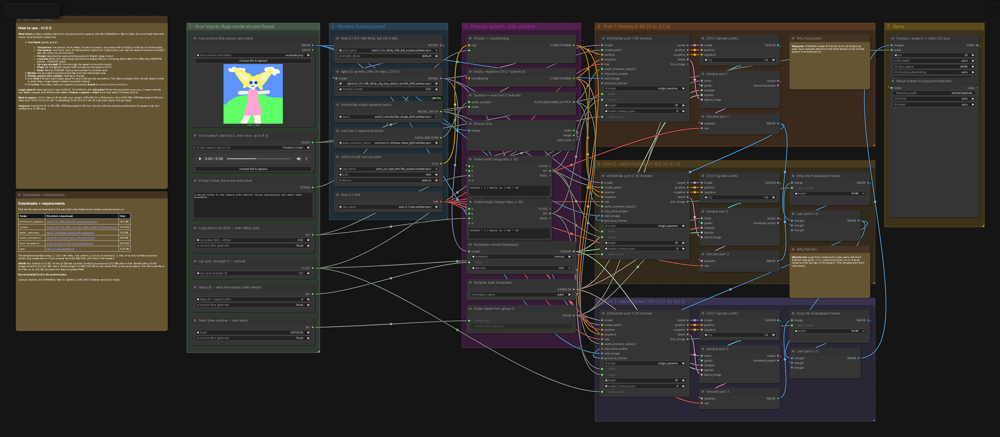

# The_frizzy1 — InfiniteTalk Talking Video v1.0.0

> Turn one picture and a speech clip into a talking video: the lips, face and head follow the voice. InfiniteTalk on Wan 2.1 14B, core ComfyUI nodes only, Apache-2.0 model.

| | |
|---|---|
| **Model family** | InfiniteTalk (MeiGen-AI), a patch on Wan 2.1 I2V 14B 480p |
| **Tasks** | Picture + speech → talking video (lip sync) · one speaker · 9 s in three parts |
| **Min VRAM** | 12 GB is the target. **Not verified on 12 GB** (see Hardware & VRAM) |
| **Tested on** | RTX PRO 4000 Blackwell 24 GB · 64 GB RAM · ComfyUI 0.45.3 (frontend 1.57.6) |
| **CivitAI** | Not published |
| **Hugging Face** | Not published |
| **YouTube explainer** | Not published |
| **License** | Workflow: MIT · InfiniteTalk: Apache-2.0 ([MeiGen-AI/InfiniteTalk](https://huggingface.co/MeiGen-AI/InfiniteTalk), LICENSE in the GitHub repo) · Wan 2.1 files: Apache-2.0 ([Comfy-Org/Wan-2.1](https://huggingface.co/Comfy-Org/Wan-2.1)) · lightx2v LoRA: Apache-2.0 ([lightx2v](https://huggingface.co/lightx2v/Wan2.1-I2V-14B-480P-StepDistill-CfgDistill-Lightx2v)) · speech encoder: MIT ([TencentGameMate/chinese-wav2vec2-base](https://huggingface.co/TencentGameMate/chinese-wav2vec2-base)) |

## Preview

<p align="center">
  
  
</p>

<sub>Both: the lab's 8 s English speech clip ("In the last video, I showed you LTX 2.3 running on my RTX 3060…"), the default prompt, seed 24112026, 6 steps, 832x464, 25 fps, about 14 min each. The .webp previews are silent and scaled to 512 px; the videos with sound are [preview-1.mp4](samples/preview-1.mp4) and [preview-2.mp4](samples/preview-2.mp4). The source pictures, from the lab's standard inputs:</sub>

<p align="center"></p>

<p align="center"></p>

## Overview
Built from ComfyUI's built-in template `video_wan2_1_infinitetalk` and restructured: the template's two subgraphs are laid out flat in numbered groups, every input you change is in group 1, and the notes are inside. The template is a two-speaker setup where you paint a mask for each person; this one is the simpler single-speaker case: one picture, one speech clip, nothing to paint. It makes three parts instead of two (9.0 s instead of 6.1 s), drops the repeated frames where parts join (the template keeps them, which pushes the lips off the speech), keeps the picture's shape, and loads the Comfy-Org model files.

## Capabilities
- `The_frizzy1_infinitetalk_v1.0.0.json`: one picture + one speech clip (one voice) gives a 9.0 s, 25 fps MP4 with the speech as its sound.
- Three parts: part 1 makes frames 0-80, parts 2 and 3 each continue from the last 9 frames so far and add 72 frames. Each part reads the speech from its own start frame.
- The video keeps the picture's shape: long side 832 (Wan 2.1's 480p size), sides a multiple of 16. A 16:9 picture gives 832x464.
- lightx2v speed LoRA: 6 steps, CFG 1, euler / normal, as in the template.
- Colour-coded groups: your inputs (green) · models (blue) · prompt, speech, size, sampler (purple) · part 1 (orange) · part 2 (brown) · part 3 (violet) · save (amber).

## Hardware & VRAM
All numbers are from one machine: RTX PRO 4000 Blackwell 24 GB. It is not a 12 GB card.

| Run | Peak VRAM, ComfyUI process | Peak VRAM, whole GPU | Time |
|---|---|---|---|
| No VRAM limit (cyborg picture) | 22.3 GiB | 22.8 GiB | 13 min 43 s |
| 12 GiB budget (`--reserve-vram 11.89`, custom nodes off), cyborg picture | 13.2 GiB | 14.1 GiB | 14 min 1 s |
| 12 GiB budget, apple picture | 13.1 GiB | 13.9 GiB | 13 min 57 s |
| 10 GiB budget (`--reserve-vram 13.89`, custom nodes off), cyborg picture | 11.3 GiB | 12.2 GiB | 14 min 0 s |

- **Not verified on 12 GB.** With no limit ComfyUI fills the memory it finds, so the first row shows what a 24 GB card uses, not what the workflow needs. In both budgets ComfyUI went over the budget by 1.1 to 1.3 GiB. The 10 GiB run stayed at 11.3 GiB for ComfyUI itself, which is close to what a 12 GB card has free. That is not a test on a 12 GB card.
- About 0.9 GiB of each capped whole-GPU figure was held by other programs, among them the idle first ComfyUI.
- The 14B model file is 16.4 GB, more than 12 GB, so ComfyUI keeps part of it in system RAM. RAM use was not measured.
- The budget did not change the speed (sampling about 43 s per step in every run). The capped runs gave slightly different videos than the run with no limit (mean pixel difference 2.7 to 3.6 of 255 between runs; the same picture, mouth and motion by eye).
- Peak VRAM is the highest `nvidia-smi` reading, sampled once per second, MiB / 1024.

## Required models
See the per-workflow [downloads.md](downloads.md) for the full table with verified links.
Every file below was read from the workflow `.json`.

```
ComfyUI/models/
├── diffusion_models/   ← wan2.1_i2v_480p_14B_fp8_scaled.safetensors                          (16.4 GB)
├── loras/              ← lightx2v_I2V_14B_480p_cfg_step_distill_rank64_bf16.safetensors       (0.74 GB)
├── model_patches/      ← wan2.1_infiniteTalk_single_fp16.safetensors                          (5.13 GB)
├── audio_encoders/     ← wav2vec2-chinese-base_fp16.safetensors                               (0.19 GB)
├── text_encoders/      ← umt5_xxl_fp8_e4m3fn_scaled.safetensors                               (6.74 GB)
└── vae/                ← wan_2.1_vae.safetensors                                              (0.25 GB)
```

About 29.5 GB. The text encoder and VAE are the usual Wan 2.1 / Wan 2.2 files.

## Required custom nodes
None. Run on ComfyUI 0.45.3 only; older versions were not tested. InfiniteTalk support (`WanInfiniteTalkToVideo`, the model patch loader, the wav2vec2 audio encoder) came with ComfyUI PR [#10179](https://github.com/Comfy-Org/ComfyUI/pull/10179), merged 2026-01-22.

Core nodes used (27, plus the frontend's MarkdownNote for the notes): AudioEncoderEncode, AudioEncoderLoader, BasicScheduler, BatchImagesNode, CFGGuider, CLIPLoader, CLIPTextEncode, ComfyMathExpression, ConditioningZeroOut, CreateVideo, GetImageSize, ImageFromBatch, KSamplerSelect, LoadAudio, LoadImage, LoraLoaderModelOnly, ModelPatchLoader, PrimitiveFloat, PrimitiveInt, PrimitiveStringMultiline, RandomNoise, SamplerCustomAdvanced, SaveVideo, UNETLoader, VAEDecode, VAELoader, WanInfiniteTalkToVideo. Each one's module in `/object_info` of ComfyUI 0.45.3 is `nodes` or `comfy_extras.*`, none is marked deprecated, and three runs were done with `--disable-all-custom-nodes`. `ModelPatchLoader` is marked experimental in ComfyUI.

## Optional custom nodes
None.

## Installation
1. Update ComfyUI (0.45.3 is the version this was run on).
2. Download the six files ([downloads.md](downloads.md), or the Downloads note inside the workflow).
3. Load `The_frizzy1_infinitetalk_v1.0.0.json`, load your picture in **Your picture** and your clip in **Your speech**, describe the scene in **Prompt**, press **Run**.

## Recommended settings
| Setting | Value | Notes |
|---|---|---|
| Long side in px | 832 | Wan 2.1's 480p size; the model files are the 480p ones. Other sizes were not run |
| Steps | 6 | the template's value for the lightx2v LoRA. Other step counts were not run |
| CFG | 1 | set in each part's guider; the speed LoRA is made for CFG 1 |
| Lip-sync strength | 1.0 | the template's `audio_scale`. Other values were not run |
| Frames per part / motion frames | 81 / 9 | the template's values, set on the InfiniteTalk nodes |
| Seed | 24112026, fixed | type a new number for another take |

## Inputs / Outputs
- **Inputs:** one picture with one person whose face is visible, one speech clip with one voice (tested with an 8 s WAV), a short English prompt.
- **Outputs:** an MP4 in `output/InfiniteTalk/`: 225 frames, 9.0 s at 25 fps, H.264 with your speech as AAC sound. 1368x768 pictures gave 832x464 videos.

## Performance
On the machine above, model files in the disk cache:

| Run | Time |
|---|---|
| Cyborg picture, no VRAM limit, first run (models loaded from disk) | 13 min 43 s |
| Cyborg / apple picture, 12 GiB budget | 14 min 1 s / 13 min 57 s |
| Cyborg picture, 10 GiB budget | 14 min 0 s |

Sampling took 3 min 40 s to 4 min 22 s per part (about 43 s per step, 6 steps); the rest is model loading and the three decodes. ComfyUI ran without `--use-sage-attention`.

RTX 3060 12 GB: Not verified.

## Known issues
- **Why the frames are trimmed (template difference):** a continuing part starts with the 9 frames it was given. The template joins the parts without dropping them. A comparison run that way (cyborg picture, same seed) made a 9.72 s video in which frames 81-89 repeat frames 72-80, and the mouth in part 2 moved 8 frames (0.32 s) after the speech. With the trim the lag measured 0 to 1 frame in parts 1 and 2 of the cyborg run. Lag here is the shift with the best match between mouth movement (pixel change around the mouth) and changes in speech loudness; a rough measure, not a listening test.
- **Lip sync was checked by measurement and by looking at frames, not by a person watching with sound.** In the apple run the mouth led the speech by 2 to 3 frames (0.08 to 0.12 s) by the same measure. In part 3 most of the speech has ended (the clip's last words end at about 7.4 s), so its lag figure says little; the mouth there moves during "GGF conversions" and stays closed after about 7.2 s.
- **A fingertip flickers into the frame:** in the apple run a small pink shape shows at the bottom edge for 2 frames (100-101). InfiniteTalk tends to add hand and body motion; Reddit users report the same ("trying to do sign").
- **Speech up to 9 s.** The video is always 225 frames. For longer speech add parts (the How to use note says how); that was not run here.
- **Default speech file:** the speech loader is set to `Timeline 2.wav`, the lab's test clip, which a fresh ComfyUI does not have. ComfyUI ships no audio file, so upload your own clip before the first Run. The picture loader is set to `example.png`, which ships with ComfyUI.
- **Two speakers** (the template's mode with painted masks and the `multi` patch) are not part of this workflow. The built-in template covers them.
- **The speech encoder is the Chinese wav2vec2 base model**, as in the template. It worked with the English test clip; other languages were not run.
- The prompt is my own: the lab's standard `prompts.json` was not in the inputs folder.
- The browser checks (screenshot, App mode view) used frontend 1.57.6, older than the 1.58.5 that ComfyUI 0.45.3 asks for. No run was started from App mode.

## Changelog
See [changelog.md](changelog.md).

## Related workflows
- [Wan 2.1 GGUF Low-VRAM](../gguf-lowvram) · [Wan 2.1 FLF2V](../flf2v) · [LTX-2.3 Ultimate · 12 GB](../../ltx/ltx2.3-ultimate) (audio)
